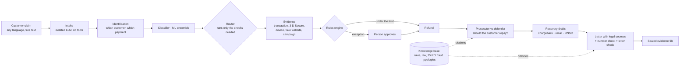

# VersoML

**Disputed payments, refunded by the next business day. Then the evidence, the chargeback and the letter.**


Built for the Raiffeisen Bank track, "AI for Operational Efficiency", at NEXXT Summit 2026 (VibeHack, Bucharest).

**Live:** https://versoml.vercel.app (the agents answer while the demo server is running; otherwise the site switches to a simulated run)

## The problem

A customer says "I didn't make this payment." Since the CJEU ruling C-70/25 (15 October 2026), the bank has to refund an unauthorized payment by the end of the next business day, even when it suspects the customer was careless. Only after that can it try to get the money back. Card disputes were about two thirds of Raiffeisen Romania's complaints in 2025.

Doing this by hand means pulling records from five systems, checking the law, writing to the customer and preparing a chargeback, all before tomorrow night.

## What VersoML does

1. **Refunds on time.** A rules engine decides, with a rule ID and a legal basis behind every decision. Under the limit the refund goes out on its own; above it, a person approves with one click.
2. **Builds the evidence file.** The transaction, 3-D Secure, the device and the fake website, each hashed when collected and sealed with a Merkle root and an Ed25519 signature.
3. **Starts recovery.** A Visa 10.4 chargeback only where it can win, a SEPA recall (camt.056, reason FRAD) for transfers, and a phishing report for DNSC. Everything stays a draft until a person sends it.
4. **Writes to the customer.** Claude drafts the letter in plain English, and a filter blocks it if it leaks personal data or anything the customer must not see.

The models extract, argue and draft. They never decide, and no model has a tool that moves money.

## Quick start

You need [uv](https://docs.astral.sh/uv/) (it installs Python 3.12) and Node 20 or newer.

```bash
uv sync
uv run versoml up
```

The first run generates the synthetic bank, trains the ML models and builds the website. Then open http://127.0.0.1:8000 and press **Run demo case** in the console.

| Page | What it shows |
|---|---|
| `/` | What VersoML does, in one scroll |
| `/cases` | The console: cases, approvals, evidence, letters |
| `/bank` | Demo Bank, the customer's phone app, where you can dispute a payment |
| `/demo/delivery` | The fake courier page that starts the demo scam |
| `/rules`, `/evaluation`, `/mcp` | The rules with their legal basis, the test results, the MCP setup |

### The Bedrock key

Put your Amazon Bedrock API key in `API_KEY.txt` at the repo root (it is git-ignored). VersoML loads it into `AWS_BEARER_TOKEN_BEDROCK` at runtime and redacts it from every log. Check what your key can reach with `uv run versoml check-bedrock`.

No key, no network? It still works: **replay** mode serves recorded model answers, and **offline** mode uses deterministic templates. The rules, deadlines and evidence never depend on a model.

To change the region, the model IDs or the LLM and OSINT modes, copy `.env.example` to `.env`. The search and threat-intel keys in it are optional; without them the OSINT checks fall back to recorded fixtures.

## Commands

| Command | What it does |
|---|---|
| `versoml up` | Starts the app (client zone on :8000, AML zone on :8001) |
| `versoml setup` | Synthetic data, models, website and the fast evaluation |
| `versoml eval` | Full evaluation; writes `reports/eval_report.md` |
| `versoml demo` | Runs the demo case end to end, without the website |
| `versoml mcp --zone client` | The MCP server over stdio, for Claude Desktop or Cursor |
| `versoml check-bedrock` | Which region and models work with your key |

Prefix each with `uv run`. Docker works too: `docker compose up --build`. The containers read the Bedrock key from `AWS_BEARER_TOKEN_BEDROCK` in your environment, not from `API_KEY.txt`.

### Tests

```bash
uv run pytest
```

Tests that call real external services are marked `live` and only run with `VERSOML_LIVE_TESTS=1`.

## How a case runs



- **Rules decide.** 54 rules from Law 209/2019 (Romania's PSD2 law) and the C-70/25 ruling, each with an ID, a legal source and tests. Deadlines use the Romanian banking calendar.
- **Untrusted text stays data.** The complaint only reaches an isolated model with no tools, which returns typed fields and flags prompt injections.
- **No raw personal data reaches the model.** Names, IBANs, card numbers and phone numbers are replaced with labels before every call.
- **A second zone, kept apart.** An anti-money-laundering zone runs as a separate process with its own database and receives only strict, signed facts. It is hidden in the console, and a non-interference test proves it never changes a refund decision.

### Models

| Model | Job |
|---|---|
| Claude Haiku 4.5 | Reads the complaint (isolated, no tools) |
| Claude Opus 5.5 and Sonnet 5 | The prosecutor and defender debate, the letter, the DNSC report |
| M1 · stacked ensemble: character and word TF-IDF with logistic regression, Complement NB, multilingual embeddings | What kind of dispute this is, in Romanian or English |
| M2 · stacked ensemble: LightGBM, logistic regression, IsolationForest | A first-party fraud signal; it sends a case to a person, never refuses one |
| Cohere Embed v4 on Bedrock + BM25 | The knowledge base: hybrid search with reciprocal rank fusion |
| M3, M4 | Lookalike domains and how closely a fake page copies the bank's |
| M7 | Counterfactuals: change one fact and see which decisions move |

## Real complaints, not just samples

Paste what a customer sent, in any language, on the **New case** page (`/cases/new`), through `POST /api/intake/preview`, or with the MCP tool `versoml_intake`. No case ID or payment reference is needed.

- **Identification:** VersoML finds the customer from an IBAN, phone, e-mail or name. It then finds the payment in their history from the amount ("3.494,60 RON", "RON 1,940.92"), the date ("ieri", "last Monday", "14/09"), the payee and the channel, and shows a score with its reasons.
- **Two payments fit equally well:** the graph pauses and a person picks one.
- **No customer or no payment found:** the case runs on the customer's own statements. Nothing is refunded automatically and nothing reaches the AML zone. The refund deadline still runs, and the letter asks for the missing details.
- **Before any letter goes out:** every amount, date, deadline, IBAN fragment and case ID in it is checked against the evidence file. A mismatch is rewritten once; if it persists, a person gets it.

## Knowledge base

`versoml/knowledge/` indexes the rules, the legal context in `docs/context/`, the documented Raiffeisen cases and 25 Romanian fraud typologies (`versoml/data/typologies_ro.yaml`). Each typology has its sources and a confidence mark.

- **Search:** BM25 and embeddings, fused with reciprocal rank fusion.
- **Answers:** every citation must be a retrieved passage, and every quote must appear in it word for word.
- **Who uses it:** the Knowledge page, the letter, the debate and the AML report draft cite it.
- **Similar past cases:** shown in the client zone as information only. They never feed a decision and never reach the AML zone.
- **Offline:** the document vectors are in the repo, so it also works without Bedrock.

Commands: `versoml kb build [--live]`, `versoml kb search "..."`, `versoml kb ask "..."`, `versoml kb eval`. The research behind these choices, with sources, is in `docs/08_cercetare_rag_ml_agenti.md`.

## Results

From `uv run versoml eval`, on synthetic data:

| Check | Result |
|---|---|
| Correct refund decisions, 40 hand-checked cases and 300 generated ones | 100% |
| Correct deadlines, with weekends and Romanian public holidays | 100% |
| Cases sent to a person when they should be | 100% |
| Prompt injections caught (28 claims) / false alarms (312 clean claims) | 100% / 0% |
| Raw personal data sent to a model | 0 |
| Correct decisions on 25 cases built from documented Romanian fraud typologies | 100% |
| Free-form intake, 60 claims in Romanian and English: right payment on clear cases / ambiguous or unknown sent to a person / wrong automatic matches | 100% / 100% / 0 |
| Knowledge base, 72 questions in Romanian and English: right passage in the top 5 / answers fully cited | 88% / 100% |
| Claim classifier on wordings it never saw in training: macro-F1 / calibration error | 0.97 / 0.012 |
| Same classifier on free text / trained on English, tested on Romanian | 0.82 / 0.66 |
| First-party fraud signal, AUC on a later time period with 5% noisy labels | 0.885 |

A live case takes about 6 seconds to a refund decision and under a minute to a sealed file, for roughly USD 0.07 in model calls. The old 0.99 for the classifier came from training and test text sharing templates; the numbers above use held-out templates and time-based splits. The synthetic bank has 2,000 customers and 210,000 transactions. The repo has 1,492 tests, including integration tests that start the real processes. Expect lower ML scores on real data.

## Use it from Claude Desktop or Cursor

VersoML is also an MCP server: open a case, read its decision and evidence, approve, or check a letter from your own assistant. Every call goes through the same access policy as the console. The config to copy is on the `/mcp` page, or connect over HTTP at `http://127.0.0.1:8000/mcp/`.

## Project layout

```
versoml/
  zone_client/   the dispute agents, the LangGraph graph and the API
  knowledge/     the knowledge base: chunks, embeddings, hybrid search, cited answers
  shared/rules/  the rules engine, the Romanian calendar and the deadlines
  shared/ledger/ the evidence file: SHA-256 chain, Merkle root, Ed25519
  shared/privacy/ pseudonymization before every model call
  shared/llm/    the Bedrock client: live, replay and offline modes
  wall/          the letter filter and the link to the AML zone
  ml/  osint/  data/  eval/  mcp_server/
frontend/        Vite + React: the homepage, the console, Demo Bank
tests/           unit and integration tests
docs/            the brief, the research and the rules with their sources
```

## Data

Everything is synthetic. Demo Bank is not a real bank. IBANs use made-up bank codes, scam domains end in `.example` or `.test`, and no real customer data is used anywhere.
