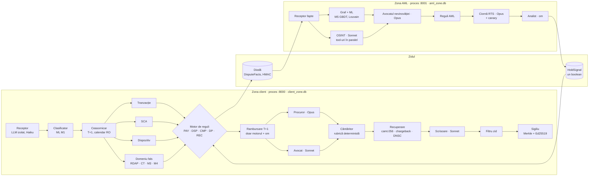

# VERSOML · Banii înapoi la T+1. Escrocul, pe urmă.

NEXXT Summit 2026 · VibeHack · track Raiffeisen Bank „AI for Operational Efficiency".

Un client spune „nu eu am făcut plata asta". După hotărârea CJUE **C-70/25** (15.10.2026), banca trebuie să-i dea banii înapoi până la sfârșitul zilei lucrătoare următoare, chiar dacă îl crede grav neglijent. Circa **64%** din reclamațiile Raiffeisen din 2025 au fost tranzacții cu cardul contestate.

**VersoML** e un sistem multi-agent care preia contestația cap-coadă:
1. **Rambursează la T+1** când legea o cere. Regulile decid, un om semnează excepțiile.
2. **Construiește dosarul de probe:** fiecare frază trimite la o probă cu sursă, oră și hash, sigilată Merkle + Ed25519.
3. **Pornește recuperarea:** rechemare camt.056 FRAD, chargeback acolo unde e valid, raport DNSC. Totul rămâne ciornă până trimite un om.
4. **Transformă contul care a primit banii într-o pistă AML**, într-o zonă separată de un **zid testat**. Tipping-off-ul e infracțiune (Legea 129/2019, art. 38 alin. 2).

Totul pe **date sintetice** („Banca Demo"). VersoML e o aplicație web și, în același timp, un **server MCP**, deci poate fi folosit din Claude Desktop, Cursor sau orice client MCP.

---

## Pornire într-o comandă

Ai nevoie de Python 3.12 prin [uv](https://docs.astral.sh/uv/) și de Node 20+.

```bash
uv sync
```

```bash
uv run versoml up
```

Dacă `uv sync` nu găsește Python 3.12 (s-a întâmplat pe Windows cu o instalare uv mai veche), creează mediul cu calea explicită: `uv venv --python <cale spre python 3.12> .venv`, apoi `uv sync --python .venv/Scripts/python.exe`. Pe Windows merge și direct `.venv\Scripts\versoml up`.

La prima rulare, `versoml up` face singur setup-ul: generează lumea sintetică, antrenează modelele ML și construiește interfața. Apoi pornește **două procese**:

| Proces | Adresă | Ce conține |
|---|---|---|
| Zona client | http://127.0.0.1:8000 | consola de contestații, Banca Demo, pagina falsă de demo, MCP la `/mcp/` |
| Zona AML | http://127.0.0.1:8001 | consola AML, graful banilor, OSINT, ciornele RTS, MCP la `/mcp/` |

Alte comenzi:

| Comandă | Ce face |
|---|---|
| `versoml setup` | Date sintetice + modele + interfață |
| `versoml eval` | Evaluarea completă; scrie `reports/eval_report.md` și `var/eval/report.json` |
| `versoml demo` | Rulează scenariul demo fără UI, pentru o verificare rapidă |
| `versoml mcp --zone client` | Serverul MCP al zonei client, prin stdio (`--zone aml` pentru AML) |
| `versoml check-bedrock` | Pasul 0: regiunea și modelele care merg cu cheia, fără s-o afișeze |

Docker (opțional): `docker compose up --build` pornește cele două zone în containere separate, cu volume de date separate.

## Cheia Bedrock și cheile opționale

- Cheia AWS Bedrock stă în `API_KEY.txt`, exclus prin `.gitignore`. Aplicația o încarcă **doar la rulare**, în variabila `AWS_BEARER_TOKEN_BEDROCK`. Cheia nu apare în cod, loguri, trasări sau UI: logurile trec printr-un filtru care o înlocuiește cu `***`.
- **Pasul 0 (28.10.2026):** în UE, politica SCP a contului de hackathon blochează Bedrock, așa că regiunea de lucru e `us-east-1`. Merg Claude Opus 5.5, Opus 4.8, Sonnet 5 și Haiku 4.5. Sonnet 5.5 și Haiku 5.5 nu sunt activate pe cont.
- Fără cheie sau fără rețea, VersoML merge în modul **replay** (răspunsuri înregistrate) sau **offline** (reguli și șabloane deterministe), deci demo-ul nu depinde de internet.
- Cheile opționale intră în `.env` (pornește de la `.env.example`), care e exclus din git și ale cărui valori sunt înlocuite cu `***` în loguri. `SERPER_API_KEY` e deja configurată pentru căutarea web; fără ea, căutarea merge pe DuckDuckGo. Următoarele chei utile, toate gratuite: `VIRUSTOTAL_API_KEY`, `GOOGLE_SAFE_BROWSING_KEY`, `URLHAUS_AUTH_KEY`, apoi `URLSCAN_API_KEY`.
- Fără nicio cheie merg live: RDAP (și WHOIS ROTLD pentru .ro), crt.sh și Cert Spotter, DNS-over-HTTPS, Wayback, ip-api, ANAF (TVA, v9), cursul BNR, feedul OpenPhish, lista de sancțiuni UE (OpenSanctions) și Jina Reader. Detaliile sunt în `versoml/osint/SOURCES.md`.

## Arhitectura



**Principii**
- LLM-ul extrage, argumentează și redactează. **Regulile deterministe decid**, cu ID-ul regulii în fiecare decizie. Omul semnează tot ce e defavorabil clientului sau peste plafon.
- Niciun LLM nu are un tool care mută bani. Instrucțiunea de rambursare o emite doar `MotorReguli`, verificat de Cedar.
- Textul escrocului e dată, nu instrucțiune. Reclamația intră doar într-un LLM izolat, fără tool-uri, care scoate câmpuri tipizate.
- Nicio dată personală brută nu pleacă spre model: PrivacyProxy pseudonimizează înainte de fiecare apel.

**Zidul, în șase straturi testate**

| # | Strat | Unde e în cod |
|---|---|---|
| 1 | Procese și baze de date separate; un proces nu poate obține nici măcar calea bazei celeilalte zone | `versoml/config.py` (`VERSOML_ZONE`), `versoml up` |
| 2 | Dioda: spre AML doar `DisputeFacts` (schemă strictă, HMAC); înapoi doar `HoldSignal`, un boolean fără text | `versoml/wall/diode.py`, `versoml/contracts.py` |
| 3 | Politici Cedar, default deny, pe fiecare apel de tool, inclusiv din MCP | `versoml/shared/policy/` |
| 4 | Etichete pe date (pașaportul datelor): confidențialitate, încredere, destinații | `versoml/contracts.py` (`Labels`), registrul de probe |
| 5 | Filtru pe scrisori: termeni de tipping-off, canary, date personale | `versoml/wall/letter_filter.py`, `versoml/wall/canary.py` |
| 6 | Test de neinterferență: aceleași cazuri cu zona AML goală, apoi plină de canary; decizii identice, zero scurgeri | `versoml/eval/noninterference.py` |

## ML: unde și de ce

| Model | Ce face | Unde se vede |
|---|---|---|
| M1 | Clasificarea contestației: TF-IDF + regresie logistică calibrată | Clasificatorul, cu probabilitate și semnal de ambiguitate |
| M2 | Semnal de fraudă a clientului: LightGBM pe fapte obiective; e doar un semnal pentru om | Motorul de reguli trimite la om, nu refuză |
| M3 | Domeniu-sosie: permutări în stilul dnstwist, schelet de confusables, vârstă RDAP și CT | Colectorul de domeniu |
| M4 | Asemănarea paginii false cu pagina băncii: simhash pe text, formulare și DOM | Colectorul de domeniu |
| M5 | Cont-cărăuș: LightGBM pe trăsături de graf + agregare pe vecini, comunități Louvain, tipologii AMLworld | Zona AML: graful se aprinde |
| M6 | Rezolvarea entităților între cazuri (IBAN, CUI, firmă, domeniu, telefon) | Legarea victimelor de aceeași pistă |
| M7 | Robustețe contrafactuală: schimbăm câte un fapt și vedem ce decizii se schimbă | Butonul „Schimbă un fapt" |

## MCP: VersoML ca tool, oriunde

Câte un server MCP pe zonă, ca zidul să existe și în MCP: tool-urile AML nici nu apar în serverul zonei client, iar fiecare apel trece prin Cedar.

- **Orice client MCP** (Claude Desktop, Cursor și altele): configurarea gata de copiat e pe pagina `/mcp` din aplicație.
- **Prin HTTP:** `http://127.0.0.1:8000/mcp/` (zona client) și `http://127.0.0.1:8001/mcp/` (zona AML).

Câteva tool-uri: `versoml_open_case`, `versoml_case_status`, `versoml_case_evidence`, `versoml_approve`, `versoml_counterfactual`, `versoml_check_letter`, `versoml_evaluate_rules`, `versoml_t1_deadline`, `versoml_domain_intel`, `versoml_wall_status`, `versoml_aml_leads`, `versoml_osint_investigate`, `versoml_sanctions_screen`, `versoml_company_lookup`, `versoml_aml_decide`.

## Evaluare

`versoml eval` rulează tot și scrie raportul în `reports/eval_report.md` (și pe pagina `/evaluare`). Rezultatele din 28.10.2026, pe date sintetice:

| Ce măsurăm | Rezultat | Țintă |
|---|---|---|
| Reguli: verdictul T+1 pe setul de aur (40) și pe 300 de cazuri generate | 100% / 100% | 100% |
| Termene T+1 corecte (weekenduri, sărbători RO) | 100% | 100% |
| Recall-ul escaladărilor spre om | 100% | ≥ 95% |
| Neinterferență: 12 rulări reale ale grafului, zona AML goală vs plină de canary | 0 decizii schimbate, 0 scurgeri | 0 |
| Date personale brute trimise modelului | 0 | 0 |
| Injecții detectate (28 de reclamații cu instrucțiuni ascunse) / alarme false (312 curate) | 100% / 0% | 100% / ≈ 0 |
| Filtrul zidului: tipping-off blocat / scrisori curate blocate greșit | 100% / 0 | 100% / 0 |
| M1 scenariu: macro-F1 / ECE | 0,99 / 0,04 | ≥ 0,90 / ≤ 0,05 |
| M5 cont-cărăuș: AUC reguli simple → GBDT fără graf → GBDT pe graf | 0,75 → 0,95 → 0,99 | ≥ 0,85 |

Pe date reale cifrele ML vor fi mai mici; comparația cu baseline-urile e partea relevantă. Testele: peste 1.100 de teste unitare pe module, plus 9 teste de integrare care pornesc procesele reale.

**Pe rulări live (Claude pe Bedrock):**
- decizia de rambursare vine în ~6–7 s de la contestație, iar cazul complet (dezbatere, recuperare, scrisoare, sigiliu) în ~50–65 s;
- costul LLM e de circa 0,07 $ pe contestație în zona client.

## Structura

```
versoml/
  contracts.py        contractele Pydantic (DisputeFacts, HoldSignal, Fact, Decision, RuleContext, …)
  config.py           setări; izolarea bazelor pe zone
  secrets.py          cheia Bedrock la rulare + redactarea din loguri
  shared/llm/         clientul Bedrock (Mantle): roluri, ieșiri structurate, live / replay / offline
  shared/rules/       motorul de reguli cu ID-uri, calendarul RO, ceasurile, parametrii [U]
  shared/ledger/      registrul de probe: lanț SHA-256, Merkle, Ed25519, QR
  shared/privacy/     PrivacyProxy: CNP, IBAN, card, telefon, e-mail, nume
  shared/policy/      politici Cedar și punctul de control pe tool-uri
  shared/events.py    evenimente AG-UI pe zone, prin SSE
  wall/               dioda, canary, filtrul de scrisori, scannerul
  zone_client/        Judecătorul: agenți, graf LangGraph, serviciu, API
  zone_aml/           Investigatorul: agenți, graf LangGraph, serviciu, API
  data/               simulatorul Banca Demo, scenariile, setul de aur
  ml/                 M1, M2, M5, M6, M7
  osint/              căutare web, crawler sigur, RDAP, CT, DNS, ANAF, sancțiuni, M3, M4
  mcp_server/         serverul MCP pe zone (stdio + HTTP)
  eval/               evaluarea și testul de neinterferență
frontend/             Vite + React: consola, consola AML, Banca Demo, pagina falsă de demo
tests/                teste pe module + integrare cap-coadă
docs/                 brief, research, soluția (05), implementarea (06), contextul de reguli
```

## Documente

0. [docs/05_versoml_solutie_si_plan.md](docs/05_versoml_solutie_si_plan.md): soluția, arhitectura, agenții, ML, evaluarea, demo-ul și planul.
1. [docs/06_implementare.md](docs/06_implementare.md): harta modulelor, interfețele și contractul API.
2. [docs/01_brief_hackathon.md](docs/01_brief_hackathon.md): criteriile juriului.
3. [docs/02_top_probleme_si_idei.md](docs/02_top_probleme_si_idei.md) și [docs/03_cazuri_reale_raiffeisen.md](docs/03_cazuri_reale_raiffeisen.md): problemele și cazurile reale.
4. `docs/context/`: regulile cu ID-uri și teste (popriri, KYC/AML, plăți, dispute card, date sintetice, arhitectură).

## Reguli pentru date

Doar date sintetice. Niciun nume, CNP, IBAN sau document real. IBAN-urile folosesc coduri de bancă fictive (`BDEM`, `XBNK`…), domeniile escrocilor sunt pe `.example` și `.test`, iar IP-urile vin din intervalele TEST-NET.
