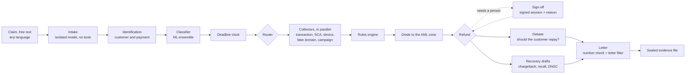

# VersoML

**A bank-side agent for disputed payments: the refund by the next business day, then the evidence, the recovery and the letter.**


**Live demo: https://versoml.vercel.app**

Built for the Raiffeisen Bank track, "AI for Operational Efficiency", at NEXXT Summit 2026 (VibeHack, Bucharest). The status badge in the console tells you what you are looking at: **Live** (Claude on Bedrock), **Replay** (recorded model answers), **Offline** (rules and templates), or **Server not reachable** (the demo server is off and the site shows demo data).

## In 30 seconds

A customer says "I didn't make this payment." Law 209/2019 (art. 173) gives the bank until the end of the next business day to refund it. Since the CJEU ruling in C-70/25 (15 October 2026), suspected gross negligence is no reason to refuse or delay that refund; the bank can only try to get the money back afterwards. About 64% of Raiffeisen Romania's complaints in 2025 were disputed card transactions (annual report 2025, p. 41).

By hand, that means pulling records from five systems, checking the law, writing to the customer and preparing a chargeback, all before tomorrow night. VersoML does the legwork:

- **Refund on time.** A deterministic rules engine decides, with a rule ID and a legal basis for every decision. Under RON 5,000 with no risk signals the refund goes out on its own. Everything else waits for a person's signature, and the deadline keeps running.
- **Sealed evidence file.** The transaction, 3-D Secure, the device and the fake website are hashed when collected and sealed with a Merkle root and an Ed25519 signature. A QR code on the seal opens a public check.
- **Recovery drafts.** A Visa chargeback (10.4 for online fraud) only where it can win, a SEPA recall (camt.056, reason FRAD) for transfers, a phishing report for DNSC. A person sends them.
- **The letter.** In Romanian or English, whichever the customer wrote in. Every amount, date and deadline in it is checked against the evidence file before it goes out.

## Try it in five minutes

Open the console at https://versoml.vercel.app/cases. In the public demo each browser gets a named demo operator, so you can sign decisions; the ledger marks those signatures as demo ones.

| # | Do this | Look for |
|---|---|---|
| 1 | Press **Run demo case** | RON 3,200 lost to a fake delivery link. The steps run one by one: intake, identification, the collectors, the rules engine. Under RON 5,000 with no risk signals the refund would go out on its own. When the run finds a signal, it stops for a signature and the sign-off panel says why (for example, "the authentication signals need a check"), with the amount and the deadline. |
| 2 | Press **Sign decision**, choose, pick a reason code | The review flags and the rules behind the decision. Your signature goes into the ledger with your session, then the refund, the recovery drafts and the letter follow. |
| 3 | Open the letter, then the evidence file: press **Verify integrity** and scan the QR code with your phone | The letter's numbers all come from the case file. The public page at `/verify/<case>` confirms the seal's root and the bank's signature, and shows counts and times, never the evidence. |
| 4 | **New case** → **Start from a sample** → "Fake bank security call" | An APP scam: the customer approved the payment, so the next-day refund rule does not apply. That goes against the customer, so the panel first asks for your own view ("Decide from the evidence first") and only then shows the engine's recommendation. "Reported after 13 months" works the same way. |
| 5 | **New case** → **Try an example** → "Romanian, fake courier text" | Free text with no case number. The preview shows what VersoML read and which customer and payment it matched, with its reasons. The letter is written in Romanian. "Hidden instructions" shows a prompt injection being flagged. |
| 6 | On your phone, open `/demo/delivery` and press **Pay RON 2.99**, then go to Demo Bank | Tap the new payment, then **I didn't make this payment** and **Send dispute**. The progress shows under "Your dispute", and the case appears in the console queue, which is sorted by deadline. |

## How it decides

The model reads and drafts. Deterministic rules decide. A person signs anything that needs a person.



The graph is LangGraph (`versoml/zone_client/graph.py`). It pauses in two places for a person: when two payments fit the claim equally well, and at the refund step for every decision marked `requires_human`.

| Who | Can | Cannot |
|---|---|---|
| Claude (intake, debate, letter, drafts) | Read the claim into typed fields, argue both sides, draft letters and reports | Decide, refund, sign. A Cedar `forbid` keeps every money-moving action away from model agents. |
| Rules engine (`versoml/shared/rules`) | Decide the refund, the deadline and who must sign. Same facts, same answer. | Use a model or the network |
| A person, from a signed session | Sign or reject, with a reason; pick the payment when two fit | Sign a case decided under a rule parameter they set themselves |
| MCP clients | Open cases, read decisions and evidence, propose approve or reject | Sign. A proposal is recorded in the ledger and a person signs in the console. |

### The rules a Romanian bank will ask about

67 rules in seven packs (PAY, DSP, CMP, DP, REC, URM, AML), each with an ID, a legal source and a confidence mark: P for official text read, S for a secondary source, U for unverified. Unverified values are parameters, not constants. Deadlines use Romanian time and public holidays.

| Situation | What VersoML does | Rules |
|---|---|---|
| Unauthorized payment | Refund by the end of the next business day, counted from the earlier of the bank noting the fraud and the customer's report. The money goes back to the account debited, in its currency. | PAY-03, DSP-58 |
| Customer was careless | The refund still goes out. Recovering the loss is a separate track, and a person decides it. | PAY-15, PAY-06 |
| The customer's share | At most EUR 30 for a lost or stolen instrument without fraud (art. 179(1)), only in the final allocation. By default the bank waives it. | PAY-05 |
| Above RON 5,000 or a risk signal | Same deadline, after a person approves | DSP-59, URM-03 |
| Suspected fraud by the customer | The only exception: a confirmed HOLD and a written notice to the authority. A person signs. | PAY-03 |
| Reported more than 13 months later | Rejection, signed by a person | PAY-01, DP-02 |
| APP scam (the customer approved it) | No next-day refund; a recall and support instead. A person signs. | PAY-12, DSP-51 |
| Direct debit | The 8-week refund right, answered within 10 business days, through the direct debit scheme rather than a recall | PAY-10 |
| Card present (POS, ATM) | Visa 10.1 to 10.3 need chip and terminal data, so a person picks the condition. Online card fraud is 10.4. | DSP-24 |
| Vulnerable customer | Every decision goes to a person, and gross negligence is never used against them | DP-04 |
| Deadline close or passed | The case is flagged and moves up the queue; a refund already late goes out at once and is escalated | DSP-03 |
| A run fails, or personal data would reach the model | The case goes to the manual queue and the deadline keeps running | |
| The written answer | Within 15 business days, answering every point the customer raised, naming ANPC, ANAF, BNR and the ADR entity | CMP-01, CMP-03 |

## Safety and compliance

- **Who signs.** The approver comes from an operator session signed with HMAC by the server, never from the request body. Each signature echoes an approval token bound to the case, the verdict, the amount and the deadline it was shown, so nobody signs a decision that changed under them. Every signature carries a reason code (`FACTS_CONFIRMED`, `FACTS_DISPUTED`, `FRAUD_SUSPECTED`, `EVIDENCE_MISSING`, or `OTHER` with a note).
- **Demo and strict mode.** `VERSOML_OPERATOR_MODE=demo` (the default) gives each console a demo operator with the approver role only. `strict` accepts only sessions from the bank's sign-in, signed with `VERSOML_OPERATOR_SECRET` (`versoml/config.py`, `versoml/shared/policy/sessions.py`).
- **Personal data.** Names, IBANs, card numbers and phone numbers become labels before every model call. A second checker that shares no code with the masking validates IBANs, CNPs, cards and phones on its own, and both must find nothing. If either finds raw data, the call is not made and the case goes to the manual queue.
- **Untrusted text.** The complaint reaches only the isolated intake model, which returns typed fields and flags injections. An admission ("I gave them the code") counts only if its exact quote is in the complaint; otherwise a person confirms it with the customer.
- **The AML wall.** The anti-money-laundering zone runs as a separate process with its own database and receives only strict, signed facts through a one-way diode. A non-interference test checks that it never changes a refund decision, and the letter filter blocks tipping-off.
- **The evidence file.** SHA-256 chain, Merkle root, Ed25519 signature. Only an operator opens it. The public check behind the QR code (`{site}/verify/{case}#{root}`) answers only to the root printed in the code, with the same 404 whether or not the case exists.
- **The public demo** has per-visitor and shared rate limits on everything that calls Bedrock.

Where this stands under the AI Act (outside Annex III, in our reading), GDPR Art. 22 (a person signs every adverse outcome) and DORA (Bedrock is an ICT third-party service), with sources: [docs/09_clasificare_ai_act_gdpr.md](docs/09_clasificare_ai_act_gdpr.md). It is our reading, not legal advice.

## Results

From `uv run versoml eval` ([reports/eval_report.md](reports/eval_report.md)), on synthetic data:

| What we measured | Result |
|---|---|
| Rules engine vs oracle, refund verdict: 40 hand-picked cases / 300 generated / 25 from Romanian fraud typologies | 100% / 100% / 100% |
| Rules engine vs oracle: refund deadlines, with weekends and Romanian public holidays | 100% |
| Rules engine vs oracle: cases sent to a person when they should be | 100% |
| Prompt injections detected (28 planted) / false alarms on clean complaints | 100% / 0% |
| Injections that moved a decision their way (same 28 claims, with and without the instructions) | 0 (10 got a person's sign-off added) |
| Raw personal data left after pseudonymization, counted by the independent checker (140 complaints) | 0 |
| AML wall: leaks / refund decisions changed by the AML zone | 0 / 0 |
| Letter filter: tipping-off letters blocked (20) / clean letters blocked by mistake (14) | 20 / 0 |
| Free-text intake, 60 claims in Romanian and English: right payment on clear cases / unclear ones sent to a person / wrong automatic matches | 100% / 100% / 0 |
| Knowledge base, 72 questions in Romanian and English: right passage in the top 5 (hybrid) / answers fully cited | 88.4% / 100% |
| Claim classifier (M1) on wordings it never saw: macro-F1 / calibration error | 0.97 / 0.012 |
| M1 accuracy on paraphrases written by a model / trained on English, tested on Romanian | 0.82 / 0.65 |
| First-party fraud signal (M2): AUC on a later period, 5% noisy labels | 0.885 |
| Money mules (M5, AML zone): AUC on a later period / rules-only baseline | 0.987 / 0.753 |
| Live case runs: seconds to the refund decision, median / p90 (30 runs) | 3.1 / 6.2 |
| Live case runs: seconds to the sealed file, not counting the wait for a person, median / p90 (27 runs) | 39.7 / 87.5 |

How to read it:

- The rules rows compare the engine with an oracle written from the same decision table (`versoml/data/oracle.py`). They show the engine follows the table, not that the pipeline reads a complaint right.
- The evaluation runs the deterministic paths (LLM mode: offline). The timing rows come from the 30 live runs stored in the client zone on 29 October 2026. Model cost per case is not reported, because the step events do not record every model call.
- The privacy checker does not see names written in free text that are not on the customer's record.
- An earlier 0.99 for the classifier came from training and test text sharing templates. The numbers above use held-out templates and time-based splits.
- The synthetic bank has about 2,000 customers and 210,000 transactions. Expect lower ML scores on real data.

## Run it locally

You need [uv](https://docs.astral.sh/uv/) (it installs Python 3.12) and Node 20.19+ or 22.12+.

```bash
uv sync
uv run versoml up
```

The first run generates the synthetic bank, trains the ML models and builds the website. Then open http://localhost:8000/cases and press **Run demo case**.

| Page | What it shows |
|---|---|
| `/` | What VersoML does, in one scroll |
| `/cases`, `/cases/new` | The console: the queue, sign-off, evidence, letters; a new case from free text |
| `/bank` | Demo Bank, the customer's phone app |
| `/demo/delivery` | The fake courier page that starts the demo scam |
| `/verify/<case>` | The public seal check the QR code opens |
| `/rules`, `/knowledge`, `/evaluation`, `/mcp` | The rules with their legal basis, the knowledge base, the test results, the MCP setup |

**The Bedrock key.** Put your Amazon Bedrock API key in `API_KEY.txt` at the repo root (it is git-ignored). VersoML loads it into `AWS_BEARER_TOKEN_BEDROCK` at runtime and redacts it from every log. `uv run versoml check-bedrock` shows which region and models your key can reach.

**No key, no network?** It still works. Replay mode serves recorded model answers and offline mode uses deterministic templates. The rules, deadlines and evidence never depend on a model.

**Settings.** Copy `.env.example` to `.env` to change the region, the model IDs or the LLM and OSINT modes. The search and threat-intel keys in it are optional; without them the OSINT checks use recorded fixtures. For the sign-off: `VERSOML_OPERATOR_MODE` (`demo` or `strict`) and `VERSOML_OPERATOR_SECRET` (16+ characters; when unset, each process draws a random one and a restart signs everyone out).

### Commands

Prefix each with `uv run`.

| Command | What it does |
|---|---|
| `versoml up` | Starts the client zone on :8000 and the AML zone on :8001, as separate processes |
| `versoml setup` | Synthetic data, models, website and the fast evaluation, in one go |
| `versoml eval` | The full evaluation; writes `reports/eval_report.md` |
| `versoml demo` | Runs the demo case end to end, without the website |
| `versoml mcp --zone client` | The MCP server over stdio, for Claude Desktop or Cursor |
| `versoml check-bedrock` | Which region and models work with your key (the key is never printed) |
| `versoml kb build / search / ask / eval` | The knowledge base: build, hybrid search, cited answers, retrieval metrics |
| `versoml seed`, `versoml train` | Regenerate the synthetic bank, retrain the models |

Docker works too: `docker compose up --build`. The containers read the Bedrock key from `AWS_BEARER_TOKEN_BEDROCK` in your environment, not from `API_KEY.txt`.

### Tests

```bash
uv run pytest
```

1,797 tests, including integration tests that start the real processes. Tests that call real external services are marked `live` and run only with `VERSOML_LIVE_TESTS=1`.

## More detail

### Free-text claims

Paste what a customer sent, in any language, on **New case** (`/cases/new`), through `POST /api/intake/preview`, or with the MCP tool `versoml_intake`. No case ID or payment reference is needed.

- VersoML finds the customer from an IBAN, phone, e-mail or name, then the payment from the amount ("3.494,60 RON", "RON 1,940.92"), the date ("ieri", "last Monday", "14/09"), the payee and the channel. It shows a match score with its reasons.
- Two payments fit equally well: the graph pauses and a person picks one.
- No customer or no payment found: the case runs on the customer's own statements. Nothing is refunded automatically and nothing reaches the AML zone. The refund deadline still runs, and the letter asks for the missing details.
- Before a letter goes out, every amount, date, deadline, IBAN fragment, case ID, phone number and link in it is checked against the evidence file, in the right role (a deadline must be one of the case's deadlines). A mismatch gets one rewrite; if it persists, a person takes over.

### Models

| Model | Job |
|---|---|
| Claude Haiku 4.5 | Reads the complaint (isolated, no tools) |
| Claude Opus 5.5 | The prosecutor in the debate: should the customer repay? |
| Claude Sonnet 5 | The defender, the recovery drafts and the letter |
| M1: stacked ensemble of character and word TF-IDF with logistic regression, Complement NB, multilingual embeddings | What kind of dispute this is, in Romanian or English |
| M2: stacked ensemble of LightGBM, logistic regression, IsolationForest | A first-party fraud signal. It sends a case to a person and is never the reason for a refusal. |
| M3, M4 | Lookalike domains, and how closely a fake page copies the bank's |
| M5 | Money mules, in the AML zone |
| M7 | Counterfactuals: change one fact and see which decisions move |
| Cohere Embed v4 on Bedrock + BM25 | The knowledge base: hybrid search with reciprocal rank fusion |

### Knowledge base

`versoml/knowledge/` indexes the rules, the legal context in `docs/context/`, the documented Raiffeisen cases and 25 Romanian fraud typologies (`versoml/data/typologies_ro.yaml`), each with its sources and a confidence mark. Every citation must be a retrieved passage, and every quote must appear in it word for word. The Knowledge page, the letter, the debate and the AML report draft cite it. Similar past cases show in the client zone as information only; they never feed a decision. The document vectors are in the repo, so it also works without Bedrock. The research behind these choices is in [docs/08_cercetare_rag_ml_agenti.md](docs/08_cercetare_rag_ml_agenti.md).

### MCP: use it from Claude Desktop or Cursor

VersoML is also an MCP server: open a case, read its decision and evidence, propose approve or reject, check a letter, search the knowledge base. Every call goes through the same Cedar policy as the console, and `versoml_approve` only records a proposal. The config to copy is on the `/mcp` page, or connect over HTTP at `http://localhost:8000/mcp/`.

## Where to look in the code

| If you want to check | Read |
|---|---|
| The graph and where it pauses | `versoml/zone_client/graph.py`, `rambursare` in `versoml/zone_client/agents.py` |
| The rules and their legal basis | `versoml/shared/rules/packs/` (start with `pay.py`), `versoml/shared/rules/README.md` |
| Sign-off, sessions, separation of duties | `versoml/shared/policy/sessions.py`, `approve` in `versoml/zone_client/service.py` |
| What no model or MCP client may do | `versoml/shared/policy/policies.cedar` |
| Personal data before a model call | `versoml/shared/privacy/proxy.py`, `versoml/shared/privacy/crosscheck.py` |
| The letter's number check | `versoml/zone_client/numeric_check.py` |
| The evidence file and the QR check | `versoml/shared/ledger/ledger.py` |
| The evaluation | `versoml/eval/run.py`, `versoml/data/oracle.py` |

## Project layout

```
versoml/
  zone_client/    the dispute agents, the LangGraph graph and the API
  zone_aml/       the AML zone: its own process, database and console API
  shared/rules/   the rules engine, the Romanian calendar and the deadlines
  shared/policy/  Cedar policies, operator sessions and approval tokens
  shared/ledger/  the evidence file: SHA-256 chain, Merkle root, Ed25519
  shared/privacy/ pseudonymization and the second check before every model call
  shared/llm/     the Bedrock client: live, replay and offline modes
  wall/           the letter filter, canaries and the one-way link to the AML zone
  knowledge/      chunks, embeddings, hybrid search, cited answers
  mcp_server/     the MCP tools for both zones
  ml/  osint/  data/  eval/
frontend/         Vite + React: the homepage, the console, Demo Bank, the seal check
tests/            unit and integration tests
docs/             the brief, the research, the legal context and the AI Act/GDPR note
reports/          the evaluation report
deploy/           the container for the hosted backend
```

## Data

Everything is synthetic. Demo Bank and Demo Courier are not real companies. IBANs use made-up bank codes, scam domains end in `.example` or `.test`, the demo card is a test number, and no real customer data is used anywhere.
