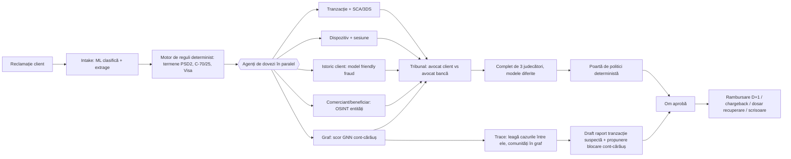

# Idee combinată: Verdict + Trace

**Chargeback Judge (Circi) + AML OSINT (Goga) → un singur sistem multi-agent: „Verdict" judecă disputa, „Trace" urmărește banii.**

## 1. Ideea într-o frază

Fiecare fraudă reclamată de un client are și un **destinatar**: contul sau comerciantul unde au ajuns banii. Azi, echipa de dispute și echipa AML lucrează separat. Verdict + Trace rezolvă disputa (rambursare, recuperare, chargeback) și, din aceeași informație, urmărește banii până la rețeaua de conturi-cărăuș. Rezultatul: 30 de dispute care duc la același inel de fraudă devin un singur caz AML.

## 2. Punctele slabe ale ideilor inițiale (de corectat înainte de pitch)

**Chargeback Judge**
- „Legea europeană face chargeback-urile să se rezolve repede" e imprecis. Hotărârea CJUE C-70/25 (15.10.2026) privește **rambursarea către client** (PSD2 art. 73 / Legea 209/2019 art. 173), nu chargeback-ul. Chargeback-ul ține de regulile Visa/Mastercard. Formularea corectă: „banca rambursează imediat, deci trebuie să decidă rapid de unde își recuperează banii".
- Un „judge" care decide rambursarea n-are ce judeca: rambursarea e obligatorie. Judecata reală e în altă parte: **clasificare** (e neautorizată sau nu?), **recuperabilitate** (chargeback posibil?), **neglijență gravă** (merită dosar de recuperare de la client?) și **suspiciune de fraudă a clientului** (singura excepție).
- Decizia finală nu poate fi automată 100%. Omul aprobă (GDPR art. 22, poziția publică a CEO-ului).
- Dovezile pot fi false, de exemplu chitanțe sau poze generate cu AI. Trebuie verificată autenticitatea lor.

**AML OSINT**
- Afirmația că echipele AML sunt copleșite de procese pe încălcarea vieții private n-are nicio sursă în research-ul nostru. **Scoateți-o** sau verificați-o cu mentorii. Supraîncărcarea documentată vine din alerte false: ~95% (NICE Actimize).
- OSINT pe clienți persoane fizice (rețele sociale, profilare) e un risc GDPR și de secret bancar. Dacă trimiți numele clientului într-un motor de căutare public, divulgi o informație despre el. OSINT-ul trebuie făcut doar pe **contrapărți și entități**: comercianți, firme beneficiare, liste de sancțiuni și PEP, registre de firme, vechimea domeniilor, rapoarte de înșelătorii. Screening-ul se face local (de exemplu, yente găzduit intern), fără date de client trimise afară.
- „Flag la orice semn" înseamnă și mai multe alerte false. Valoarea e în **triaj și închiderea alertelor false cu explicație**, nu în alerte în plus.

## 3. Cum funcționează

**Pașii**
1. **Intake (ML).** Clasifică reclamația (fraudă, eroare de procesare, dispută cu comerciantul, înșelătorie autorizată) și extrage câmpurile.
2. **Reguli (fără LLM).** Calculează ceasurile legale și Visa, plus invaliditățile Visa: ECI 5 + CAVV, peste 35 de dispute în 120 de zile, cripto/NFT.
3. **Dovezi în paralel.** Cinci agenți rulează simultan și produc dovezi cu ID: `EV-01`, `EV-02`…
4. **Tribunal.** Un agent pledează pentru client, altul pentru bancă, fiecare citând doar ID-uri de dovezi. Un complet de 3 judecători, pe modele diferite ca să nu greșească la fel, dă verdictul pe patru întrebări: clasificare, recuperabilitate, neglijență gravă, suspiciune de fraudă a clientului. Fiecare verdict vine cu încredere și justificare. Dacă judecătorii nu sunt de acord, cazul merge la om.
5. **Poartă de politici.** Verifică verdictul față de reguli. Rambursarea D+1 nu poate fi blocată decât pe traseul „suspiciune de fraudă a clientului", care cere om și notificarea autorității.
6. **Trace (AML).** Ia destinatarii banilor din toate disputele, îi leagă (entity resolution), rulează GNN pe graful de tranzacții și găsește comunitățile de conturi-cărăuș. Pe entități rulează OSINT: sancțiuni, PEP, registru, domeniu. Apoi redactează raportul de tranzacție suspectă cu termenele din Legea 129/2019.
7. **Om în buclă + audit.** Nimic nu mută bani singur. Fiecare pas e jurnalizat.

## 4. Unde e ML (mult)

- clasificator de reclamații (text);
- scor de anomalie pe tranzacție;
- model de „friendly fraud" (clientul a făcut chiar el plata);
- GNN pe multigraful de tranzacții (IBM Multi-GNN pe AMLworld);
- entity resolution între cazuri;
- clasificator de recuperabilitate;
- calibrarea încrederii judecătorilor pe setul de test.

## 5. Ce adaugă valoare (brainstorm)

1. **Legarea cazurilor între ele.** 30 de dispute → același inel → un raport AML, chargeback-uri în bloc și blocarea contului-cărăuș înainte de următoarea victimă.
2. **Contorul de bani:** câți € se pot recupera prin chargeback, câți prin dosar de recuperare și câți rămân pierdere. E limbajul COO-ului.
3. **Verificare contrafactuală:** „s-ar schimba verdictul fără dovada X?". Dacă da, verdictul e fragil și merge la om. Ideea vine din lucrarea „Explainable AML Triage with LLMs: Evidence Retrieval and Counterfactual Checks".
4. **Complet de judecători pe modele diferite** + dezacord → om.
5. **Verificarea autenticității dovezilor** (imagini și chitanțe generate cu AI).
6. **Reverificare retroactivă:** cazurile de fraudă respinse în trecut doar pe motiv de neglijență, acum riscante după C-70/25.
7. **Buclă de prevenție:** conturile-cărăuș confirmate devin reguli noi în monitorizarea tranzacțiilor.
8. **Securitate tip CaMeL:** documentele neîncrezute nu pot schimba fluxul agentului (anti prompt-injection).
9. **Privacy by design:** OSINT doar pe entități, screening local, minimizarea datelor.

## 6. Demo live (3 minute)

1. Injectăm 30 de dispute sintetice. Pe ecran se văd agenții lucrând în paralel, live.
2. Deschidem un caz: transcriptul tribunalului, cele 3 verdicte, dovezile citate și decizia propusă, pe care omul o aprobă.
3. Vizualizarea grafului arată că 7 dispute duc la același cluster de conturi-cărăuș. Un click → Trace → draft de raport și propunere de blocare.
4. Un PDF-capcană cu instrucțiune ascunsă e blocat.
5. Panoul de metrici: acuratețea pe setul de aur, timpul pe caz și € recuperabili vs. pierdere.

## 7. Scop pentru hackathon

- **P0 (obligatoriu):** intake + reguli + 3 agenți de dovezi + tribunal cu un singur judecător + poartă + UI de aprobare + 15 cazuri de aur.
- **P1:** graf + Trace pe destinatari (scor simplu, apoi GNN pre-antrenat), draft de raport, complet de 3 judecători.
- **P2:** OSINT pe entități (yente local), contrafactual, retro-review, verificarea autenticității.

Riscul principal e scopul prea mare. Dacă timpul e scurt, P0 + graful din P1 sunt suficiente pentru un demo puternic.

## 8. Punctaj estimat

| Criteriu | Notă | De ce |
|---|---:|---|
| Originalitate 15% | 5 | Puțini leagă disputele de AML; tribunalul multi-agent iese din tipar |
| Domeniu 15% | 5 | C-70/25, Visa, Legea 209/2019, Legea 129/2019, 64% din reclamații |
| Agent 25% | 5 | Agenți paraleli, dezbatere, poartă de politici, escaladare |
| Testare 20% | 4 | Cazuri de aur + AMLworld, dar sistemul e complex |
| Arhitectură 15% | 4 | Modular, dar multe piese |
| Business 10% | 5 | Bani recuperați + prevenție |
| **Total** | **4,65** | Riscul de execuție scade testabilitatea dacă scopul nu e tăiat |

## 9. Papers și repo-uri

**Repo-uri**
- [IBM/Multi-GNN](https://github.com/IBM/Multi-GNN) — GNN pentru AML pe multigrafuri direcționate (GIN, GAT, PNA, RGCN), licență Apache 2.0; datele AMLworld au 6M / 30M / 180M tranzacții. Lucrări: „Provably Powerful GNNs for Directed Multigraphs" (AAAI 2024), „Realistic Synthetic Financial Transactions for AML Models" (NeurIPS 2023). [IDB](https://knowledge.iadb.org/en/code-development/open-source-solutions/multignn)
- [assafelovic/gpt-researcher](https://github.com/assafelovic/gpt-researcher) — agenți de căutare care rulează în paralel și raport cu citări (Apache 2.0). Șablon pentru agentul OSINT. [rywalker](https://rywalker.com/research/gpt-researcher)
- [langchain-ai/open_deep_research](https://github.com/langchain-ai/open_deep_research) — supervisor + sub-agenți paraleli pe LangGraph (MIT). Șablon pentru orchestrare. [rywalker](https://rywalker.com/research/open-deep-research)
- [opensanctions/opensanctions](https://github.com/opensanctions/opensanctions) + [yente](https://www.opensanctions.org/docs/yente) + FollowTheMoney — screening de sancțiuni și PEP, găzduit local. Clientul yente are și un server MCP pentru agenți. Codul e MIT; datele sunt gratuite doar necomercial.
- [google-research/camel-prompt-injection](https://arxiv.org/pdf/2503.18813) — CaMeL, apărare prin design contra prompt injection. Rezolvă 77% din sarcinile AgentDojo, cu securitate demonstrabilă. [Simon Willison](https://simonwillison.net/2025/apr/11/camel/)

**Papers**
- [Co-Investigator AI (arXiv 2509.08380)](https://www.alphaxiv.org/abs/2509.08380) — PayPal, agenți specializați care redactează narațiunile rapoartelor AML.
- [AMLNet (arXiv 2509.11595)](https://arxiv.org/abs/2509.11595) — multi-agent care generează ~1,09M tranzacții de spălare realiste și le detectează (F1 0,90). Util ca generator de date.
- [Explainable AML Triage with LLMs (arXiv 2604.19755)](https://arxiv.org/pdf/2604.19755) — recuperare de dovezi și verificări contrafactuale. Am văzut doar titlul și referințele.
- [Courtroom-Style Multi-Agent Debate with Progressive RAG (arXiv 2603.28488)](https://arxiv.org/html/2603.28488v1) — avocați, martor expert și complet de 3 judecători pe modele diferite.
- [AgenticSimLaw (arXiv 2601.21936)](https://arxiv.org/abs/2601.21936) — procuror, apărare și judecător, dezbatere în 7 ture, transcrieri pentru explicabilitate; mai stabil decât un singur agent.
- [Survey Agent-as-a-Judge (arXiv 2601.05111)](https://arxiv.org/html/2601.05111v1).
- „Governed Agentic Automation for Chargebacks" (working paper 2026) — găsit doar printr-un rezumat secundar, neverificat.

**De ce nu există mult pe chargeback:** n-am găsit repo-uri sau dataset-uri publice pentru clasificarea disputelor card. Datele sintetice le generați voi (vezi `docs/context/12` și `docs/context/14`).
