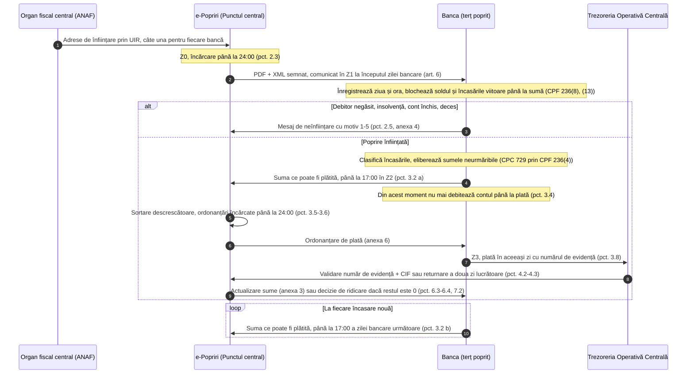
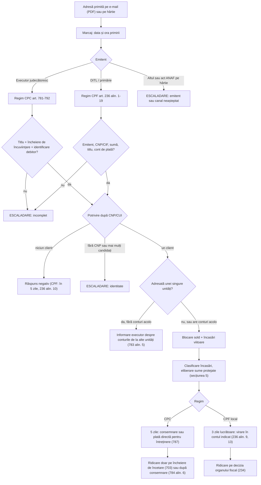

# 10 — Reguli pentru operațiuni juridice: popriri, cereri de la autorități, succesiuni și procuri

> Context pentru motorul de reguli și suita de teste (NEXXT Summit 2026, Raiffeisen Bank, „AI for Operational Efficiency”). Stare: 28.10.2026. Toate datele din exemple sunt fictive.

**Surse:** `reguli_popriri_mosteniri_autoritati.md` (principală), `perplexity_verificare.md` (Q1), `date_sintetice_formate_tooling.md` (partea e-Popriri). Conflictul de oră a fost verificat pe 28.10.2026 în OPANAF 878/2022, OPANAF 626/2023 și notificarea ProCredit.

**Etichete:** **[P]** citit în textul oficial (legislatie.just.ro, static.anaf.ro, senat.ro) · **[S]** sursă secundară citită (bănci, aviz CES, presă, bloguri juridice) · **[U]** neverificat (rezumat de căutare, Perplexity, estimare) sau în conflict între surse.

**Abrevieri:** CPC = Codul de procedură civilă (Legea 134/2010); CPF = Codul de procedură fiscală (Legea 207/2015); CC = Codul civil; CPP = Codul de procedură penală; SMN = salariul minim net pe economie; PF/PJ = persoană fizică/juridică; Z0, Z1… = zile bancare succesive.

---

## 1. Rezumat

- **Ce sunt:** patru fluxuri de back-office juridic: popririle pe conturi, cererile de informații de la autorități (excepții de la secretul bancar), clienții decedați și succesiunile, procurile. Popririle vin pe două canale: **ANAF prin e-Popriri** (PDF + XML semnat) și **executori și organe fiscale locale** prin PDF pe e-mail sau hârtie.
- **Volum:** 645.631 de adrese ANAF de înființare a popririi în 2024; 2,25 milioane de acte e-Popriri în S1 2025, din care peste 1,12 milioane de încetare [S]. Pentru 2018, o bancă mare raporta ~418.000 de popriri ANAF și ~250.000 pe an de la executori [S].
- **De ce doare:** banca blochează la primire fără să știe natura sumelor și analizează rulajele abia după (aviz CES) [S]. Rezultă alocații, salarii și pensii înghețate, aceeași datorie blocată la mai multe bănci, ridicări manuale și lente, omonime și CNP-uri greșite, comisioane cumulate.
- **Termene scurte, diferite pe regim:** 17:00 în ziua bancară următoare (e-Popriri), 3 zile lucrătoare (CPF), 5 zile (CPC), „de îndată” la cererile executorilor și procurorilor.
- **Automatizabil determinist:** extracția și validarea adreselor PDF, potrivirea pe CNP/CUI, calculul sumei urmăribile per încasare (CPC 729), cozile de concurență, verificarea temeiului legal al cererilor, listele de verificare pentru succesiuni și procuri.
- **Rămâne la om:** identitatea ambiguă, interpretarea CPC 729(3), conflictul ordinea primirii vs rang, sfera informațiilor pentru executori, decesele, insolvența, procurile a căror revocare nu poate fi verificată (băncile nu au acces la RNNEPR).
- **Contract de ieșire propus:** fiecare decizie întoarce `EXECUTA`, `EXECUTA_PARTIAL`, `RASPUNS_NEGATIV` sau `ESCALADARE`, cu ID-ul regulii, temeiul și flagurile. Fiecare regulă are cel puțin un test (secțiunea 10).

---

## 2. Popriri — cele două regimuri

### 2.1 Comparație

| | **ANAF prin e-Popriri** | **Executor judecătoresc** | **Organ fiscal local (DITL/primărie)** |
|---|---|---|---|
| Lege | CPF 236, inclusiv (20)–(21); OPANAF 878/2022 mod. 626/2023 [P] | CPC 781–792 și 729 [P] | CPF 236(1)–(19); (20)–(21) privesc doar ANAF [P] |
| Format | PDF + XML semnat; cheie: **număr de evidență a plății** [P] | PDF pe e-mail dedicat sau hârtie [S] | PDF sau hârtie; niciun canal oficial găsit |
| Țintă | câte o adresă pentru fiecare bancă unde debitorul are conturi (pct. 2.1) [P] | de regulă un cont anume [S]; adresa către o unitate prinde doar conturile ei (783(5)) [P] | — |
| Efect | la primire, cu ziua și ora înregistrate (236(8)); primită = prima zi bancară după încărcare, la ora de început (art. 6) [P] | de la comunicare, fără somație, inclusiv pentru sumele viitoare (783(1), 784(1)–(2)) [P] | la primire, cu ziua și ora (236(8)) [P] |
| Plată | în ziua descărcării ordonanțării (pct. 3.8) [P] | 5 zile: consemnare, sau plată directă pentru întreținere, alocație, despăgubiri pentru moarte/vătămare (787(1)) [P] | 3 zile lucrătoare (236(9)(a), (13)) [P] |
| Validare în instanță | nu (236(6)) [P] | da, dacă banca nu-și face obligațiile (790) [P] | nu [P] |
| Conversie valută | cursul afișat al băncii (236(3)) [P] | cursul BNR al zilei (784(7)–(8)) [P] | cursul băncii [P] |
| Ridicare | decizie emisă automat prin e-Popriri (pct. 6.4, 7.2) [P] | încheiere de încetare (703) sau după consemnarea integrală (784(6)) [P] | decizie în max. 2 zile de la încetare (234) [P] |

### 2.2 Flux A — ANAF prin e-Popriri



**Ceasul e-Popriri** (OPANAF 878/2022, anexa 1) [P]:

| Moment | Eveniment | Temei |
|---|---|---|
| Z0, până la 24:00 | ANAF încarcă adresele | pct. 2.1, 2.3 |
| Z1, începutul zilei bancare | adresa e considerată comunicată; banca înregistrează data și ora și blochează | art. 6; CPF 236(8), (13) |
| Z1, până la trimiterea sumei plătibile | sunt permise plățile din 236(14) (salarii cu declarație, accize, înlesniri); în practică doar în ziua înființării sau a creditării [S, Intesa] | pct. 3.4 |
| Z2, până la 17:00 | suma ce poate fi plătită sau mesajul de neînființare | pct. 3.2 a), 2.5 |
| Z2, până la 24:00 | sortare descrescătoare și ordonanțări | pct. 3.5–3.6 |
| Z3, la deschidere | descărcarea ordonanțării și plata în aceeași zi | pct. 3.8 |
| zilnic, până la 11:00 | actualizarea sumei rămase (se reține valoarea mai mică) | pct. 6.1–6.2 |
| Z4 | rest 0 → decizie de ridicare la toate băncile; ciclu de 4 zile, după CES [S] | pct. 6.4, 7.2 |
| după orice încasare | sumă plătibilă nouă până la 17:00 în ziua bancară următoare | pct. 3.2 b) |

> **Conflict rezolvat: 15:30 sau 17:00?** OPANAF 878/2022 pct. 3.2 cere mesajul „până la ora 17.00 a următoarei zile bancare” [P, verificat 28.10.2026]. OPANAF 626/2023 nu a atins pct. 3.2: a modificat art. 4(2), art. 12 și pct. 5.3 și 6.3, a introdus pct. 4.2^1 și a abrogat pct. 8.4 și anexa 2 [P]. Ora 15:30 vine din notificarea ProCredit despre protocolul ANAF–ARB–bănci: banca trimite soldul cert „în fiecare zi lucrătoare, la ora 15:30” [S]. Art. 6 lasă protocolul să fixeze ora de început a zilei bancare a fiecărei bănci, iar art. 12, în forma din 626/2023, menține protocolul în vigoare. **Pentru motor:** termenul legal e 17:00 în ziua bancară următoare; cut-off-ul zilnic e un parametru per bancă (implicit 15:30, de confirmat cu Raiffeisen).

**Dacă banca nu plătește** [P]: suma confirmată și neplătită se anulează și sortarea se reia (pct. 3.9–3.10). Organul fiscal primește un referat și analizează solidaritatea băncii în limita sumei rămase (CPF 25(1)(b)) sau amenda pentru întârziere (336(2)(d)) (pct. 3.11–3.12). Diferențele de curs nu atrag solidaritatea (pct. 3.13). La actele de actualizare, suspendare, continuare și ridicare banca nu trimite mesaj de neînființare; sistemul se actualizează săptămânal (pct. 5.2, 6.3, 7.2). Dacă platforma cade, se folosește calea alternativă (pct. 8.2).

### 2.3 Flux B — executori și organe fiscale locale



**Intrare, după regulile publicate de Revolut (26.03.2025)** [S]: doar e-mail dedicat sau hârtie; un singur PDF pe e-mail (poprirea plus anexele, ideal sub 3 MB), iar jpeg, .doc, .p7s sau textul din corpul e-mailului nu se procesează în aceleași condiții; subiect unic `tip poprire/nume_prenume/data`, trimis de preferință între 09:00 și 14:00; pe hârtie, pachet A4 capsat, cu opis pentru loturi; popririle non-ANAF se ridică doar pe adresa emitentului.

**CPC, pe scurt** [P]: banca nu poate contesta poprirea și se apără doar la validare (787(5)). Validarea se cere în cel mult o lună (790(1)); terțul poprit de rea-credință riscă o amendă de 2.000–10.000 lei (790(9)). Hotărârea definitivă de validare e titlu executoriu împotriva băncii (791–792).

### 2.4 Ridicare

| Emitent | Ce ridică poprirea | Termen | Ce nu o ridică |
|---|---|---|---|
| ANAF | decizia de ridicare din e-Popriri (rest 0 sau status „ridicare”, pct. 6.4, 7.1–7.2); adresa de actualizare reduce suma; ridicarea pentru sumele care depășesc creanța (CPF 234) [P] | max. 2 zile de la încetare (CPF 234) [P]; tipic Z4 [S] | cererea clientului; la majoritatea băncilor, nici dovada plății de la altă bancă [S] |
| Organ fiscal local | decizia sau adresa de ridicare; poprirea rămasă fără obiect (CPF 234(2)–(5)) [P] | max. 2 zile de la încetare [P] | cererea clientului [S] |
| Executor | încheierea de încetare (CPC 703); informarea după consemnarea integrală (784(6)) [P] | nespecificat în note [U] | documentele clientului [S] |

### 2.5 Coduri de răspuns negativ

| Cod | Motiv (OPANAF 878 pct. 2.5, anexa 4) [P] | Când |
|---|---|---|
| 1 | nu are cont deschis | CNP/CIF negăsit |
| 2 | societate în procedura insolvenței | PJ cu flag de insolvență |
| 3 | contul a fost închis | toate conturile închise |
| 4 | debitor decedat/radiat | flag de deces (DEC-01) sau radiere |
| 5 | alte motive convenite cu Punctul central | doar lista convenită; altfel `ESCALADARE` |

Executorii și organele locale nu au coduri legale; banca răspunde în scris. Propunere de design (nu normă): motorul reutilizează intern codurile 1–5.

---

## 3. Model de date

### 3.1 Model canonic (toate canalele)

| Câmp | Conținut | Obligatoriu |
|---|---|---|
| `tip_act` | înființare / actualizare / suspendare / continuare / ridicare / transformare / înștiințare (pct. 1.2(i)) | da |
| `regim`, `canal` | CPC / CPF_CENTRAL / CPF_LOCAL; e-Popriri / email / poștă / ghișeu | da |
| `emitent` | denumire, adresă, CIF, tip; nr. de înregistrare și data | da |
| `primit_la` | data și ora primirii, imutabil (CPF 236(8)) | da |
| `debitor` | nume sau denumire; CNP sau CUI/CIF; domiciliu sau sediu; sedii secundare | CNP/CUI doar „dacă sunt cunoscute” (CPC 783(3)) |
| `creanta` | total, monedă; pe titlu: obligația, nr. și data titlului, suma; accesorii; cheltuieli de executare | da |
| `natura_creantei` | obișnuită / întreținere-alocație / despăgubiri pentru moarte-vătămare | derivat din titlu; schimbă cota (729) și plata (787(1)) |
| `numar_evidenta_plata` / `dosar_executare` | cheia actului (ANAF / executor) | da |
| `tinta` | IBAN-uri sau „toate conturile”; unitatea destinatară (783(4)–(5)) | da |
| `destinatie_plata` | IBAN Trezorerie / cont de consemnare / contul organului local | da |
| `atasamente` | titlul, încheierea de încuviințare | da (CPC) |
| `temei_legal`, `asiguratorie`, `referinte_acte_anterioare` | pentru transformări, actualizări, ridicări | da |

### 3.2 e-Popriri: termeni și mesaje [P]

| Element | Conținut | Temei |
|---|---|---|
| Glosar | număr de evidență a plății = ID unic al adresei; sumă poprire; suma rămasă de recuperat; suma ce poate fi plătită (confirmată de bancă); ordonanțare de plată | pct. 1.2(d)–(h) |
| Neînființare (anexa 4) | ID poprire, număr de evidență, CIF (al debitorului sau al sediului secundar), motiv 1–5 | pct. 2.5 |
| Sumă plătibilă (anexa 5) | ID poprire, număr de evidență, CIF, data (ZZ.LL.AAAA), suma care poate fi plătită (lei), alte informații relevante | pct. 3.2–3.3 |
| Ordonanțare (anexa 6) | număr de evidență, ID poprire, CNP/CIF, sumă; citează CPF 236(20)–(21) | pct. 3.5 |
| Ordinul de plată al băncii | Beneficiar = numele debitorului; CIF = CIF-ul debitorului; IBAN = `RO08TREZ999506702XXXXXXX`; La = Trezoreria Operativă Centrală; Nr. de evidență a plății; cont 50.67.02. Număr greșit → banii se întorc (CPF 236(21)) | pct. 3.8, 4.1 |
| Feedback Trezorerie | CIF beneficiar, sumă, nr. și data documentului, număr de evidență, SWIFT/BIC, data extrasului, data plății, CIF plătitor, explicații | pct. 4.5 |
| Actualizare (anexa 3) | temei CPF 230(5), 233(3); număr de evidență, CIF, noua sumă rămasă; efect de la primire, cu ziua și ora | pct. 6.3 |

Schema XML nu e publică [U]; JSON-ul din 3.4 e un model intern propus. Formularele ANAF pe hârtie sunt în OPANAF 63/2017 (anexa 24 înființare, 27 înștiințare, 48 suspendare, 50 continuare, 53 ridicare) [P]; textele anexelor (MO 32 bis) nu au fost recuperate, deci câmpurile lor sunt inferate [U].

### 3.3 Executor: elementele obligatorii ale adresei (CPC 783) [P]

| Element | Text | Dacă lipsește |
|---|---|---|
| Titlul executoriu | 783(1) | INCOMPLET → `ESCALADARE` |
| Încheierea de încuviințare sau certificatul | 783(1), 666 | INCOMPLET → `ESCALADARE` |
| Interdicția de a plăti debitorului, „în măsura necesară” | 783(2) | `ESCALADARE` (nu e clar că e o poprire) |
| Nume și domiciliu / denumire și sediu | 783(3) | INCOMPLET |
| CNP / CUI / CIF („dacă sunt cunoscute”) | 783(3) | opțional: potrivire pe nume + adresă, cu confirmare umană |
| Conturile și subunitățile vizate („dacă sunt cunoscute”) | 783(4) | opțional: se aplică tuturor conturilor din domeniu |
| La transformarea popririi asigurătorii: copia certificată a titlului, nr. și data adresei inițiale, nr. dosarului, contul de consemnare | 783(7) | INCOMPLET |
| Competența teritorială (circumscripția curții de apel a debitorului) | 782(1) | flag juridic; banca nu poate contesta (787(5)) |

**Domeniul sucursalei (783(5)) [P]:** adresa trimisă unei unități prinde doar conturile acelei unități; dacă debitorul nu are cont acolo, unitatea informează executorul despre conturile de la alte unități. În motor: `unitate_destinatara` ≠ null ⇒ domeniu = conturile cu acel `branch_id`; domeniu gol ⇒ scrisoare de informare. Adresele ANAF sunt per bancă.

**Organ fiscal local:** nu s-a găsit niciun model oficial [U]; se folosesc modelul canonic și regulile CPF 236.

### 3.4 Exemple JSON (fictive)

ANAF prin e-Popriri, cu răspunsul băncii:

```json
{
  "document": {
    "tip_act": "infiintare",
    "regim": "CPF_CENTRAL",
    "canal": "e-Popriri",
    "emitent": {"tip": "organ_fiscal_central", "denumire": "AJFP Exemplu (fictiv)", "cif": "45678900"},
    "nr_inregistrare_emitent": "FICTIV-2026-0001",
    "incarcat_pe_platforma_la": "2026-11-02T21:40:00+02:00",
    "primit_la": "2026-11-03T08:00:00+02:00",
    "temei_legal": ["CPF art. 236", "CPF art. 236 alin. (20)-(21)", "OPANAF 878/2022"],
    "asiguratorie": false,
    "fisiere": ["adresa_infiintare.pdf", "adresa_infiintare.xml"]
  },
  "epopriri": {
    "id_poprire": "ID-FICTIV-000123",
    "numar_evidenta_plata": "NEP-FICTIV-000123",
    "suma_poprire": "3000.00",
    "suma_ramasa_de_recuperat": "3000.00"
  },
  "debitor": {"tip": "PF", "nume": "TESTESCU ANA", "cnp": "2850412045675", "domiciliu": "Str. Exemplului nr. 1, Bacău (fictiv)"},
  "creanta": {
    "moneda": "RON",
    "natura": "obisnuita",
    "titluri": [
      {"obligatie": "impozit (fictiv)", "titlu_nr": "TE-FICTIV-17", "titlu_data": "2026-08-14", "suma": "2750.00"},
      {"obligatie": "accesorii (fictiv)", "titlu_nr": "TE-FICTIV-18", "titlu_data": "2026-09-30", "suma": "250.00"}
    ]
  },
  "tinta": {"conturi": "toate", "unitate_destinatara": null},
  "destinatie_plata": {"iban": "RO08TREZ999506702XXXXXXX", "la": "Trezoreria Operativă Centrală", "cont": "50.67.02"},
  "raspuns_banca": {
    "mesaj": "suma_ce_poate_fi_platita",
    "id_poprire": "ID-FICTIV-000123",
    "numar_evidenta_plata": "NEP-FICTIV-000123",
    "cif": "2850412045675",
    "data": "04.11.2026",
    "suma_care_poate_fi_platita": "3000.00"
  }
}
```

Executor, primit pe e-mail:

```json
{
  "document": {
    "tip_act": "infiintare",
    "regim": "CPC",
    "canal": "email",
    "subiect_email": "Infiintare/Fictivu Mihai/031126",
    "emitent": {"tip": "executor_judecatoresc", "denumire": "BEJ Exemplu (fictiv)", "sediu": "Str. Testului nr. 2, Constanța (fictiv)"},
    "dosar_executare": "DE-FICTIV-45/2026",
    "data_adresa": "2026-11-02",
    "primit_la": "2026-11-03T10:42:00+02:00",
    "temei_legal": ["CPC art. 781-792"],
    "asiguratorie": false,
    "fisiere": ["poprire_si_anexe.pdf"]
  },
  "debitor": {"tip": "PF", "nume": "FICTIVU MIHAI", "cnp": "1791122135795", "domiciliu": "Str. Probei nr. 3, Constanța (fictiv)"},
  "titlu_executoriu": {"tip": "sentință civilă", "numar": "TC-FICTIV-900/2025", "instanta": "Judecătoria Exemplu (fictiv)"},
  "incheiere_incuviintare": {"numar": "INC-FICTIV-12/2026", "data": "2026-10-20", "instanta": "Judecătoria Exemplu (fictiv)"},
  "interdictie_plata_catre_debitor": true,
  "creanta": {"debit": "4200.00", "accesorii": "300.00", "cheltuieli_executare": "500.00", "total": "5000.00", "moneda": "RON", "natura": "obisnuita"},
  "tinta": {"conturi": "toate", "iban": [], "unitate_destinatara": null},
  "destinatie_plata": {"tip": "consemnare", "cont": "RO50RZBR0000060099990003"}
}
```

CNP-urile, CUI-urile și IBAN-urile sunt sintetice, cu cifre de control calculate după algoritmii din notele de date sintetice. Marcați-le ca sintetice: pot coincide întâmplător cu valori reale.

---

## 4. Catalog de reguli pentru popriri (POP)

POP-01…POP-11 sunt din note, rafinate; POP-12…POP-16 sunt extrase din aceleași note.

| ID | Regulă | Temei | Tag | Aplicare în motor |
|---|---|---|---|---|
| POP-01 | Clasifică emitentul: ANAF prin e-Popriri → CPF 236 cu (20)–(21); organ fiscal local → CPF 236(1)–(19); executor → CPC 781–792; altceva (de ex. o instanță direct) → excepție. | CPC 623; CPF 1–2, 236(20)–(21); OPANAF 878 pct. 1.3 | [P] | `regim = f(tip_emitent, canal)`. Act ANAF pe alt canal → verifică calea alternativă (pct. 8.2), altfel `ESCALADARE`. |
| POP-02 | Completitudine, executor: titlu + încheiere de încuviințare, interdicția de plată, identificarea debitorului, competența teritorială (tabelul 3.3). | CPC 783(1)–(4), (7); 666; 782(1) | [P] | Lipsă titlu sau încheiere → `ESCALADARE` în aceeași zi (termenul curge). Lipsă CNP → fallback cu confirmare umană. |
| POP-03 | Completitudine, fiscal: emitent, CIF/CNP, sumă, titluri, cont de plată sau număr de evidență. | CPF 236(5)–(8); OPANAF 878 pct. 1.2, 3.3, 3.8 | [P]; [U] câmpurile DITL | e-Popriri: validare XML; DITL: OCR + listă de câmpuri inferată. |
| POP-04 | Potrivire după CNP/CUI; răspuns negativ cu motivele 1–5; domeniul sucursalei. | OPANAF 878 pct. 2.5, anexa 4; CPC 783(5) | [P] | Cheie CNP/CUI cu checksum; doar nume + adresă → `ESCALADARE`. |
| POP-05 | Marcaj temporal: efect la primire, cu ziua și ora; în e-Popriri, prima zi bancară după încărcare, la începutul zilei. | CPF 236(8); OPANAF 878 art. 6, pct. 2.3 | [P] | `primit_la` obligatoriu, imutabil; toate termenele pornesc de aici; calendar bancar configurabil. |
| POP-06 | Blochează soldul și încasările viitoare până la suma din adresă (CPF) sau „în măsura necesară” (CPC); fără decontări din cont, cu excepțiile din 236(14); titlurile neonorate se urmăresc din încasările zilnice. | CPF 236(13)–(14), (18); CPC 781(2), 783(2), 784(1)–(2) | [P] | `blocaj = min(sold, suma_ramasa)` pe fiecare cont din domeniu, reevaluat la fiecare încasare. |
| POP-07 | Clasifică fiecare încasare a unei PF: absolut neurmăribilă (729(7): alocații și indemnizații pentru copii, ajutoare pentru copilul bolnav, de maternitate și de deces, burse de stat, diurne, alte indemnizații cu destinație specială) → eliberare; limitată (729(4)–(5): incapacitate temporară de muncă, compensații la concediere, șomaj) → doar întreținere sau despăgubiri, max. 1/2; venit periodic (salariu, pensie) → cote, plafon 1/2, prag; restul → urmăribil. Încălcările sunt nule de drept. | CPC 729, 730; CPF 236(4) | [P]; maparea pe plătitor e inferență | Clasificator pe IBAN/CUI-ul plătitorului (angajator, Casa de Pensii, ANPIS/AJPIS, AJOFM) și pe descrierea plății. Încredere mică → `NECUNOSCUT`: rămâne blocat + `ESCALADARE`. Calcul: secțiunea 5. |
| POP-08 | PJ, regim CPF: permise salariile și impozitele aferente (cu declarație pe propria răspundere că nu există alte fonduri), accizele, sumele pentru înlesnire; în e-Popriri doar până la mesajul de sumă plătibilă, în practică doar în ziua înființării sau a creditării. Regim CPC: salariile viitoare pe 3 luni nu se popresc. | CPF 236(14)–(15); OPANAF 878 pct. 3.4; CPC 781(5)(c) | [P]; [S] fereastra (Intesa) | Verifică documentul și fereastra; după mesaj → `RASPUNS_NEGATIV`. PJ + CPC → `VERIFICA_CPC_781_5_c`. |
| POP-09 | Plata: CPC 5 zile (consemnare sau plată directă); CPF pe hârtie 3 zile lucrătoare; e-Popriri: sumă plătibilă până la 17:00 în ziua bancară următoare (și după fiecare încasare), plată în ziua ordonanțării, cu numărul de evidență. | CPC 787(1); CPF 236(9)(a), (13), (20)–(21); OPANAF 878 pct. 3.2, 3.4, 3.8 | [P]; [S] cut-off 15:30 | Termene pe regim, alarme SLA; în e-Popriri nicio plată fără ordonanțare. |
| POP-10 | Concurență: e-Popriri în ordinea vechimii primirii; plafon 1/2 pe venit; CPC: informare reciprocă, consemnare, distribuie executorul; CPF: informare + rangurile din 258; fiscal + nefiscal → conexare. Conflict ordine vs rang → om. | OPANAF 878 pct. 8.5; CPC 729(2), 787(2), 789, 865; CPF 236(11), 258, 220(13) | [P] | Coadă per debitor după `primit_la`, cu flaguri (secțiunea 6). |
| POP-11 | Suspendare, continuare, actualizare, ridicare: în suspendare sumele existente rămân blocate, încasările viitoare nu, iar Trezoreria nu validează viramentele; CPC: ridicare doar pe încheiere de încetare sau după consemnare; documentele clientului nu ridică. | OPANAF 878 pct. 1.2(i), 4.2^1, 5.1–5.5, 6.1–6.4, 7.1–7.2; CPF 233(3)–(5), 234; CPC 703, 784(6) | [P]; [S] practica băncilor | Mașină de stări per poprire, idempotentă pe număr de evidență sau dosar. |
| POP-12 | Conversie valutară fără acordul titularului: CPC la cursul BNR, CPF la cursul băncii; diferențele de curs nu atrag solidaritatea. | CPC 784(7)–(8); CPF 236(3); OPANAF 878 pct. 3.13 | [P] | Sursa cursului după regim; cursul se jurnalizează. |
| POP-13 | Excluse: sume cu afectațiune specială, finanțări nerambursabile; (CPC) salariile viitoare pe 3 luni, o singură dată de la prima poprire; salariile din conturile instituțiilor publice (RIL 1/2020). | CPC 781(5); CPF 236(2) | [P] | `EXCLUS` doar cu dovadă (de ex. contractul de finanțare); altfel `ESCALADARE`. |
| POP-14 | Informări către emitent: CPF — în 5 zile dacă nu se datorează nimic, plus informarea tuturor creditorilor; CPC — ceilalți creditori și sumele lor, toți executorii la depășire, conturile de la alte unități. | CPF 236(10)–(11); CPC 783(5), 787(2), 789(1) | [P] | Scrisori generate din șabloane; SLA 5 zile. |
| POP-15 | Informarea clientului: nicio obligație legală găsită în CPC/CPF; practica: SMS, e-mail, aplicație; extrasul lunar gratuit e obligatoriu. | CC 2.191(3) | [P] lege; [S] practică | Notificare configurabilă, fără efect juridic. |
| POP-16 | Risc: solidaritate în limita sumelor sustrase indisponibilizării; plăți nule dacă încalcă 236(9), (11), (13), (14), (18), (20), (21); amendă 1.000–5.000 lei pentru contribuabilii mijlocii și mari (500–1.000 lei pentru ceilalți); CPC: validare + 2.000–10.000 lei. | CPF 25(1)(b)–(c), 236(16), 336(1)(k), (2)(d); OPANAF 878 pct. 3.11–3.13; CPC 790 | [P] | Prioritizează alertele după expunere; nicio plată sau eliberare fără regulă. |

---

## 5. Algoritmul pentru venituri protejate (CPC 729; pentru popririle fiscale prin CPF 236(4))

### 5.1 Ce spune textul [P]

- **729(1)–(2):** veniturile periodice (salarii, pensii, alte sume pentru existență) se urmăresc până la **1/2** din venitul lunar net pentru întreținere sau alocație pentru copii și până la **1/3** pentru alte datorii; cu mai multe urmăriri, totalul ≤ **1/2**.
- **729(3):** veniturile sub SMN pot fi urmărite „numai asupra părții ce depășește jumătate din acest cuantum”. Categoriile din 729(4)–(5) și 729(7) sunt listate în POP-07.

### 5.2 Pași, pentru fiecare încasare

1. **PJ** → 729 nu se aplică; se exclud doar sumele din POP-13.
2. Clasifică încasarea (POP-07): `ABSOLUT_NEURMARIBIL`, `EXCLUS`, `LIMITAT_729_4`, `VENIT_PERIODIC`, `ALTE_SUME` sau `NECUNOSCUT`.
3. `ABSOLUT_NEURMARIBIL` / `EXCLUS` → urmăribil 0, totul se eliberează; poprirea rămâne pentru încasările viitoare.
4. `NECUNOSCUT` → nu se plătește și nu se eliberează: suma rămâne blocată (efectul legal implicit) și se escaladează înainte de termenul de plată.
5. `ALTE_SUME` → min(încasare, total rămas), alocat în ordinea primirii.
6. `LIMITAT_729_4` → doar popririle pentru întreținere sau despăgubiri, cu cota 1/2, apoi ca la pasul 7 (pragul se aplică doar dacă `prag_729_3_si_pentru_729_4`); pentru celelalte popriri, 0.
7. `VENIT_PERIODIC`, cu V = venitul lunar net (dacă lipsește, V = încasarea, cu flag):
   1. cota pe poprire: 1/2 pentru întreținere sau alocație, 1/3 pentru restul (inclusiv fiscale);
   2. plafon total: cota popririi dacă e una singură, 1/2 × V dacă sunt mai multe;
   3. dacă V < SMN, calculează ambele lecturi ale 729(3): **A** = cotele și plafonul se aplică doar peste prag (V − SMN/2); **B** = cotele se aplică lui V, iar totalul ≤ V − SMN/2;
   4. dreptul lunar al fiecărei popriri, în ordinea primirii, limitat de suma ei rămasă;
   5. din încasarea curentă se ia dreptul lunar minus ce s-a reținut deja în lună; la venit în tranșe, proporțional cu încasarea / V.
8. Dacă A ≠ B: plătește A (protectoare), ține B − A blocat, flag `REVIEW_729_3` → om.
9. Rotunjire în jos la bani.
10. Ieșire: urmăribil, alocare, în așteptare, eliberat, flaguri. POP-09 și POP-10 decid plata.

### 5.3 Parametri configurabili

| Parametru | Implicit | Observație |
|---|---|---|
| `salariu_minim_net` | 2.699,00 lei de la 1.07.2026 (prag 1.349,50) | **[U]**: dintr-un calculator comercial care citează HG 146/2026 și OUG 89/2025 (brut 4.325 lei); neverificat în HG |
| `interpretare_729_3` | A | ambiguitate (5.6); diferența rămâne blocată |
| `plafon_1_3_cumulat` | False | ambiguitate (5.6) |
| `prag_729_3_si_pentru_729_4` | True | ambiguitate (5.6) |
| rotunjire | în jos la bani | politică; nota principală afișează 666,67 la rotunjire standard |
| unitatea termenelor de 5 zile (CPC 787, CPF 236(10)) | de configurat | notele nu precizează modul de calcul |
| calendar bancar | fără sâmbete, duminici, sărbători legale | definiția din convenția-cadru abrogată [P] |
| cut-off zilnic e-Popriri | 15:30 | per bancă [S]; termenul legal rămâne 17:00 în ziua bancară următoare |

### 5.4 Funcție de referință (Python 3.10+)

```python
"""Referință: suma urmăribilă dintr-o încasare (CPC art. 729; pentru popririle fiscale prin CPF art. 236 alin. (4)).

Doar calcul. Clasificarea încasării (POP-07) și potrivirea popririlor (POP-04) se fac în amonte.
"""
from __future__ import annotations

from dataclasses import dataclass, field
from datetime import datetime
from decimal import Decimal, ROUND_DOWN
from enum import Enum
from fractions import Fraction

ZERO = Decimal("0.00")
JUMATATE, TREIME = Fraction(1, 2), Fraction(1, 3)


def _r(x: Decimal) -> Decimal:
    """Rotunjire în jos la bani: nu se reține niciodată peste fracția legală (politică configurabilă)."""
    return x.quantize(Decimal("0.01"), rounding=ROUND_DOWN)


def _mul(baza: Decimal, f: Fraction) -> Decimal:
    return baza * f.numerator / f.denominator  # exact pentru 3000 / 3 etc.


class TipVenit(str, Enum):
    ABSOLUT_NEURMARIBIL = "absolut_neurmaribil"  # CPC 729(7)
    EXCLUS = "exclus"                            # CPC 781(5) a)-b), CPF 236(2)
    LIMITAT_729_4 = "limitat_729_4"              # incapacitate temporară, compensații la concediere, șomaj
    VENIT_PERIODIC = "venit_periodic"            # salariu, pensie, alte sume periodice pentru existență (729(1))
    ALTE_SUME = "alte_sume"                      # încasări fără protecție specială
    NECUNOSCUT = "necunoscut"                    # sursa nu a putut fi clasificată cu încredere


class TipCreanta(str, Enum):
    OBISNUITA = "obisnuita"      # 729(1) b): orice alte datorii, inclusiv fiscale
    INTRETINERE = "intretinere"  # 729(1) a): întreținere sau alocație pentru copii
    DESPAGUBIRI = "despagubiri"  # despăgubiri pentru moarte / vătămare corporală (729(4))


class Regim(str, Enum):
    CPC = "CPC"                  # executor judecătoresc
    CPF_CENTRAL = "CPF_CENTRAL"  # ANAF prin e-Popriri
    CPF_LOCAL = "CPF_LOCAL"      # DITL / DGITL / primărie


class Interpretare7293(str, Enum):
    A = "A"  # cota (1/3 sau 1/2) se aplică doar părții care depășește SMN/2
    B = "B"  # prag și cotă ca limite separate: min(V - SMN/2, cota x V)


@dataclass(frozen=True)
class Poprire:
    id: str
    regim: Regim
    tip_creanta: TipCreanta
    suma_ramasa: Decimal   # rămasă de recuperat, după reținerile deja făcute
    primita_la: datetime   # data și ora primirii (CPF 236(8)); ordinea de plată (OPANAF 878 pct. 8.5)


@dataclass(frozen=True)
class Parametri:
    salariu_minim_net: Decimal                                # CONFIG; valoarea 2026 (2.699 lei) e NEVERIFICATĂ
    interpretare_729_3: Interpretare7293 = Interpretare7293.A  # A = varianta cea mai protectoare
    plafon_1_3_cumulat: bool = False                          # True: creanțele obișnuite împreună <= 1/3
    prag_729_3_si_pentru_729_4: bool = True                   # pragul se aplică și beneficiilor 729(4)?


@dataclass
class Rezultat:
    urmaribil: Decimal                 # de plătit / consemnat din această încasare
    alocare: dict[str, Decimal]        # pe poprire, în ordinea primirii
    eliberat: Decimal                  # disponibil debitorului
    retinut_in_asteptare: Decimal      # rămâne blocat până la decizia umană
    flaguri: list[str] = field(default_factory=list)


def _cota(x: Poprire, tip: TipVenit) -> Fraction:
    if tip is TipVenit.LIMITAT_729_4:  # 729(4)-(5): doar întreținere / despăgubiri, max 1/2
        return JUMATATE if x.tip_creanta in (TipCreanta.INTRETINERE, TipCreanta.DESPAGUBIRI) else Fraction(0)
    return JUMATATE if x.tip_creanta is TipCreanta.INTRETINERE else TREIME


def _flaguri_concurs(active: list[Poprire]) -> list[str]:
    regimuri = {x.regim for x in active}
    f: list[str] = []
    if Regim.CPC in regimuri and len(regimuri) > 1:
        f += ["CONCURS_CPC_CPF", "CONFLICT_ORDINE_PRIMIRE_VS_RANG"]  # CPF 220(13); 8.5 vs 865/258
    elif {Regim.CPF_CENTRAL, Regim.CPF_LOCAL} <= regimuri:
        f.append("CONFLICT_ORDINE_PRIMIRE_VS_RANG")                  # 8.5 vs pro rata CPF 258
    elif regimuri == {Regim.CPC} and len(active) > 1:
        f.append("CPC_789_CONSEMNARE_SI_INFORMARE")                  # distribuie executorul
        if len({x.tip_creanta for x in active}) > 1:
            f.append("CPC_787_PLATA_DIRECTA_VS_789")
    if len({x.primita_la for x in active}) < len(active):
        f.append("EGALITATE_ORA_PRIMIRE")                            # criteriu de departajare nedefinit
    return f


def _plan_lunar(active: list[Poprire], tip: TipVenit, baza: Decimal, plafon_extra: Decimal | None,
                deja: dict[str, Decimal], p: Parametri) -> dict[str, Decimal]:
    """Dreptul lunar al fiecărei popriri asupra venitului (include ce s-a reținut deja în lună)."""
    elig = [x for x in active if _cota(x, tip) > 0]
    if not elig:
        return {}
    total = _mul(baza, JUMATATE if len(elig) > 1 else _cota(elig[0], tip))  # 729(2) sau cota unică
    if plafon_extra is not None:
        total = min(total, plafon_extra)                                  # 729(3), varianta B
    ramas = _r(total)
    ramas_ob = _r(_mul(baza, TREIME)) if p.plafon_1_3_cumulat else None
    plan: dict[str, Decimal] = {}
    for x in elig:                                                        # ordinea primirii
        cap = _r(_mul(baza, _cota(x, tip)))
        if ramas_ob is not None and x.tip_creanta is TipCreanta.OBISNUITA:
            cap = min(cap, ramas_ob)
        e = max(ZERO, min(cap, ramas, x.suma_ramasa + deja.get(x.id, ZERO)))
        plan[x.id] = e
        ramas -= e
        if ramas_ob is not None and x.tip_creanta is TipCreanta.OBISNUITA:
            ramas_ob -= e
    return plan


def _din_credit(plan: dict[str, Decimal], deja: dict[str, Decimal], credit: Decimal,
                venit_transe: Decimal | None) -> dict[str, Decimal]:
    """Reținerea din încasarea curentă; dacă venitul vine în tranșe, repartizează proporțional (credit / V)."""
    ramas = credit
    out: dict[str, Decimal] = {}
    for pid, e in plan.items():
        tinta = e if venit_transe is None else _r(e * credit / venit_transe)
        luat = max(ZERO, min(tinta, e - deja.get(pid, ZERO), ramas))
        out[pid] = luat
        ramas -= luat
    return out


def suma_urmaribila(suma_credit: Decimal, tip_venit: TipVenit, debitor_pf: bool, popriri: list[Poprire],
                    p: Parametri, venit_lunar_net: Decimal | None = None,
                    retinut_deja_luna: dict[str, Decimal] | None = None) -> Rezultat:
    """Împarte o încasare în: urmăribil (de plătit/consemnat), reținut în așteptare (om) și eliberat.

    venit_lunar_net: venitul periodic net al lunii (dacă lipsește, se presupune = suma_credit și se marchează).
    retinut_deja_luna: ce s-a reținut deja în aceeași lună din același venit, pe id de poprire.
    """
    deja = retinut_deja_luna or {}
    active = sorted((x for x in popriri if x.suma_ramasa > 0), key=lambda x: x.primita_la)
    if not active:
        return Rezultat(ZERO, {}, suma_credit, ZERO, ["FARA_POPRIRE_ACTIVA"])
    flaguri = _flaguri_concurs(active)
    total_ramas = sum((x.suma_ramasa for x in active), ZERO)

    def integral(suma: Decimal) -> Rezultat:  # încasare fără protecție: ordinea primirii
        alocare: dict[str, Decimal] = {}
        for x in active:
            alocare[x.id] = min(x.suma_ramasa, suma)
            suma -= alocare[x.id]
        urm = sum(alocare.values(), ZERO)
        return Rezultat(urm, alocare, suma_credit - urm, ZERO, flaguri)

    if tip_venit in (TipVenit.ABSOLUT_NEURMARIBIL, TipVenit.EXCLUS):
        return Rezultat(ZERO, {}, suma_credit, ZERO, flaguri)
    if not debitor_pf:                                  # art. 729 protejează doar persoanele fizice
        if any(x.regim is Regim.CPC for x in active):
            flaguri.append("VERIFICA_CPC_781_5_c")     # salarii viitoare pe 3 luni (debitor angajator)
        return integral(min(suma_credit, total_ramas))
    if tip_venit is TipVenit.NECUNOSCUT:                # nu plătim, nu eliberăm: blocat + om
        blocat = min(suma_credit, total_ramas)
        return Rezultat(ZERO, {}, suma_credit - blocat, blocat, flaguri + ["CLASIFICARE_NECUNOSCUTA"])
    if tip_venit is TipVenit.ALTE_SUME:
        return integral(min(suma_credit, total_ramas))
    if tip_venit is TipVenit.LIMITAT_729_4 and not any(_cota(x, tip_venit) > 0 for x in active):
        return Rezultat(ZERO, {}, suma_credit, ZERO, flaguri + ["729_4_NEURMARIBIL_PT_ACESTE_CREANTE"])

    # VENIT_PERIODIC sau LIMITAT_729_4 cu creanțe eligibile
    transe: Decimal | None = None
    if venit_lunar_net is None:
        venit_lunar_net = suma_credit
        flaguri.append("VENIT_LUNAR_ESTIMAT_DIN_CREDIT")
    elif suma_credit < venit_lunar_net:
        transe = venit_lunar_net                       # venit plătit în tranșe
    V = venit_lunar_net
    prag_aplicabil = V < p.salariu_minim_net and (
        tip_venit is TipVenit.VENIT_PERIODIC or p.prag_729_3_si_pentru_729_4)
    if not prag_aplicabil:
        alocare = _din_credit(_plan_lunar(active, tip_venit, V, None, deja, p), deja, suma_credit, transe)
        urm = sum(alocare.values(), ZERO)
        return Rezultat(urm, alocare, suma_credit - urm, ZERO, flaguri)

    if tip_venit is TipVenit.LIMITAT_729_4:
        flaguri.append("PRAG_729_3_LA_729_4_NECLAR")
    peste_prag = max(ZERO, V - _r(_mul(p.salariu_minim_net, JUMATATE)))  # 729(3)
    aloc_a = _din_credit(_plan_lunar(active, tip_venit, peste_prag, None, deja, p), deja, suma_credit, transe)
    aloc_b = _din_credit(_plan_lunar(active, tip_venit, V, peste_prag, deja, p), deja, suma_credit, transe)
    tot_a, tot_b = sum(aloc_a.values(), ZERO), sum(aloc_b.values(), ZERO)
    if tot_a != tot_b:
        flaguri.append("REVIEW_729_3")
    if p.interpretare_729_3 is Interpretare7293.A:      # plătim A; diferența B - A rămâne blocată
        return Rezultat(tot_a, aloc_a, suma_credit - tot_b, tot_b - tot_a, flaguri)
    return Rezultat(tot_b, aloc_b, suma_credit - tot_b, ZERO, flaguri)
```

Teste minimale (rulate local, trec):

```python
from datetime import datetime
from decimal import Decimal as D

P = Parametri(salariu_minim_net=D("2699.00"))  # valoare NEVERIFICATĂ, doar pentru teste
T1, T2 = datetime(2026, 11, 3, 8, 0), datetime(2026, 11, 4, 10, 42)
anaf = lambda rest: Poprire("ANAF-1", Regim.CPF_CENTRAL, TipCreanta.OBISNUITA, D(rest), T1)

def test_e2_salariu_sub_smn_tine_diferenta_blocata() -> None:
    r = suma_urmaribila(D("2000.00"), TipVenit.VENIT_PERIODIC, True, [anaf("5000.00")], P)
    assert (r.urmaribil, r.retinut_in_asteptare, r.eliberat) == (D("216.83"), D("433.67"), D("1349.50"))
    assert "REVIEW_729_3" in r.flaguri

def test_e6_concurs_anaf_si_intretinere() -> None:
    intretinere = Poprire("BEJ-INT", Regim.CPC, TipCreanta.INTRETINERE, D("5000.00"), T2)
    r = suma_urmaribila(D("3000.00"), TipVenit.VENIT_PERIODIC, True, [anaf("2000.00"), intretinere], P)
    assert r.alocare == {"ANAF-1": D("1000.00"), "BEJ-INT": D("500.00")}
    assert {"CONCURS_CPC_CPF", "CONFLICT_ORDINE_PRIMIRE_VS_RANG"} <= set(r.flaguri)
```

### 5.5 Exemple numerice

SMN = 2.699,00 lei [U], prag 1.349,50. Toate rezultatele au fost calculate cu funcția de mai sus. Flagul informativ `VENIT_LUNAR_ESTIMAT_DIN_CREDIT` (V netransmis) e omis.

| # | Intrare | Calcul | Urmăribil | În așteptare | Eliberat | Flaguri |
|---|---|---|---|---|---|---|
| E1 | Salariu 4.500; ANAF, rest 10.000 | V ≥ SMN → 4.500 / 3 | 1.500,00 | 0 | 3.000,00 | — |
| E2 | Salariu 2.000; ANAF, rest 5.000 | A: (2.000 − 1.349,50) / 3 = 216,83; B: min(650,50; 666,66) = 650,50 | 216,83 | 433,67 | 1.349,50 | `REVIEW_729_3` |
| E3 | Alocație de stat 600 | 729(7) | 0 | 0 | 600,00 | — |
| E4 | Ajutor de șomaj 1.800; ANAF | 729(4) | 0 | 0 | 1.800,00 | `729_4_NEURMARIBIL_PT_ACESTE_CREANTE` |
| E5 | Ajutor de șomaj 1.800; executor pentru întreținere, rest 3.000 | cota 1/2, cu prag: A 450,50 / 2 = 225,25; B min(900; 450,50) = 450,50 | 225,25 | 225,25 | 1.349,50 | `PRAG_729_3_LA_729_4_NECLAR`, `REVIEW_729_3` |
| E6 | Pensie 3.000; ANAF (prima, rest 2.000) + executor pentru întreținere (rest 5.000) | plafoane 1.000 / 1.500; total ≤ 1.500; ordinea primirii | 1.500,00 (1.000 + 500) | 0 | 1.500,00 | `CONCURS_CPC_CPF`, `CONFLICT_ORDINE_PRIMIRE_VS_RANG` |
| E7 | Aceeași zi, executor, rest 2.000: salariu 3.600 + alocație 600 + transfer 400 | 1.200 + 0 + 400 | 1.600,00 | 0 | 3.000,00 | — |
| E8 | Salariu 2.600; ANAF rest 300 (prima) + executor rest 5.000 | A: baza 1.250,50, plafoane 416,83, total 625,25 → 300 + 325,25. B: 866,66 fiecare, total ≤ 1.250,50 → 300 + 866,66 | 625,25 | 541,41 | 1.433,34 | `CONCURS_CPC_CPF`, `CONFLICT_…`, `REVIEW_729_3` |
| E9 | Salariu 2.698 față de 2.700; ANAF | 2.698: A 449,50, B 899,33; 2.700: fără prag, 900,00 | 449,50 / 900,00 | 449,83 / 0 | 1.798,67 / 1.800,00 | `REVIEW_729_3` la 2.698 |
| E10 | Salariu în tranșe 1.500 + 3.000, V = 4.500; ANAF | drept lunar 1.500, proporțional | 500,00 + 1.000,00 | 0 | 1.000,00 + 2.000,00 | — |
| E11 | Încasare de 1.200 neidentificată | `NECUNOSCUT` | 0 | 1.200,00 | 0 | `CLASIFICARE_NECUNOSCUTA` |
| E12 | PJ: factură 30.000 și grant UE nerambursabil 100.000; ANAF rest 50.000 | 729 nu se aplică; 236(2) | 30.000,00 și 0 | 0 | 0 și 100.000,00 | — |

E9 arată o consecință a lecturii A: 2 lei peste SMN aproape dublează suma urmăribilă (449,50 → 900,00), pe când la B trecerea e continuă (899,33 → 900,00). E un argument pentru revizuirea juridică, nu o concluzie.

### 5.6 Ambiguități care merg la om

Flagurile de la rândurile 6–7 vin din etapele din amonte (clasificare, extracție), nu din funcție.

| # | Ambiguitate | Implicit | Flag |
|---|---|---|---|
| 1 | 729(3) + 729(1): calculatorul comercial aplică 1/3 doar părții de peste prag (A); textul poate fi citit ca permițând toată partea de peste prag, sub plafonul de 1/3 din venitul total (B) | plătește A, ține diferența | `REVIEW_729_3` |
| 2 | Cu mai multe creanțe obișnuite, 1/3 e pe fiecare poprire (total ≤ 1/2) sau cumulat? Notele confirmă doar plafonul cumulat de 1/2 | 1/3 pe poprire | decizie de politică |
| 3 | „Venitul lunar net” dedus din încasări (mai mulți plătitori, avansuri, bonusuri, restanțe) e predispus la erori | V = încasarea | `VENIT_LUNAR_ESTIMAT_DIN_CREDIT` |
| 4 | Pragul din 729(3) se aplică și ajutorului de șomaj sau de boală (sume periodice pentru existență)? | da (protector) | `PRAG_729_3_LA_729_4_NECLAR` |
| 5 | Valoarea SMN și data de referință (a încasării sau a popririi) | parametru | — |
| 6 | Soldul existent la înființare poate conține alocații mai vechi (exemplul din comentariu: 3.000 lei din alocații) | analiză de rulaj | `TRASARE_SOLD_EXISTENT` |
| 7 | Natura creanței neclară în titlu (întreținere sau obișnuită) | obișnuită + escaladare | `NATURA_CREANTA_NECLARA` |

---

## 6. Popriri concurente și ordinea de plată

### 6.1 Rangurile [P]

| Rang | CPC 865 | CPF 258 |
|---|---|---|
| a | cheltuieli de executare și de conservare | idem |
| b | cheltuieli de înmormântare | idem |
| c | salarii, pensii, șomaj, asigurări sociale, despăgubiri pentru moarte sau vătămare | idem |
| d | întreținere, alocații pentru copii, alte sume periodice pentru existență | idem |
| e | creanțe fiscale | creanțe fiscale, **inclusiv amenzile** |
| f | împrumuturi de stat | idem |
| g | pagube aduse proprietății publice | idem |
| h | împrumuturi bancare, furnizări, servicii, chirii | idem |
| i | **amenzi** către bugetul de stat sau local | alte creanțe |
| j | alte creanțe | — |

În același rang: pro rata, în ambele coduri. Creditorii cu gaj sau ipotecă trec înaintea lit. c) (CPC 867). În e-Popriri se plătește „în ordinea vechimii primirii adreselor” (OPANAF 878 pct. 8.5).

### 6.2 Tabel de decizie

| # | Situație | Ce face motorul | Temei | Escaladare |
|---|---|---|---|---|
| C1 | Mai multe popriri ANAF | plată în ordinea vechimii primirii; fiecare blocată până la suma ei | pct. 8.5 [P] | da, la aceeași oră de comunicare (toate actele din Z0 sunt „primite” la începutul Z1; departajarea nu e definită) |
| C2 | ANAF + organ fiscal local | informare scrisă; ambele în rangul e) → pro rata (258); termenele e-Popriri se aplică și popririlor concurente [S] | CPF 236(11), 258 [P] | da: pro rata vs ordinea primirii |
| C3 | Fiscal + nefiscal pe același venit sau bun | conexare, executare după CPF prin organul fiscal cu creanța fiscală mai mare; banca nu poate stabili singură cine conduce | CPF 220(13) [P] | întotdeauna |
| C4 | Mai mulți executori | informare reciprocă; la depășire, consemnează suma urmăribilă în 5 zile și informează toți executorii; distribuie executorul | CPC 787(2), 789 [P] | da, dacă una e pentru întreținere (plată directă vs consemnare) |
| C5 | Venit periodic, mai multe popriri | total ≤ 1/2 din venitul lunar net | CPC 729(2) [P] | da, dacă regimurile diferă |
| C6 | Aceeași datorie ANAF la mai multe bănci | fiecare bancă blochează integral; plata e plafonată central; excesul se ridică după plată | CPF 236(13); pct. 3.5–3.6, 6.4, 7.2 [P] | nu; plată doar pe ordonanțare |
| C7 | O poprire suspendată, altele active | sumele existente rămân blocate, folosibile doar pentru obligații fiscale sau salarii; încasările viitoare nu se mai blochează pentru cea suspendată | CPF 233(3)–(5); pct. 4.2^1, 5.3 [P] | da, dacă suma e revendicată de altă poprire |
| C8 | Executarea unei amenzi | rang i) în CPC, e) în CPF | CPC 865; CPF 258 [P] | da, dacă regimul e neclar |

### 6.3 Conflicte care merg obligatoriu la om

1. Ordinea primirii (8.5) vs rang (865/258) când concurează popriri fiscale și nefiscale.
2. Cine conduce executarea conexată (220(13)): banca vede doar sumele din adrese.
3. Pro rata în același rang (258) vs ordinea primirii (8.5).
4. Plata directă pentru întreținere (787(1)) vs consemnarea pentru distribuire (789).
5. Egalitate de oră între două acte e-Popriri.
6. Excepțiile PJ din 236(14) când există și o poprire CPC (care are doar excluderea din 781(5)(c)).
7. Suspendarea unei popriri pe sume revendicate de alta.

---

## 7. Cereri de informații de la autorități

**Principii [P]:** secretul bancar acoperă persoana, bunurile, afacerile și conturile clientului, inclusiv ale foștilor clienți și ale celor cu care s-a negociat (OUG 99 art. 111). Informațiile se dau doar în cazurile din art. 113(2) și 114, „în măsura în care” scopul le justifică; destinatarul le păstrează confidențiale (art. 116). Secretul nu e opozabil supravegherii (113(1)). Nu încalcă secretul: datele agregate, CRB, CIP, fondul de garantare, auditorul, băncile corespondente, grupul (art. 115).

### 7.1 Tabel de decizie pe solicitant

| Solicitant | Temei | Elemente obligatorii | Sferă permisă | Termen | Rezultat | Regulă |
|---|---|---|---|---|---|---|
| Procuror (din oficiu sau la cererea poliției) | CPP 153; OUG 99 art. 114 | **ordonanță**: instituția, suspectul sau inculpatul, motivele, obligația de comunicare imediată și confidențială (+ art. 286(2)) | existența și conținutul conturilor | „de îndată” | `EXECUTA`, confidențial; element lipsă → `ESCALADARE` | REQ-02 |
| Poliție fără ordonanța procurorului | CPP 153(2), 170 | — | — | — | `ESCALADARE` (excepție: ordinul de predare din art. 170) | REQ-02 |
| Instanță | OUG 99 art. 113(2)(e) (civil), 114 + CPP (penal) | cererea instanței în cauză | cât justifică scopul | termenul din adresă (nespecificat în note) | `EXECUTA` | REQ-06 |
| Executor judecătoresc | CPC 660(1)–(2); OUG 99 art. 113(2)(f) | cerere scrisă pentru executare; dosarul și debitorul | **conflict**: „existența conturilor” (113(2)(f)) vs toate datele necesare, inclusiv CNP, „chiar dacă prin legi speciale se dispune altfel” (660(2)) | „de îndată” | `EXECUTA` pentru existența conturilor; restul → `ESCALADARE` | REQ-03 |
| ANAF | CPF 61(1) | cererea organului fiscal central | toate rulajele și/sau soldurile + documentele operațiunilor | nespecificat; procedura ANAF neverificată | `EXECUTA` | REQ-04 |
| Organ fiscal local | CPF 58(1)–(2) | cerere scrisă: natura informațiilor, documente justificative | **conflict** cu 113(2)(c): legea specială trebuie să identifice clar informațiile, iar art. 58 e general | nespecificat | `EXECUTA_PARTIAL` (solduri) + `ESCALADARE` | REQ-04 |
| Alte autorități | OUG 99 art. 113(2)(c), (3) | lege specială; temeiul legal, identitatea clientului, categoria informațiilor, scopul | doar ce identifică legea | — | element lipsă → `RASPUNS_NEGATIV` / `ESCALADARE` | REQ-01 |
| Notar | OUG 99 art. 113(2)(g) | procedură succesorală: referința dosarului + dovada decesului | conturile defunctului | nespecificat | `EXECUTA` | REQ-05 |
| Moștenitori | OUG 99 art. 113(2)(a) | dovada calității | conturile defunctului | — | `EXECUTA`; fără certificat → la notar (practică [S]) | REQ-05 |
| Soț sau soție | OUG 99 art. 113(2)(d) | cerere scrisă + dovada acțiunii de partaj | bunurile comune | — | `EXECUTA`; fără dovadă → `RASPUNS_NEGATIV` | REQ-06 |
| Titular, reprezentant, acord expres | OUG 99 art. 113(2)(a) | identitate, mandat sau consimțământ | — | — | `EXECUTA` | REQ-01 |
| ANAF, FATCA/CRS | CPF 62(12) | cererea ANAF | documentația FATCA/CRS | 45 de zile | `EXECUTA` | REQ-08 |

Toate rândurile sunt [P] pe temei; rezultatele implicite pentru conflicte sunt propuneri de politică.

### 7.2 Reguli REQ

REQ-01…06 sunt din note și apar în tabel; REQ-07…10 sunt noi, din aceleași surse. Precizări:
- **REQ-01** [P]: o cerere pe 113(2)(c) fără temei, identitatea clientului, categoria informațiilor sau scop → `RASPUNS_NEGATIV` / `ESCALADARE` (113(3)).
- **REQ-02** [P]: SLA „de îndată” (propunere: aceeași zi lucrătoare). **[U]**: dacă e necesară încuviințarea judecătorului de drepturi și libertăți; forma consolidată din 13.06.2026 nu o cere, modificările ulterioare nu au fost verificate.
- **REQ-03** [P]: parametrul `POLITICA_EXECUTOR` = `existenta_conturi` / `date_necesare`; executorul păstrează secretul și nu construiește baze de date (660(4)).
- **REQ-04** [P]: raportarea zilnică a conturilor (61(2)) e un flux separat, nu o cerere; organele locale pot lua date fiscale de la ANAF electronic (60(7)). [U]: Ordinul ANAF 393/2026 (raportare zilnică XML).
- **REQ-07** [P]: proporționalitate: doar ce justifică scopul; răspunsul amintește obligația de confidențialitate (113(2), 116).
- **REQ-08** [P]: FATCA/CRS în 45 de zile (CPF 62(12)).
- **REQ-09** [P]: supravegherea (113(1)) și situațiile din art. 115 se rutează separat.
- **REQ-10** [P]: la cererile penale, clientul nu se informează (CPP 153(2)–(3)) → flag `CONFIDENTIAL`. Cererile AML (Legea 129/2019, ONPCSB) nu au fost cercetate.

Context [U]: cererile autorităților publice privind conturile s-ar face exclusiv electronic, prin ANAF PatrimVen (OMF 109/2022); data de start nu e verificată. Un comentariu din 23.10.2026 spune că executorii interoghează PatrimVen prin API-urile software-ului lor [S], pe temeiul CPC 660(2).

---

## 8. Succesiuni și procuri

### 8.1 Documente de verificat

| Document | Ce dovedește / ce se verifică | Temei | Tag |
|---|---|---|---|
| Certificat de deces | decesul și data; CNP = CNP-ul clientului | DEC-01 | [S] |
| Certificat de moștenitor (original sau copie legalizată) | calitatea de moștenitor și dreptul de proprietate al acceptanților, în cote; se extrag notarul, nr. și data, defunctul, moștenitorii și cotele, mențiunea sumelor din bancă | CC 1.132–1.133 | [P] |
| Hotărâre judecătorească | înlocuiește certificatul; verificare juridică | nota principală | [S] |
| Certificat de vacanță succesorală | bunurile trec la UAT-ul unde se aflau | CC 1.135, 1.138–1.139 | [P] |
| Actele de identitate ale moștenitorilor; cererea semnată de toți sau de reprezentant, ori consimțământul expres pentru plata către unul | identitatea și acordul | practică (Lexeto, 03.09.2026) | [S] |
| Pentru minori: părinte sau tutore; autorizarea instanței de tutelă la actele de dispoziție | de la 14 ani minorul acționează singur, cu încuviințare | CC 144, 146, 501–502 | [P] |
| Certificat european de moștenitor | Reg. (UE) 650/2012 art. 62–73; art. 69 (prezumție, protecția celui care plătește); art. 70 (copii valabile 6 luni) | din memorie, neverificat | [U] |
| Certificat de calitate de moștenitor, suplimentar, de legatar | articolele din Legea 36/1995 nu au fost recuperate | — | [U] |

Certificatul poate fi anulat în instanță (CC 1.134); nulitatea absolută privind compunerea sau împărțirea masei e imprescriptibilă (2.502(2) pct. 4). Opțiunea succesorală: 1 an de la deschiderea succesiunii (1.103) [P].

### 8.2 Reguli pentru clientul decedat (DEC)

| ID | Regulă | Temei | Tag | Aplicare |
|---|---|---|---|---|
| DEC-01 | La notificarea decesului (certificat, adresă de la notar, flag pe o poprire): verifică CNP-ul; flag + data decesului; blochează debitările și cardurile; încetează mandatele și împuternicirile; marchează tranzacțiile de după deces (se restituie masei, chiar dacă le-a făcut fostul împuternicit; terții de bună-credință sunt protejați). | CC 2.030(c), 1.307(1), (4), 2.035 | [P] lege, [S] practică | tranzacțiile post-deces → `ESCALADARE` |
| DEC-02 | Încasări după deces (pensii, salarii, alocații) → flag de posibilă restituire către plătitor. | Legea 360/2023, 30 de zile (secundar) | [U] | doar flag |
| DEC-03 | Poprire pe debitor decedat: e-Popriri → motiv 4; executor → răspuns scris + revizuire juridică. | OPANAF 878 pct. 2.5 | [P] | — |
| DEC-04 | Eliberarea către moștenitori: documentele din 8.1; semnăturile tuturor sau consimțământ expres; reguli pentru minori; plata = sold × cotă; discrepanță → om; moștenire vacantă → UAT. | CC 1.132–1.133, 1.138, 144, 146, 501–502 | [P]/[S] | tabelul 8.3 |
| DEC-05 | Informații către notar (dosar + deces) și către moștenitori (dovada calității). | OUG 99 art. 113(2)(g), (a) | [P] | REQ-05 |
| DEC-06 | Contul comun nu trece automat la supraviețuitor; descoperitul și creditele devin pasiv succesoral. | Lexeto | [S] | `ESCALADARE` |
| DEC-07 | Cheltuielile de înmormântare din cont: nicio regulă generală, practica diferă; în distribuire au rangul b). | CPC 865(1)(b); CPF 258(1)(b) | [U] practică; [P] rang | `ESCALADARE` |

### 8.3 Tabel de decizie: eliberarea către moștenitori

| Condiție | Rezultat |
|---|---|
| Fără dovada decesului sau CNP diferit | `ESCALADARE` |
| Deces confirmat, fără certificat, hotărâre sau certificat de vacanță | conturi blocate; informații doar notarului; `RASPUNS_NEGATIV` la eliberare |
| Certificat valid, toți moștenitorii majori semnează | `EXECUTA`: plată pe cote |
| Un moștenitor cere tot, ceilalți au consimțit expres | `EXECUTA` către el |
| Un moștenitor cere doar cota lui, fără ceilalți | `ESCALADARE` (practica descrisă cere cererea tuturor) |
| Moștenitor minor, reprezentat, pentru un act care nu e de dispoziție | `EXECUTA` (ce e „act de dispoziție” se fixează prin politică juridică) |
| Moștenitor minor, act de dispoziție fără autorizarea instanței de tutelă | `ESCALADARE` |
| Certificatul nu menționează sumele din bancă | `ESCALADARE` (unele bănci cer certificat suplimentar [U]) |
| Cotele nu însumează 100% sau datele nu corespund | `ESCALADARE` |
| Certificat de vacanță succesorală | `EXECUTA` către UAT |
| Poprire activă pe cont | `ESCALADARE` (DEC-03) |

### 8.4 Reguli pentru procuri (PROC)

PROC-01 vine din note; PROC-02…06 îl detaliază. Toate [P] pe temei, cu excepțiile marcate.

| ID | Regulă | Temei |
|---|---|---|
| PROC-01 | Verifică tipul (autentică / sub semnătură privată; generală / specială), puterile, valabilitatea, identitățile, că mandantul nu e decedat și că procura nu e revocată. | CC 1.306–1.307, 2.013, 2.016, 2.030–2.031, 2.033 |
| PROC-02 | Mandatul pentru un act care cere o anumită formă trebuie să aibă acea formă. Băncile cer de regulă forma autentică, ca politică proprie [S]. | CC 2.013 |
| PROC-03 | Mandatul general acoperă doar conservarea și administrarea; actele de dispoziție (retragere, transfer, închidere de cont, credit) cer împuternicire expresă. | CC 2.016 |
| PROC-04 | Încetare: moartea, incapacitatea sau falimentul oricărei părți; revocarea e posibilă oricând, chiar la procura „irevocabilă”; un mandat nou pentru aceeași afacere îl revocă pe cel vechi; revocarea neadusă la cunoștința terților nu le e opozabilă dacă nu au știut și nu ar fi trebuit să știe. | CC 2.030(c), 2.031, 1.306, 1.307(4) |
| PROC-05 | RNNEPR poate fi interogat doar de un notar public, nu și de bancă [S]. Se cere un certificat de verificare emis de notar (cu data, ora și minutul) sau confirmarea notarului emitent; altfel `ESCALADARE`. | CC 2.033; Legal Badger, 13.03.2025 |
| PROC-06 | Procuri străine: apostila și traducerea nu au fost verificate [U] → `ESCALADARE`. | — |

Tabel de decizie pentru o operațiune pe bază de procură:

| Condiție | Rezultat |
|---|---|
| Mandant cu flag de deces | `RASPUNS_NEGATIV` (2.030(c)) |
| Procură generală, operațiune de dispoziție | `RASPUNS_NEGATIV` (2.016) |
| Există o procură mai nouă pentru aceeași afacere | `RASPUNS_NEGATIV` pentru cea veche (2.031(2)) |
| Expirată sau în afara sferei | `RASPUNS_NEGATIV` |
| Specială, autentică, puteri exprese, identități verificate, certificat RNNEPR recent | `EXECUTA` |
| La fel, fără dovada nerevocării | `ESCALADARE` |
| Sub semnătură privată, pentru act de dispoziție | `ESCALADARE` (politica băncii) |
| Procură străină | `ESCALADARE` |

Prospețimea certificatului RNNEPR e un parametru; în practica notarială, verificarea se face în ziua autentificării [U]. Registrul e administrat de CNARNN prin platforma Infonot (Legal Badger [S]); notari.pro spune că e ținut de UNNPR [S]. Diferența nu schimbă regula.

---

## 9. Catalog de excepții și situații neprevăzute

| ID | Situație | Semnal | Comportament așteptat | Regulă |
|---|---|---|---|---|
| EXC-01 | CNP nepotrivit: numele e al unui client, CNP-ul diferă sau are checksum invalid | checksum, distanță mică față de CNP-ul clientului | executor/DITL: fără blocare automată, `ESCALADARE`; e-Popriri: cheia e CIF-ul, dacă nu există → motiv 1 (datele sunt răspunderea organului fiscal, pct. 8.8) | POP-04 |
| EXC-02 | Nume fără CNP (permis de 783(3)) | `cnp = null` | candidați după nume + adresă, confirmare umană, alertă pe termenul de 5 zile | POP-02, 04 |
| EXC-03 | Omonimi | >1 candidat | `ESCALADARE` cu toți candidații, fără blocare | POP-04 |
| EXC-04 | Poprire trimisă unei singure sucursale | `unitate_destinatara` | doar conturile unității; fără conturi acolo → informare despre celelalte unități | POP-04 |
| EXC-05 | Aceeași datorie la mai multe bănci | client cu dovada plății de la altă bancă | blocare integrală, plată doar pe ordonanțare; dovada nu ridică poprirea (practica majoritară [S]) | POP-06, 11 |
| EXC-06 | Venit protejat amestecat cu salariu în aceeași zi | încasări de tipuri diferite | fiecare încasare separat (E7); sold existent cu alocații mai vechi → analiză de rulaj, `ESCALADARE` | POP-07 |
| EXC-07 | Debitor decedat | flag de deces | motiv 4; executor: răspuns scris + revizuire juridică | DEC-03 |
| EXC-08 | Cont închis | toate conturile închise | motiv 3; dacă există alte conturi active, poprirea se aplică pe ele | POP-04 |
| EXC-09 | Insolvență | flag pe PJ | e-Popriri: motiv 2; executor/DITL: `ESCALADARE` (regim necercetat) | POP-04 |
| EXC-10 | Scan ilizibil, pagini lipsă, format neacceptat | încredere OCR mică | nu se ghicesc câmpuri; marcaj de timp oricum; `ESCALADARE` în aceeași zi; cerere de retransmitere | POP-02, 05 |
| EXC-11 | Reguli de rang în conflict | flaguri `CONFLICT_*` | `ESCALADARE` (6.3) | POP-10 |
| EXC-12 | Cerere de informații fără temei legal | temei gol | `RASPUNS_NEGATIV` / `ESCALADARE` | REQ-01 |
| EXC-13 | Emitent neașteptat (instanță direct, autoritate străină) | tip necunoscut | `ESCALADARE`; înainte de 07.02.2025, ANAF executa clienții Revolut prin autoritățile lituaniene (Directiva 2010/24/UE) [S] | POP-01 |
| EXC-14 | Act ANAF pe hârtie sau e-mail | canal ≠ e-Popriri | e calea alternativă (pct. 8.2)? altfel `ESCALADARE` | POP-01 |
| EXC-15 | Executor din altă circumscripție de curte de apel | sediu vs domiciliu | flag juridic; banca se apără doar la validare (787(5)) | POP-02 |
| EXC-16 | Plată nevalidată de Trezorerie | retur în ziua lucrătoare următoare | reconciliere; sumă plătibilă nouă dacă poprirea e activă | POP-09 |
| EXC-17 | Plata nu s-a făcut în ziua ordonanțării (incident IT) | SLA depășit | alertă P1: risc de solidaritate și amendă (pct. 3.11–3.12); eroarea IT nu e forță majoră (comentariu [S]) | POP-16 |
| EXC-18 | Suspendare după trimiterea sumei plătibile | status `suspendare` | nicio plată; sumele rămân blocate; încasările viitoare nu se mai blochează | POP-11 |
| EXC-19 | Două acte e-Popriri cu aceeași oră | `primita_la` egal | alocare provizorie + `EGALITATE_ORA_PRIMIRE` → `ESCALADARE` | POP-10 |
| EXC-20 | Duplicat (aceeași poprire pe e-mail și hârtie) | același dosar, emitent, sumă | deduplicare, fără blocare dublă (design, nu normă) | POP-11 |
| EXC-21 | Clientul cere ridicarea cu documente proprii | cerere de la client | `RASPUNS_NEGATIV`; doar adresa emitentului ridică [S] | POP-11 |
| EXC-22 | Natura creanței neclară | titlu ambiguu | obișnuită + `ESCALADARE` | POP-07, 09 |
| EXC-23 | Revocarea procurii nu poate fi verificată | lipsă certificat RNNEPR | `ESCALADARE` | PROC-05 |
| EXC-24 | Minor, act de dispoziție fără autorizare | vârsta < 18 | `ESCALADARE` | DEC-04 |
| EXC-25 | Pensie creditată după deces | încasare după data decesului | flag de restituire [U], fără acțiune automată | DEC-02 |

---

## 10. Cazuri de test sintetice

Date: TESTESCU ANA (CNP 2850412045675); FICTIVU MIHAI (1791122135795); două cliente DEMOVICI ELENA (2920708402461 și 6010315431239); EXEMPLU DEMO SRL (CUI 12345674); IBAN-uri RO07RZBR0000060099990001 și RO77RZBR0000060099990002. SMN = 2.699 lei, neverificat.

| ID | Intrare | Rezultat așteptat / excepție | Reguli |
|---|---|---|---|
| TC-01 | e-Popriri, TESTESCU ANA, sold 10.000 din transferuri, sumă 3.000 | blocare 3.000; sumă plătibilă 3.000 până la 17:00 în Z2; după ordonanțare, plată la RO08TREZ999506702XXXXXXX cu numărul de evidență; 7.000 disponibile | POP-01, 03, 05, 06, 09 |
| TC-02a–d | e-Popriri pe CIF inexistent / conturi închise / EXEMPLU DEMO SRL în insolvență / client decedat | neînființare cu motiv 1 / 3 / 2 / 4; nicio blocare | POP-04, DEC-03 |
| TC-03 | Salariu 4.500 după o poprire ANAF (rest 10.000) | 1.500,00 urmăribil, 3.000,00 eliberat; sumă plătibilă nouă până la 17:00 în ziua bancară următoare | POP-07, 09 (E1) |
| TC-04 | Salariu 2.000, ANAF rest 5.000 | 216,83 / 433,67 în așteptare / 1.349,50 eliberat; `REVIEW_729_3` | POP-07 (E2) |
| TC-05 | Alocație de stat 600 pe cont poprit | 0 urmăribil, 600 eliberat | POP-07 (E3) |
| TC-06 | Ajutor de șomaj 1.800, poprire ANAF | 0 urmăribil; flag `729_4_…` | POP-07 (E4) |
| TC-07 | Pensie 3.000; ANAF (prima) + executor pentru întreținere | 1.000 + 500; flaguri de concurs → `ESCALADARE` înainte de plată | POP-10 (E6) |
| TC-08 | Salariu 2.600; ANAF rest 300 + executor rest 5.000 | 625,25 (300 + 325,25); 541,41 în așteptare | POP-07, 10 (E8) |
| TC-09 | Salariu în tranșe 1.500 + 3.000, V = 4.500 | 500,00 și 1.000,00 | POP-07 (E10) |
| TC-10 | Încasare de 1.200 fără plătitor identificabil | 0 urmăribil; 1.200 în așteptare; `CLASIFICARE_NECUNOSCUTA` | POP-07 (E11) |
| TC-11 | PDF de la executor fără încheiere de încuviințare | INCOMPLET → `ESCALADARE`; alertă pe termenul de 5 zile | POP-02 |
| TC-12 | PDF de la executor fără CNP, pe numele DEMOVICI ELENA | fără blocare automată; `ESCALADARE` cu ambele cliente | POP-04, EXC-03 |
| TC-13 | Poprire adresată Agenției X; debitorul are cont doar la Agenția Y | nicio blocare la Y; scrisoare către executor despre conturile de la alte unități | POP-04, EXC-04 |
| TC-14 | CNP 1630615123458 (checksum invalid), nume identic cu clientul cu CNP 1630615123457 | executor: `ESCALADARE`, fără blocare automată | POP-04, EXC-01 |
| TC-15 | Două adrese ANAF încărcate în Z0; sold 900; resturi 500 și 800 | alocare provizorie 500 + 400; `EGALITATE_ORA_PRIMIRE` → `ESCALADARE` | POP-10, EXC-19 |
| TC-16 | Suspendare e-Popriri după trimiterea sumei plătibile | nicio plată; sume blocate; încasări viitoare neblocate | POP-11 |
| TC-17 | Actualizare ANAF la rest 0, apoi decizie de ridicare | deblocare totală; niciun mesaj de neînființare | POP-11 |
| TC-18 | Clientul aduce dovada plății către executor și cere ridicarea | `RASPUNS_NEGATIV`; se așteaptă adresa executorului | POP-11, EXC-21 |
| TC-19 | EXEMPLU DEMO SRL cere plata salariilor, cu declarație pe propria răspundere, în ziua înființării, înainte de mesaj; aceeași cerere după mesaj | prima `EXECUTA`, a doua `RASPUNS_NEGATIV` | POP-08 |
| TC-20 | Ordonanța procurorului completă: extrase pe 12 luni pentru FICTIVU MIHAI | `EXECUTA` de îndată; `CONFIDENTIAL`; nicio notificare către client | REQ-02, 10 |
| TC-21 | Adresă de la poliție fără ordonanța procurorului | `ESCALADARE` | REQ-02 |
| TC-22 | Executorul cere extrase pe 12 luni | `EXECUTA_PARTIAL` (existența conturilor) + `ESCALADARE` pentru extrase | REQ-03 |
| TC-23 | DITL cere rulajele pe un an în baza art. 58 | `EXECUTA_PARTIAL` + `ESCALADARE` | REQ-04 |
| TC-24 | „Autoritate” fără temei legal și fără scop | `RASPUNS_NEGATIV` / `ESCALADARE` | REQ-01 |
| TC-25 | Certificat de moștenitor: 2 moștenitori majori cu câte 1/2, ambii semnează; sold 10.000 | 5.000 + 5.000 | DEC-04 |
| TC-26 | Moștenitor de 15 ani își cedează cota fratelui, fără autorizarea instanței de tutelă | `ESCALADARE` | DEC-04, EXC-24 |
| TC-27 | Procură generală pentru o retragere de 20.000 | `RASPUNS_NEGATIV` | PROC-03 |
| TC-28 | Procură specială autentică, mandant cu flag de deces | `RASPUNS_NEGATIV` | PROC-04, DEC-01 |
| TC-29 | Procură specială autentică, fără dovada nerevocării | `ESCALADARE` | PROC-05, EXC-23 |

Fiecare test verifică și jurnalul: ID-ul regulii, temeiul, `primit_la` și flagurile.

---

## 11. Volume, costuri și dovezi de durere

| Indicator | Valoare | Sursă | Încredere |
|---|---|---|---|
| Adrese ANAF de înființare a popririi în e-Popriri, 2024 | 645.631 | Wall-street.ro, 09.03.2025 (răspuns ANAF) | [S] |
| PF poprite de ANAF, 2025 | ~525.000 | Factual.ro | [S] |
| Acte e-Popriri către bănci, S1 2025 | 2,25 mil., din care >1,12 mil. de încetare (acte, nu persoane) | Factual.ro, după raportul ANAF din 18.08.2025 | [S] |
| Adrese de poprire asupra sumelor datorate de terți, S1 2025 | 581.804 (poate include terți care nu sunt bănci) | raport ANAF S1 2025, fragment din căutare | [U] |
| Ordine de poprire ANAF, 2023 | „peste 2.500.000”, ~750.000 pe debitori cu 2+ conturi | expunerea de motive L40/2026 | [U]; Factual arată că o cifră similară confunda acte cu persoane |
| ANAF Brașov, 9 luni 2023 | 11.487 popriri pe conturile PF, 88.046.562 lei | comunicat ANAF Brașov, 23.10.2023 | [P] |
| BRD, 2018 | 418.000 cereri ANAF; ~250.000/an de la executori; ~700.000 total; ANAF bloca ~1/3 din conturile deschise la bancă | Adevărul, 10.04.2019 | [S] |
| Echipă dedicată (proxy de cost) | departament de 20 de oameni pentru popriri și notificări, plus relația digitală cu clienții | Adevărul, 2019 | [S] |
| Comisioane (2019, probabil depășite) | Banca Transilvania 15 lei la înființare; Raiffeisen 2,5 lei pentru sume până la 100 lei | Adevărul, 2019 | [S] |
| Valoarea conturilor poprite | 4,0 mld. lei (2016), 3,8 mld. lei (2017) | rapoarte de performanță ANAF, rezumat de căutare | [U] |
| Debitori cu conturi Revolut | cereri prin Lituania: de la ~5 mil. lei (finalul lui 2022) la cel mai probabil 624.660.795 lei (cifră tipărită inconsecvent) | Wall-street.ro | [S]/[U] |
| Estimare Raiffeisen | 60–100k adrese ANAF/an, dacă banca are 10–15% din conturile retail | ipoteză din nota principală | [U] |

**Dovezi de durere** [S]:
- **Aceeași datorie, mai multe conturi:** în 2019, ANAF le-a spus senatorilor că nu cunoaște soldurile și scrie tuturor băncilor; exemplul discutat: o datorie de 10.000 lei care a blocat 10 conturi de câte 30.000 lei (Adevărul).
- **Venituri protejate înghețate:** blocare fără cunoașterea naturii sumelor, eliberare după analiză (CES); alocații blocate până când părinții dovedesc sursa (Reclamații Bănci, 2014).
- **Erori sistemice** (juridice.ro, 23.10.2026): omonime și CNP-uri greșite, PF legate greșit de datoriile unei firme, sursa încasărilor neetichetată, ridicări de zile sau săptămâni, supra-asigurare. Autorul avertizează că automatizarea propagă erorile mai repede și mai larg.
- **Expunerea de motive L40/2026:** ordine separate pe fiecare cont, sume reținute peste datorie, comisioane cumulate (inclusiv pe conturi goale), ridicare mai ales manuală și întârziată, plăți la IBAN bugetar greșit tratate drept neplată.
- **Context:** băncile spun că au investit mult în e-Popriri (CES); afirmația „2,5 milioane de români popriți într-un an” a fost evaluată FALS (Factual).

Ținte de automatizare (nota principală): clasificarea încasărilor la blocare, extracția din PDF-urile executorilor și primăriilor, orchestrarea ridicărilor, concurența și rangurile.

---

## 12. Legislație în mișcare

| Act / proiect | Conținut | Stare și dată | Încredere |
|---|---|---|---|
| **PLX 70/2026** (B528/2025) | modifică CPC 781: soldurile PF de până la 3.000 lei integral neurmăribile; indexare anuală; s-ar aplica și executărilor în curs | respins de Senat pe 11.02.2026 (82 pentru respingere, 6 contra, 9 abțineri); avize negative (Consiliul Legislativ, CSM, comisii); în comisiile Camerei | [S] |
| **PLX 198/2026** (b674/2025, L40/2026) | poprire unică electronică trimisă simultan tuturor băncilor; ridicare automată în 24 h; comision plafonat prin regulament BNR, o dată pe creanță; art. 164^1 (regularizarea în 15 zile lucrătoare a plăților în cont greșit); 90 de zile pentru normele secundare, 120 pentru IT | Consiliul Legislativ favorabil; CES, BNR, Guvernul contra; respins de Senat pe 11.03.2026 (59–36); la Cameră din 16.03.2026; ultimul eveniment 19.05.2026 | [P] |
| **Ordinul ANAF 393/2026** (MO 259 / 1.04.2026) | raportare zilnică XML de către bănci, instituții de plată și emitenți de monedă electronică (CPF 61 și 61^1, registrul central electronic al conturilor) | publicat, după Perplexity; neconfirmat în textul oficial | [U] |
| Legea 170/2026 | modifică CPF, inclusiv art. 165 (ordinea stingerii); nu introduce poprirea unică | adoptată, după Perplexity | [U]; de verificat dacă atinge art. 236 |
| Proiect adoptat în 2026 | perioada de grație de 6 luni pentru executarea instituțiilor publice, extinsă la conturile din bănci comerciale | după Perplexity | [U] |
| CPC art. 666 | modificare de la finalul lui 2025 (încuviințarea revine instanței); propunere din 2026 privind executarea directă a titlurilor executorii prin lege | rezumat de căutare | [U] |
| Decizia CCR 235/2026 | ar fi confirmat poprirea fără somație (CPC 783(1)) | citată de un comentariu, textul nu a fost citit | [U] |
| ÎCCJ HP 24/2026 (MO 195 / 13.03.2026) | respingere, legată de CPC 781(4) | notă în CPC consolidat | [P] |
| CPF consolidat până la OUG 7/2026 (MO 146 / 25.02.2026) | art. 236 neschimbat de la OG 11/2022 | modificările ulterioare neconfirmate | [P] |
| CPC consolidat (14.12.2025) | nicio modificare a art. 729 și 781–792 în 2022–2025 | — | [P] |
| OPANAF 626/2023 | modificările e-Popriri; art. I pct. 1, 2, 5–7 în vigoare de la 01.10.2023 | în vigoare | [P], verificat 28.10.2026 |
| Revolut Bank UAB, sucursala București | intrată în e-Popriri pe 07.02.2025 | — | [S] |
| SMN 2026 | brut 4.325 lei (HG 146/2026, OUG 89/2025 citate); net 2.699 lei de la 1.07.2026 | calculator comercial | [U] |
| Legea 360/2023 | restituirea pensiilor creditate după deces, termen de 30 de zile pentru bancă | rezumat de căutare | [U] |

---

## 13. Goluri și de verificat înainte de demo

**Juridic:**
1. Lectura 729(3) față de 729(1) (A sau B) și dacă 1/3 se aplică pe poprire sau cumulat; jurisprudența ÎCCJ nu a fost căutată.
2. SMN 2026, direct din HG.
3. Dacă CPP 153 cere azi încuviințarea judecătorului de drepturi și libertăți.
4. Efectul Legii 170/2026 și al Ordinului ANAF 393/2026 asupra CPF 236 și 61; stadiul PLX 70/2026 și PLX 198/2026 după mai 2026.
5. Politica băncii pentru executori (113(2)(f) vs 660(2)) și pentru organele locale (58 vs 113(2)(c)).
6. Termenele de ridicare la băncile care nu au plătit, în afara e-Popriri.
7. Necercetate: poprirea asigurătorie în CPC, insolvența (Legea 85/2014), cererile AML (Legea 129/2019, ONPCSB), Legea 36/1995, Reg. (UE) 650/2012, restituirea pensiilor după deces, plata înmormântării din cont, accesul băncilor la Infonot/RNNEPR, procurile străine.

**Date și formate:**
8. Formularul ANAF anexa 24 (MO 32 bis) și schema XML e-Popriri nu sunt publice; pentru demo, modelul JSON din 3.4, marcat ca propunere.
9. Nu există formular oficial pentru adresa executorului sau a DITL.
10. Cut-off-ul zilnic și ora de început a zilei bancare la Raiffeisen; departajarea la aceeași oră de comunicare.
11. Volumele, FTE-urile, ratele de eroare și comisionul actual pentru poprire la Raiffeisen.
12. Lipsesc: statisticile de reclamații (ANPC, CSALB, BNR, Avocatul Poporului), volumele naționale de la executori (UNEJ) și de la organele locale, volumul cererilor de informații, regulile pentru conturi inactive.

**Presupuneri explicite pentru demo** (parametri, nu reguli): SMN = 2.699 lei; lectura A cu diferența blocată; cut-off 15:30; „de îndată” = aceeași zi lucrătoare; politica pentru executori = existența conturilor.

---

## 14. Surse

**Legislație și documente oficiale**
- Codul de procedură civilă: https://legislatie.just.ro/Public/DetaliiDocument/140271
- Codul de procedură fiscală: https://legislatie.just.ro/Public/FormaPrintabila/00000G0YZX4HQ2NBF771PRKG2U2WS61K
- OUG 99/2006: https://legislatie.just.ro/Public/DetaliiDocument/166384
- Codul civil: https://legislatie.just.ro/Public/DetaliiDocument/175630
- Codul de procedură penală: https://legislatie.just.ro/Public/DetaliiDocument/120611
- OPANAF 878/2022: https://static.anaf.ro/static/10/Anaf/legislatie/OPANAF_878_2022.pdf
- OPANAF 626/2023: https://static.anaf.ro/static/10/Anaf/legislatie/OPANAF_626_2023.pdf
- OPANAF 63/2017: https://static.anaf.ro/static/10/Anaf/legislatie/OPANAF_63_2017.pdf
- OMF 109/2022 (PatrimVen): https://static.anaf.ro/static/10/Anaf/legislatie/OMF_109_2022.pdf
- Senat, dosar L40/2026: https://www.senat.ro/legis/lista.aspx?nr_cls=L40&an_cls=2026
- Senat, expunere de motive L40/2026: https://www.senat.ro/legis/PDF/2026/26L040EM.pdf
- Aviz CES 8071/30.12.2025: https://www.ces.ro/newlib/PDF/avize/2026/2.21-b674-Aviz-CES-30.12.2025.pdf
- Comunicat ANAF Brașov, 23.10.2023: https://static.anaf.ro/static/3/Brasov/20231023105828_comunicat_popriri_pf.pdf
- Raport de activitate ANAF S1 2025: https://static.anaf.ro/static/10/Anaf/Informatii_R/18.08.2025%20-%20Raport%20de%20activitateANAF_2025S1_V7.pdf
- Raport de performanță ANAF 2017: https://static.anaf.ro/static/10/Anaf/Informatii_R/Raport_performanta_2017_26032018.pdf

**Practica băncilor**
- Intesa Sanpaolo, protocolul ANAF: https://www.intesasanpaolobank.ro/document/documents/ISPROMANIA/Protocoale-ANAF/protocol-ANAF-poprirea-electronica.pdf
- ProCredit, protocolul de poprire electronică: https://procreditbank.ro/wp-content/uploads/files/Protocolul%20de%20colaborare%20privind%20implementarea%20sistemului%20de%20instituire%20electronica%CC%86%20a%20popririi%20asupra%20conturilor%20bancare.pdf
- Revolut, informații despre popriri: https://cdn.revolut.com/terms_and_conditions/pdf/informa_ii_despre_popriri_b41776b9_1.0.0_1742987422_ro.pdf

**Presă, comentarii, alte surse secundare**
- Wall-street.ro, 09.03.2025: https://www.wall-street.ro/articol/Finante-Banci/314727/poprirea-contului-bancar-cati-romani-au-avut-conturile-executate-de-anaf-si-ce-trebuie-sa-stii-despre-procedura.html
- Factual.ro: https://www.factual.ro/declaratii/fals-anamaria-gavrila-sustine-ca-milioane-de-romani-au-popriri-pe-conturi/
- Adevărul, 10.04.2019: https://adevarul.ro/economie/stiri-economice/avalansa-popririlor-milioane-conturi-blocate-anaf-pune-fiscul-poprire-conturile-debitorului-aceeasi-datorie-1_5caddb67445219c57e56305c/index.html
- juridice.ro, 23.10.2026: https://www.juridice.ro/862896/interoperabilitatea-bazelor-de-date-in-procedura-popririi-electronice-de-la-automatizarea-interogarilor-la-riscul-erorilor-de-sistem.html
- juridice.ro, proiectul de 3.000 lei: https://www.juridice.ro/804470/sumele-sub-3-000-lei-din-conturi-nu-pot-fi-poprite-proiect.html
- juridice.ro, art. 666: https://www.juridice.ro/811329/executarea-silita-fara-instanta-de-executare-o-analiza-critica-a-noii-filosofii-legislative-consacrate-de-art-666-cod-procedura-civila.html
- Bursa, 07.06.2023: https://www.bursa.ro/popririle-pe-mai-multe-conturi-bancare-pentru-aceeasi-datorie-nu-vor-mai-fi-posibile-29649941
- Profit.ro (PatrimVen): https://profit.ro/stiri/economie/anaf-le-va-furniza-autoritatilor-publice-informatii-referitoare-la-conturile-bancare-doar-in-format-electronic-15956462
- contabilul.manager.ro (OPANAF 3942/2020): https://contabilul.manager.ro/a/25506/ordinul-nr-39422020-modifica-doua-formulare-utilizate-in-domeniul-colectarii-creantelor-fiscale.html
- Calculator de poprire (SMN 2026): https://www.zarinacrm.ro/calculator-poprire-salariu/
- Reclamații Bănci, 2014: https://www.reclamatiibanci.ro/brd-mi-a-pus-poprire-pe-alocatiile-copiilor-au-voie-sa-faca-asta/
- Lexeto, conturi și succesiune: https://www.lexeto.ro/conturi-bancare-succesiune-deblocare/
- Legal Badger, RNNEPR: https://legalbadger.org/stiri/administratie/cum-poti-verifica-rapid-o-procura-sau-un-mandat-in-sistemul-rnnepr/
- Lege5, regulamentul procedurilor notariale: https://lege5.ro/Gratuit/gm3tgmbzgm/procedura-actelor-notariale-regulament?dp=gy2tgmrrgy3dq
- Avocatnet, forum (certificat suplimentar): https://www.avocatnet.ro/forum/discutie_434375/Atestare-a-calitatii-de-mostenitor.html
- Capital, pensii după deces: https://www.capital.ro/pensie-2026-casa-de-pensii-poate-cere-inapoi-banii-in-aceste-cazuri-ce-trebuie-sa-stie-toti-pensionarii.html
- Perplexity, verificarea încrucișată Q1: https://www.perplexity.ai/search/80a9ba6f-67ad-4346-b790-3cd4aa8f3af1
