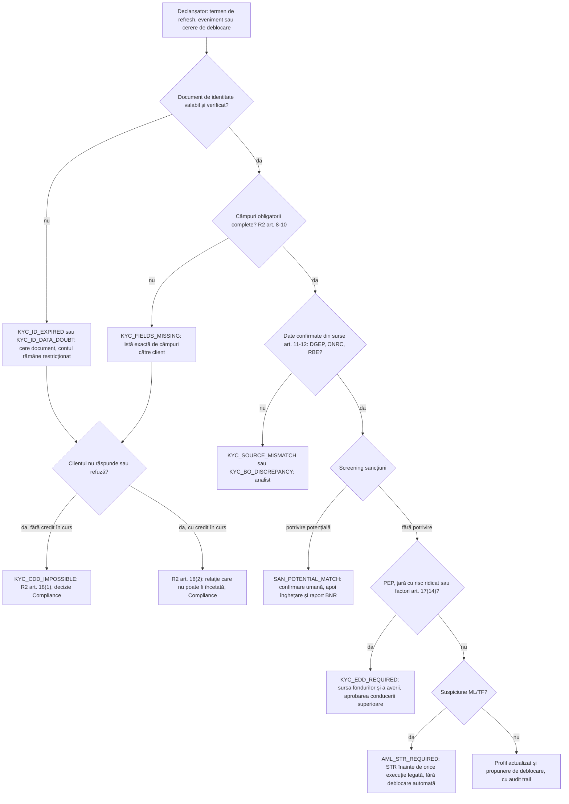
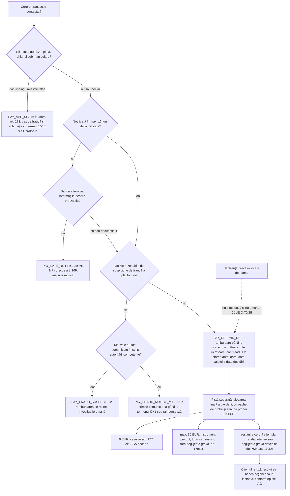
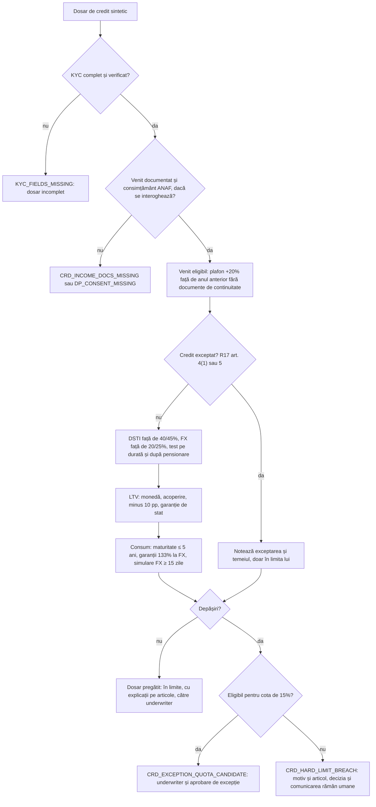

# 11 — Reguli codificabile RO/UE pentru back-office bancar: KYC/AML, sancțiuni, credit, plăți și fraude, reclamații, protecția datelor și guvernanța AI

> **Pentru cine:** dezvoltatori și agenți de cod care implementează motorul de reguli și suita de teste pentru MVP-ul NEXXT Summit 2026 (track Raiffeisen „AI for Operational Efficiency”): agent care primește un document sau date, aplică reguli predefinite și produce un rezultat sau o excepție, pe date sintetice.
> **Surse:** cercetarea echipei despre reguli KYC/AML, credit, plăți și reclamații (sursa principală, cu starea juridică verificată la 28.10.2026). Din cea despre dispute card, apărută după redactare, s-a preluat doar hotărârea CJUE C‑70/25 (PAY-03, PAY-06, PAY-15, arborele 4.2, testele aferente). Disputele card și chargeback-ul sunt tratate în [14_dispute_card_fraude.md](14_dispute_card_fraude.md).
> **Nu este aviz juridic.** Regulile [S] și [U] nu se folosesc drept blocări dure fără verificare în textul oficial și confirmare umană.

**Taguri de încredere** (preluate din note): **[P]** citit în textul oficial; **[S]** sursă secundară; **[U]** neverificat, contradictoriu sau proiect; **[P-proiect]** proiect oficial citit, neadoptat; **[Inf]** inferență de design din secțiunile „Inferences” ale notelor (nu e regulă juridică).

| Abreviere | Act | Versiunea folosită în note |
|---|---|---|
| L129 | Legea 129/2019 privind prevenirea și combaterea spălării banilor | consolidată 19.12.2025 (legislatie.just.ro) |
| R2 | Regulamentul BNR nr. 2/2019 | consolidat 25.10.2022 (modificat prin Reg. BNR 11/2022) |
| OUG202 | OUG 202/2008 privind punerea în aplicare a sancțiunilor internaționale | text consolidat ASF 18.12.2025 (ultima modificare 05.12.2025); **nu** folosiți legislatie.just.ro ID 214306, oprit la OUG 37/2019 |
| R17 | Regulamentul BNR nr. 17/2012 privind unele condiții de creditare | consolidat 25.10.2022 |
| OUG50 | OUG 50/2010 privind contractele de credit pentru consumatori | versiune nespecificată; articole citite doar secundar |
| L209 | Legea 209/2019 privind serviciile de plată | text original 2019; consolidările 20.03.2025 și 05.03.2026 nerevizuite, deci numerotarea poate diferi |
| IPR | Regulamentul (UE) 2024/886 (plăți instant, VoP) | pagina BCE |
| AMLR / AMLD6 / AMLA | Reg. (UE) 2024/1624 / Dir. (UE) 2024/1640 / Reg. (UE) 2024/1620 | surse secundare |
| CCD2 | Directiva (UE) 2023/2225 | surse secundare |
| AI Act | Regulamentul (UE) 2024/1689 | surse secundare |

**Principii pentru motor**
1. Fiecare regulă e o înregistrare cu `effective_from`/`effective_to`. Pragurile care se schimbă (15.000→10.000 EUR, „>25%”→„≥25%”) sunt versiuni separate, nu `if`-uri hard-codate. [Inf]
2. Ieșirea agentului conține fapte calculate, excepții și explicația cu articol. Rezultatele adverse (refuz de credit, încetarea relației, înghețare, STR) le decide un om. [Inf]
3. Tot ce nu provine din note e `PARAM` configurabil: calendarul de sărbători, cursul EUR/RON, fereastra „operațiunilor legate”, salariul mediu net, intervalele de refresh pe clase de risc, ora „sfârșitului zilei lucrătoare”.
4. Datele lipsă produc o excepție explicită (`*_MISSING`), niciodată o valoare presupusă.

```yaml
- id: CRD-02
  text: "DSTI ≤ 40% din venitul net lunar"
  legal_basis: {act: "Regulamentul BNR 17/2012", article: "art. 19 alin. (1)", version: "consolidat 25.10.2022"}
  confidence: P
  effective_from: 2019-01-01      # limitele DSTI introduse de Reg. BNR 6/2018 [S]
  params: {cap: 0.40}
  on_violation: CRD_DSTI_CAP_EXCEEDED
  outcome: route_to_human
```

## 1. Rezumat

- **Domeniile sunt foarte codificabile.** L129 + R2 fixează declanșatorii CDD (relație de afaceri; tranzacție ocazională ≥15.000 EUR; transfer de fonduri ≥1.000 EUR; orice suspiciune), pragul de beneficiar real (>25%), regimul PEP și câmpurile obligatorii. R17 dă plafoane numerice: DSTI 40/45%, expunere valutară 20/25%, LTV 85/80/75/60% minus 10 pp, cotă de excepție 15%. L209 dă termenele de rambursare și de răspuns la reclamații.
- **Ceasurile bune pentru demo:** rambursarea unei tranzacții neautorizate până la sfârșitul următoarei zile lucrătoare; reclamații de plăți în 15 (max. 35) zile lucrătoare; RTN/RTE în 3 zile lucrătoare; STR înainte de execuție, cu blocare 24h, suspendare ≤48h și prelungire ≤72h, iar termenele căzute în zile nelucrătoare se mută. Toate depind de un calendar de sărbători configurabil.
- **Agentul pregătește dosarul, omul decide** creditul și rezultatele KYC adverse (GDPR art. 22 + CJUE SCHUFA C‑634/21, CCD2 art. 18, AI Act Anexa III). Explicațiile trebuie să fie trasabile până la articol.
- **Regulile se versionează pe date:** CCD2 se aplică de la 20.11.2026 (peste ~3 săptămâni) fără act de transpunere găsit, deci OUG 50/2010 rămâne operativă. IPR pentru România: 9.01.2027 (primire), 9.07.2027 (trimitere + VoP), 9.06.2028. AMLR se aplică de la 10.07.2027 (refresh ≤1 an / ≤5 ani, BO ≥25%, CDD ocazional 10.000 EUR), iar AMLA supraveghează direct din 2028. AI Act Anexa III e amânată la 2.12.2027 [S/U].
- **Sancțiuni:** o potrivire potențială merge la confirmare umană. O potrivire confirmată înseamnă înghețare „fără întârziere” și raport „de îndată” către BNR. Derogările merg la ANAF.
- **Frauda s-a mutat spre plăți autorizate sub manipulare** (vishing = 42% din fraudele raportate în S1 2026), care nu intră în regimul de rambursare pentru tranzacții neautorizate. Primul pas al agentului de fraudă este clasificarea autorizat / neautorizat.
- **CJUE C‑70/25 (15.10.2026):** la o tranzacție neautorizată, neglijența gravă a clientului nu justifică refuzul sau amânarea rambursării de până la sfârșitul următoarei zile lucrătoare. Doar suspiciunea rezonabilă de fraudă a plătitorului, comunicată autorității competente, permite reținerea. Banca poate cere ulterior restituirea și trebuie să dovedească ea neglijența gravă. În motor, rambursarea și alocarea finală a pierderii sunt două piste separate.
- **Rămân goluri importante** (secțiunea 8): regimul declarației BO la ONRC, reglementarea BNR pentru sancțiuni, modificările L209 din 2025–2026, adoptarea PSR/PSD3 și publicarea în JO a modificării AI Act.

## 2. Reguli pe domenii

### 2.1 KYC / CDD (KYC-xx)

| ID | Regulă | Temei · versiune | Tag | Logica motorului | Excepție |
|---|---|---|---|---|---|
| KYC-01 | CDD standard obligatoriu la: inițierea relației; tranzacție ocazională ≥ echivalentul în lei a 15.000 EUR (una sau mai multe operațiuni legate); transfer de fonduri ocazional ≥1.000 EUR (Reg. (UE) 2023/1113) | L129 art. 13(1)(a)-(b) · 19.12.2025 | [P] | `new_relationship or linked_eur >= 15000 or (transfer_of_funds and eur >= 1000)`; prag versionat (AMLR: 10.000) | `KYC_CDD_REQUIRED` |
| KYC-02 | CDD indiferent de sumă sau exceptări la suspiciune ML/TF ori la îndoieli privind datele de identificare obținute anterior | L129 art. 13(1)(d)-(e) | [P] | `suspicion or id_data_doubt` → CDD complet | `KYC_ID_DATA_DOUBT`, `KYC_ID_EXPIRED` |
| KYC-03 | Identitatea clientului și a BO se verifică înainte de relație sau tranzacție; la entitățile supuse înregistrării BO: dovada înregistrării sau extras din registrul central | L129 art. 11(8), 11(8^1) | [P] | starea `ACTIVE` cere `id_verified`, `bo_verified`, `rbe_extract` (PJ) | `KYC_VERIFICATION_PENDING`, `KYC_RBE_PROOF_MISSING` |
| KYC-04 | Cine acționează în numele clientului: verificarea autorizării, identificare și verificare; datele reprezentantului, natura și limitele reprezentării | L129 art. 11(4); R2 art. 9 · 25.10.2022 | [P] | câmpuri reprezentant + limite documentate; verificare umană a împuternicirii | `KYC_REPRESENTATIVE_UNVERIFIED` |
| KYC-05 | Set minim de date pentru PF, BO, reprezentanți, PJ (tabelele de mai jos); set redus pentru tranzacții ocazionale | R2 art. 8-10; L129 art. 15(1^1)-(2) | [P] | validare de completitudine pe schemă | `KYC_FIELDS_MISSING` |
| KYC-06 | Verificare din documente „din categoria celor mai greu de falsificat” sau din surse independente credibile; BO-ul PJ se verifică în registrele art. 19(5) L129 | R2 art. 11-12 | [P] | fiecare câmp are `source` și `verified_at`; listă de surse permise (PARAM) | `KYC_SOURCE_MISMATCH`, `KYC_ADDRESS_UNVERIFIED` |
| KYC-07 | CDD pentru clienți existenți: pe risc și materialitate, la schimbarea circumstanțelor, la contactul din anul calendaristic pentru revizuirea BO (inclusiv L207/2015 art. 62). Frecvența refresh-ului o stabilesc normele interne, pe risc, plus actualizări pe eveniment | L129 art. 14 (mod. L86/2025); R2 art. 5(2)(e), 13(1)-(2) | [P] | `next_review = last_review + interval[risk_class]` (PARAM; preset AMLR ≤1 an / ≤5 ani) + declanșatori | `KYC_REFRESH_DUE` |
| KYC-08 | CDD simplificat doar pentru risc scăzut, după evaluare globală; identificarea și verificarea clientului și BO plus monitorizarea rămân obligatorii; interzis la suspiciune | L129 art. 16 | [P] | SDD doar dacă `risk == LOW and not suspicion` | `KYC_SDD_NOT_ALLOWED` |
| KYC-09 | EDD obligatoriu: țări cu standarde AML insuficiente sau necooperante; relații de corespondent; PEP sau client cu BO PEP, cel puțin 12 luni după funcție; persoane din țări terțe cu risc ridicat listate de CE (informații suplimentare, sursa fondurilor și a averii, aprobarea conducerii superioare, monitorizare sporită) | L129 art. 17(1), 17^1(1) | [P] | `edd = any(factori)`; activare doar după aprobare `senior_mgmt` | `KYC_EDD_REQUIRED` |
| KYC-10 | Tranzacțiile complexe, neobișnuit de mari, atipice sau fără scop economic/legal aparent se examinează; factorii de risc ridicat intră în scor | L129 art. 17(2), 17(14) | [P] | scor cu `HIGH_RISK_FACTORS`; peste prag → analist | `KYC_UNUSUAL_TX_REVIEW` |
| KYC-11 | Dacă CDD nu poate fi aplicat (inclusiv legitimitatea scopului): nu se inițiază și nu se continuă relația, nu se execută tranzacția ocazională; tratament separat pentru relațiile care nu pot fi încetate (ex. credit în curs) | R2 art. 18(1)-(2) | [P] | blocare onboarding/tranzacție; cu credit în curs → Compliance, fără încetare automată | `KYC_CDD_IMPOSSIBLE` |
| KYC-12 | BO prin deținere: persoană fizică cu 25% + 1 acțiune sau peste 25% din capital = indicator direct; aceeași deținere prin entități corporative controlate de aceeași persoană = indicator indirect. Dacă nu se identifică BO după toate diligențele, se înregistrează conducerea superioară și se documentează pașii | L129 art. 4(2)(a) | [P] | `share > 0.25` strict până la 09.07.2027; lanț indirect → `REVIEW_INDIRECT` (`bo_status()`); fallback cu jurnal | `KYC_BO_REVIEW`, `KYC_BO_FALLBACK_SMO` |
| KYC-13 | PJ furnizează informații BO adecvate, exacte și actuale; BO sunt în registrul central de la ONRC; autoritățile cu acces raportează discrepanțele | L129 art. 19(3), 19(5)(a), 19(7) | [P]; obligația băncii de a raporta discrepanța: [U] | BO declarat vs. extras RBE; orice diferență → analist | `KYC_BO_DISCREPANCY` |
| KYC-14 | PEP = funcții publice importante (art. 3(2)), fără funcții intermediare sau inferioare; lista ANI se actualizează în 5 zile de la modificări; membri de familie (3(4)) și asociați apropiați (3(5)); sisteme pe risc pentru determinarea PEP | L129 art. 3(2)-(5), 11(3) | [P] | screening client, BO, familie, asociați; potrivire → confirmare umană | `KYC_PEP_MATCH` |
| KYC-15 | Statutul PEP încetează la 1 an după ieșirea din funcție; se prelungește cu 1 an dacă persistă riscul din influența reziduală. EDD cel puțin 12 luni | L129 art. 3(6) (L86/2025, în vigoare 26.05.2025), 17(1)(c) | [P] | `pep_status_end()`; downgrade doar cu evaluare umană documentată | `KYC_PEP_STATUS_REVIEW` |
| KYC-16 | PEP: aprobarea conducerii superioare pentru inițierea sau continuarea relației; măsuri pentru sursa averii și a fondurilor (restul alineatului era trunchiat în extras) | L129 art. 17(9) | [P] | workflow cu aprobare obligatorie | `KYC_PEP_APPROVAL_MISSING` |
| KYC-17 | Relația la distanță fără garanții (identificare electronică eIDAS sau proces la distanță reglementat, recunoscut, aprobat sau acceptat de ADR) e factor de risc ridicat; video-identificarea cere consimțământ explicit pentru biometrie | L129 art. 17(14) [P]; eIDAS (Reg. (UE) 910/2014) + notificare bancă [S] | [P]/[S] | `remote and not (eidas or adr_process)` → +risc; fără consimțământ → stop | `KYC_REMOTE_HIGH_RISK` |
| KYC-18 | Interzise produsele anonime, inclusiv acceptarea cardurilor preplătite anonime; riscurile produselor și tehnologiilor noi se evaluează înainte de lansare | L129 art. 10, 25^1 (L86/2025) | [P] | validare catalog de produse | `KYC_ANONYMOUS_PRODUCT` |

**Factori de risc ridicat (L129 art. 17(14), [P])**, ca listă pentru scor:

```python
HIGH_RISK_FACTORS = [
    "circumstante_neobisnuite", "rezidenta_in_zona_cu_risc_ridicat", "vehicul_personal_de_detinere_active",
    "actionari_nominali_sau_actiuni_la_purtator", "afacere_intensiva_in_numerar", "proprietate_neobisnuit_de_complexa",
    "cetatenie_sau_rezidenta_pentru_investitori", "private_banking", "produs_care_favorizeaza_anonimatul",
    "relatie_la_distanta_fara_eidas_sau_proces_adr", "plati_de_la_terti_necunoscuti_sau_neasociati",
    "produse_sau_tehnologii_noi", "comert_petrol_arme_metale_pretioase_tutun_bunuri_culturale_fildes_specii_protejate",
    "tara_cu_sanctiuni_sau_embargo_ue_onu", "tara_care_sprijina_terorismul",
]
```

**Indicatori de risc scăzut pentru SDD (art. 16, [P]):** societăți listate supuse cerințelor de transparență; administrații și întreprinderi publice; zone cu risc scăzut (state UE, țări terțe cu sisteme AML/CFT eficiente sau corupție scăzută); asigurări de viață cu primă anuală ≤1.000 EUR sau primă unică ≤2.500 EUR; pensii fără răscumpărare anticipată; produse de incluziune financiară.

#### Date și documente obligatorii (R2, [P])

**Persoană fizică, art. 8(1).** Coloana „ocazional” urmează setul redus din art. 8(2) („a-e, j, k”). Maparea literelor pe câmpuri e dedusă din ordinea câmpurilor din note și trebuie verificată în text.

| Câmp (schemă) | Conținut | Ocazional |
|---|---|---|
| `nume`, `prenume`, `pseudonim` | nume, prenume, pseudonim | da |
| `data_nasterii`, `locul_nasterii` | data și locul nașterii | da |
| `cnp` | CNP sau identificator unic similar | da |
| `adresa`, `regim_adresa` | adresa și regimul ei (domiciliu / reședință) | da |
| `cetatenie` | cetățenie | da |
| `ocupatie`, `angajator` | ocupația și angajatorul sau natura activității proprii | nu |
| `telefon`, `fax`, `email` | dacă există | nu |
| `scop_natura_relatie` | scopul și natura relației | nu |
| `sursa_fondurilor` | sursa fondurilor care vor fi folosite | nu |
| `statut_pep` | PEP / membru de familie / asociat apropiat | da |
| `info_bo` | informații BO, dacă diferă de client | da |

**BO, art. 8(3):** `natura_relatiei_bo` (ce generează calitatea de BO), `nume`, `data_locul_nasterii`, `cnp_sau_echivalent`, `tara_rezidenta`, `cetatenie`, `natura_activitatii`, `statut_pep`.
**Reprezentant, art. 9:** `nume`, `data_locul_nasterii`, `cnp`, `adresa_regim`, `cetatenie`, `natura_limitele_reprezentarii`.
**Persoană juridică, art. 10(1) + L129 art. 15(1^1)-(2) și 11(8^1):** `denumire`, `forma_juridica`, `cui` și/sau `nr_reg_comert` (sau echivalent străin), `lei` (dacă există), `sediu_social`, `sediu_real` (cerut explicit dacă diferă), `date_contact`, `tip_natura_activitate`, `reprezentanti` (identificare + puterea de a angaja entitatea), `scop_natura_relatie`, `info_bo`, `dovada_rbe`, `traducere_legalizata` (PJ străine: actele constitutive sau de înregistrare traduse în română, legalizate).
**Surse de verificare, art. 11-12:** act de identitate cu fotografie emis de o autoritate oficială; acte constitutive înregistrate la registrul comerțului; mijloacele de identificare electronică prevăzute de L129; DGEP (evidența populației), IGI, ONRC, alte autorități publice, baze private alimentate de autorități publice; autorizații de funcționare, rapoarte de audit, documente fiscale, extrase bancare. BO-ul PJ se verifică în registrele BO.

#### Ce se schimbă — KYC

| Data | Schimbare | Tag | În motor |
|---|---|---|---|
| 26.05.2025 (în vigoare) | L86/2025: sfârșitul statutului PEP (art. 3(6)), CDD pe clienți existenți (art. 14), interdicția produselor anonime (art. 10), evaluarea produselor noi (art. 25^1); transpune art. 74 AMLD6 | [P] | deja aplicabil |
| 03.06–03.09.2026 | Consultarea AMLA privind ghidurile de monitorizare continuă (AMLR art. 26(5)); statutul final neconfirmat | [S] | parametrii de refresh pot fi rafinați |
| 10.07.2027 | AMLR se aplică direct: refresh cel puțin anual la risc ridicat și cel puțin la 5 ani în rest (art. 26(2), plafoane, nu cicluri implicite); declanșatori pe eveniment (art. 26(3)); BO „25% sau mai mult” (art. 52), cu procentele înmulțite pe fiecare lanț și însumate; CDD ocazional de la 10.000 EUR; termenul de transpunere AMLD6 | [S] | versiune nouă a KYC-01, KYC-07, KYC-12 |
| 10.07.2027 | Identificare la tranzacții ocazionale în numerar ≥3.000 EUR (art. 19(4), după un singur ghid); plafon UE de 10.000 EUR pentru plățile în numerar la comercianți (articolul citat ca 80 sau 75) | [S/U] | doar după verificare EUR-Lex |
| 01.07.2027 + 6 luni | AMLA selectează entitățile supravegheate direct | [S] | — |
| 01.01.2028 | AMLA supraveghează direct până la ~40 de grupuri (activitate în ≥6 state membre + risc rezidual ridicat); o sursă spune „până în iulie 2028” | [S] / [U] | — |
| până la 10.07.2029 | Comisia poate coborî pragul BO până la 15% pentru categorii cu risc ridicat | [S] | prag BO ca parametru |

### 2.2 AML — raportări și termene (AML-xx)

| ID | Regulă | Temei · versiune | Tag | Logica motorului | Excepție |
|---|---|---|---|---|---|
| AML-01 | STR exclusiv la ONPCSB când entitatea știe, suspectează sau are motive rezonabile să suspecteze că bunurile provin din infracțiuni sau au legătură cu finanțarea terorismului, ori că informația poate fi utilă aplicării legii; și când ONPCSB cere ca o tranzacție viitoare să fie considerată suspectă | L129 art. 6(1), 6(3) · 19.12.2025 | [P] | agentul pregătește STR și dosarul de probe; trimiterea o decide responsabilul AML [Inf] | `AML_STR_REQUIRED` |
| AML-02 | STR „de îndată” și înainte de executarea oricărei tranzacții a clientului legate de suspiciune; ONPCSB confirmă imediat prin număr de înregistrare | L129 art. 8(1)-(2) | [P] | tranzacția legată intră în `HOLD` la crearea draftului STR | `AML_TX_HOLD` |
| AML-03 | Tranzacția nu se execută 24h de la înregistrarea STR; apoi se poate executa dacă ONPCSB nu a dispus suspendarea | L129 art. 8(3) | [P] | `str_hold_until()` | `AML_TX_HOLD` |
| AML-04 | ONPCSB poate suspenda până la 48h; poate cere PÎCCJ, o singură dată, prelungirea cu până la 72h; dacă prelungirea nu e comunicată până la expirare, entitatea poate executa | L129 art. 8(4), 8(6), 8(9) | [P] | validează duratele (≤48h, ≤72h, max. o prelungire); ancora = momentul comunicat (PARAM, de verificat) | `AML_SUSPENSION_ACTIVE`, `AML_INVALID_DURATION` |
| AML-05 | Termenele în ore care cad într-o zi nelucrătoare se mută la aceeași oră din următoarea zi lucrătoare | L129 art. 8(10) | [P] | `roll_same_hour()` | — |
| AML-06 | Raportare doar electronic, pe canalele ONPCSB; raportul neconform se returnează și se corectează în 2 zile lucrătoare; cele 24h repornesc la confirmarea STR corectat | L129 art. 8(12)-(14) | [P] | `str_correction_deadline()`; hold recalculat | `AML_STR_RETURNED` |
| AML-07 | RTN: tranzacții în numerar, în lei sau valută, ≥ echivalentul în lei a 10.000 EUR, inclusiv operațiuni legate; raportează instituția prin care trec | L129 art. 7(1)-(2) | [P] | agregare pe client în fereastra „operațiuni legate” (PARAM) cu curs EUR/RON (PARAM) | `AML_RTN_DUE` |
| AML-08 | RTE: transferuri externe în și din conturi ≥10.000 EUR, inclusiv operațiuni legate; remiteri de bani ≥2.000 EUR | L129 art. 7(3), 7(5) | [P] | idem AML-07 | `AML_RTE_DUE` |
| AML-09 | Rapoartele de prag se trimit „în cel mult 3 zile lucrătoare de la momentul efectuării tranzacției”; formularele: Ordin ONPCSB 191/2023, aplicabil din 22.11.2023 (Ordin 261/2023) | L129 art. 7(7) | [P] | `threshold_report_deadline()`; alertă cu o zi înainte | `AML_REPORT_OVERDUE` |
| AML-10 | Evidențele CDD (copii acte, rezultate de monitorizare și verificare, dovezi eID) și evidențele tranzacțiilor se păstrează 5 ani de la încetarea relației sau de la tranzacția ocazională | L129 art. 21 | [P] | `retain_until = end_of_relationship + 5 ani` | `DP_RETENTION_CONFLICT` |

#### Ce se schimbă — AML

| Data | Schimbare | Tag | În motor |
|---|---|---|---|
| 10.07.2027 | AMLR art. 69: suspiciunile se raportează din proprie inițiativă, indiferent de sumă, inclusiv tentativele și cazurile în care CDD nu poate fi finalizat; răspuns la cererile FIU în 5 zile lucrătoare (FIU poate scurta sub 24h sau prelungi) | [S] | regulă pregătită, inactivă până la dată |
| 10.07.2027 | AMLR art. 71 (abținerea de la tranzacții); fereastra de 3 zile lucrătoare e citată doar secundar | [U] | păstrați logica L129 art. 8 |
| necunoscut | Dacă RTN/RTE naționale rămân după AMLR; transpunerea AMLD6 dincolo de art. 74 | gol | flag de configurare |

### 2.3 Sancțiuni internaționale (SAN-xx)

| ID | Regulă | Temei · versiune | Tag | Logica motorului | Excepție |
|---|---|---|---|---|---|
| SAN-01 | Orice persoană exercită diligență, pe baza informațiilor și instrumentelor disponibile, ca tranzacțiile să respecte sancțiunile internaționale, inclusiv înghețarea, ținând cont de ghidurile autorităților internaționale | OUG202 art. 18(1) · ASF 18.12.2025 | [P] | screening client, BO, contrapartide, plăți vs. listele UE/ONU (sursă și frecvență PARAM); rezultat `NO_MATCH` / `POTENTIAL` / `CONFIRMED` (ultimul doar de om) | `SAN_POTENTIAL_MATCH` |
| SAN-02 | Cine are o relație juridică cu un bun supus înghețării îngheață fondurile și resursele economice „fără întârziere” și raportează „de îndată” autorităților competente | OUG202 art. 24(1) | [P] | la `CONFIRMED`: blocare fonduri + draft raport | `SAN_FREEZE_REQUIRED` |
| SAN-03 | BNR este autoritatea competentă pentru înghețare, restricțiile privind proliferarea și sancțiunile financiar-bancare la instituțiile de credit (și sucursale), IP, IEM și IFN din registrul special | OUG202 art. 12(1)(o) | [P] | destinatar raport = BNR, nu ONPCSB | — |
| SAN-04 | ANAF decide cererile de derogare de la înghețare și de la interdicția de a pune fonduri la dispoziție, plus autorizările din sancțiunile sectoriale financiare | OUG202 art. 12(1)(p) | [P] | cererea clientului de eliberare a fondurilor → rutare ANAF | `SAN_DEROGATION_ROUTE_ANAF` |
| SAN-05 | Măsurile de implementare se raportează autorităților competente: persoane, tranzacții, descrierea și valoarea totală a bunurilor, în formatul stabilit de autorități; procedurile și sistemele de monitorizare urmează reglementările supraveghetorului | OUG202 art. 18(2)-(4) | [P]; formatul BNR neidentificat | schemă de raport cu aceste câmpuri minime; format final PARAM | `SAN_REPORT_INCOMPLETE` |
| SAN-06 | Unele regimuri UE cer notificarea MAE pentru transferurile în afara UE ale entităților române deținute de persoane din statele vizate; instituțiile de credit le raportează periodic supraveghetorului | OUG202 art. 18(5)-(6) | [P] | flag pe PJ cu proprietari din state vizate + transfer non-UE | `SAN_NON_EU_TRANSFER_NOTICE` |
| SAN-07 | Cine are informații despre persoane sau bunuri sancționate și nu are obligație proprie de înghețare notifică autoritatea competentă de la luarea la cunoștință; confidențialitatea nu poate fi opusă organelor de urmărire penală, instanțelor, autorităților competente, ONU/UE etc. | OUG202 art. 7(1)-(2), 20(2) | [P] | secretul bancar nu blochează răspunsul către autorități | — |
| SAN-08 | PSP care oferă transferuri instant verifică cel puțin zilnic utilizatorii față de măsurile restrictive financiare țintite ale UE (pagina BCE nu dă o dată separată) | IPR | [P] | job zilnic de re-screening + la fiecare actualizare de listă | `SAN_DAILY_SCREEN_MISSED` |
| SAN-09 | Potrivirile de nume dau frecvent fals pozitive, deci agentul semnalează și omul confirmă; pe lângă raportul către BNR poate fi necesar un STR la ONPCSB dacă există suspiciune ML/TF | inferență din note | [Inf] | plata cu potrivire potențială rămâne în așteptare până la confirmare (alegere de design) | `SAN_POTENTIAL_MATCH` |

#### Ce se schimbă — sancțiuni

| Data | Schimbare | Tag | În motor |
|---|---|---|---|
| 19.12.2025 | Legea 224/2025 schimbă definiția persoanei/entității desemnate (text necitit) | [S] | verificați definiția înainte de a o modela |
| 08.05.2026 | Ordin ONPCSB 64/2026, doar pentru entitățile supravegheate de ONPCSB (nu bănci): verificarea listelor UE și ONU publicate de Oficiu, monitorizarea contrapartidelor la schimbarea regimurilor, raport pe formularul din Anexa 2 | [P] | util doar ca model de flux |
| în lucru | Proiect de HG care abrogă HG 603/2011 | [P] | — |
| 9.01.2027 / 9.07.2027 | Calendarul IPR pentru România (PAY-14) face screening-ul zilnic obligatoriu în practică pentru plățile instant | [P] | SAN-08 activ odată cu oferta de plăți instant |

### 2.4 Credit (CRD-xx)

| ID | Regulă | Temei · versiune | Tag | Logica motorului | Excepție |
|---|---|---|---|---|---|
| CRD-01 | DSTI („gradul total de îndatorare”) = obligații lunare din credite și alte finanțări rambursabile ÷ venit net lunar; la rate neegale se ia cea mai mare rată pe durata creditului; revolving-ul contează cu cel puțin 3% din limita aprobată | R17 art. 13 · 25.10.2022 | [P] | `Debt.counted()` (sec. 3) | `CRD_DATA_MISSING` |
| CRD-02 | DSTI ≤40% | R17 art. 19(1) | [P] | comparație pe valoarea nerotunjită | `CRD_DSTI_CAP_EXCEEDED` |
| CRD-03 | DSTI ≤45% pentru primul credit pentru investiții imobiliare destinat achiziției unei locuințe folosite de debitor, dacă acesta nu deține și nu a deținut o locuință | R17 art. 19(2) | [P] | toate condițiile din `first_home_45()`; dacă lipsește una → 40% | `CRD_DSTI_CAP_EXCEEDED` |
| CRD-04 | Credite în valută sau indexate la valută, debitori neacoperiți natural: obligațiile în valută ≤20% din venitul net (≤25% în cazul CRD-03) | R17 art. 19(3) | [P] | `fx_ratio` calculat separat | `CRD_FX_CAP_EXCEEDED` |
| CRD-05 | La acordare, creditorul trebuie să fie convins că DSTI va rămâne probabil în plafon pe toată durata, inclusiv după data estimată de pensionare | R17 art. 14 | [P] | dacă scadența depășește pensionarea: recalcul cu venitul estimat (metodă PARAM) | `CRD_OVER_TERM_RISK` |
| CRD-06 | Cota de excepție: plafoanele art. 19 pot fi depășite pentru max. 15% din volumul mediu trimestrial al ultimelor 4 trimestre, separat consum / imobiliar; nu pentru credite > echivalentul a 250.000 EUR; doar categorii cu venit ≥ salariul mediu net pe economie, adecvate conform datelor istorice; raport trimestrial la BNR în 25 de zile; BNR poate opri utilizarea; plafoanele interne țin cont de riscul valutar, de dobândă și de scădere a venitului | R17 art. 20 | [P] | doar rutare (`exception_quota_route()`); consumul cotei îl gestionează omul | `CRD_EXCEPTION_QUOTA_CANDIDATE`, `CRD_HARD_LIMIT_BREACH` |
| CRD-07 | LTV la creditele pentru investiții imobiliare: ≤85% în lei; ≤80% în valută cu venit eligibil în moneda creditului; debitori neacoperiți: ≤75% (EUR), ≤60% (alte valute) | R17 art. 18 | [P] | `ltv_cap_pp()` + `check_ltv()` | `CRD_LTV_CAP_EXCEEDED` |
| CRD-08 | Plafoanele se aplică pe baza declarației pe propria răspundere că solicitantul nu deține locuință (verificată, ex. în baze de tip birou de credit); dacă deține, plafonul scade cu 10 pp | R17 art. 18(3^1)-(3^2) | [P] | declarație vs. verificare; nepotrivire → −10 pp + clarificare | `CRD_HOME_OWNERSHIP_MISMATCH` |
| CRD-09 | Leasing imobiliar: plafonul se raportează la valoarea bunului finanțat; plafoanele LTV nu se aplică creditelor garantate total sau parțial de stat | R17 art. 18(5) | [P] | `state_guaranteed` → plafon `None`; DSTI se aplică în continuare | — |
| CRD-10 | Credite de consum în valută: garanții ≥133% din credit (asigurarea de neplată contează ca garanție personală); overdraft-urile și cardurile de credit până la 3× venitul net lunar sunt exceptate | R17 art. 16 | [P] | `guarantees * 100 >= loan * 133` | `CRD_FX_GUARANTEE_SHORTFALL` |
| CRD-11 | Maturitatea creditului de consum ≤5 ani, cu excepția creditelor în lei cu destinație imobiliară și avans dovedit ≥40%; revolving-ul pe card poate depăși 5 ani doar cu reevaluare cel puțin o dată la 5 ani | R17 art. 17 | [P] | `consumer_tenor_ok()` | `CRD_TENOR_EXCEEDED` |
| CRD-12 | Venitul eligibil curent nu poate depăși cu mai mult de 20% venitul anului anterior (stabilit din documente declarate fiscal și/sau încasări în conturile de la creditor), decât cu documente de continuitate (promovare, loc de muncă nou, creșterea afacerii) | R17 art. 15 | [P] | `eligible_income()` plafonează și cere documente | `CRD_INCOME_GROWTH_DOCS_REQUIRED` |
| CRD-13 | Normele interne definesc categoriile de venit eligibil și coeficienții de ajustare după certitudine și permanență; coeficienții nu se aplică salariului din contract de muncă pe durată nedeterminată | R17 art. 12(1)(d) | [P] | tabel PARAM `income_haircut[type]`, forțat la 1,0 pentru CIM nedeterminat | `CRD_HAIRCUT_INVALID` |
| CRD-14 | Evaluarea bonității se face înainte de contract și la majorarea sumei (fără reevaluare dacă evaluarea inițială acoperea majorarea și datele au ≤30 de zile); co-debitorii se evaluează agregat; decizia e clară, documentată, cu termen maxim de valabilitate; se bazează predominant pe venit, garanția e secundară; datele se verifică rezonabil, inclusiv din surse independente; informațiile se păstrează cel puțin pe durata creditului, cu istoricul de venit disponibil imediat BNR | R17 art. 11^1-11^4 | [P] | `assessment.valid_until`; date >30 zile la majorare → reevaluare; jurnal de verificări | `CRD_ASSESSMENT_EXPIRED`, `CRD_INCOME_DOCS_MISSING` |
| CRD-15 | Debitorii neacoperiți la credite în valută primesc, pe hârtie sau suport durabil, cu cel puțin 15 zile calendaristice înainte de contractare (reductibil la cererea scrisă a solicitantului), o simulare personalizată a plăților la o depreciere severă a leului (combinată cu creșterea dobânzii la dobândă variabilă) | R17 art. 7-9 | [P] | `fx_illustration_ok()` | `CRD_FX_ILLUSTRATION_TOO_LATE` |
| CRD-16 | Exceptate de la capitolele DSTI/LTV: credite pentru studii, cheltuieli medicale sau funerare; credite integral colateralizate cu numerar la creditor (pentru suma acoperită); restructurări la același creditor pentru dificultăți financiare; credite rambursate din subvenții; restructurări prin facilități de stat; conversii din valută în lei sau în moneda venitului; preluări la decesul debitorului sau la partaj. Refinanțarea datoriilor contractate înainte de Reg. 5/2020 și Reg. 6/2018 e exclusă de la art. 16-19 pentru acele sume | R17 art. 4(1), 5 | [P] | `exemption_code` cu temei, aplicat doar în limita temeiului | `CRD_EXEMPTION_APPLIED` (info) |
| CRD-17 | Creditorul răspunde în scris în 30 de zile de la depunerea dosarului, dar nu mai târziu de 60 de zile de la cererea de credit | OUG50 art. 20(1) · versiune nespecificată | [S] | `credit_answer_deadline()` | `CRD_ANSWER_DEADLINE_RISK` |
| CRD-18 | Noua Casă (ghidul FNGCIMM 2025; cel din 2026 nepublicat la 18.05.2026): locuință ≤70.000 EUR → avans min. 5%, garanție max. 50%; 70.001–140.000 EUR → doar locuințe noi (documente de finalizare ≤5 ani), avans min. 15%, garanție max. 60%; IRCC + marjă fixă ~2 pp; max. 30 de ani; solicitantul nu deține locuință (singur sau cu soțul) sau deține max. una sub 50 mp necumpărată prin Prima Casă/Noua Casă; fără limită de vârstă; se aplică și criteriile băncii | ghid FNGCIMM 2025, prin presă; temeiul (OUG 60/2009 + HG) necitit | [S] | tabel de eligibilitate separat; LTV din R17 nu se aplică (CRD-09) | `CRD_STATE_PROGRAM_INELIGIBLE`, `CRD_GUARANTEE_CEILING_RISK` |

Plafonul DAE pentru IFN (27 pp peste rata facilității de creditare BNR; 8 pp la creditele de tip ipotecar) vizează doar IFN-urile, iar numărul legii nu a fost verificat [S]. Nu se modelează pentru o bancă.

**Documente și date pentru dosarul de credit**
- Venit: date ANAF cu consimțământul clientului (protocoale bancă–ANAF din ~2015; unele bănci nu mai cer adeverință de venit salariaților); celelalte tipuri de venit cu documente [S]. Documente de continuitate dacă venitul crește cu peste 20% (CRD-12) [P].
- Setul KYC din 2.1 [P]; istoricul din Biroul de Credit (DP-06) [S].
- Declarația pe propria răspundere privind locuința și verificarea ei (CRD-08); dovada predării simulării FX (CRD-15); dovada avansului ≥40% (CRD-11); garanțiile ≥133% (CRD-10) [P].

**Motive frecvente de respingere sau dosar incomplet [S]:** venit în numerar fără fluturaș sau extras; activitate independentă neînregistrată (fără PFA); dividende sau chirii nedeclarate; venit din străinătate la creditori care acceptă doar venit intern; venit absent din baza ANAF (ex. muncă în străinătate); istoric negativ la Biroul de Credit; DSTI depășit cu noua rată; documente incomplete, greșite sau inconsecvente. Creditorii adesea nu spun ce regulă au aplicat. Fiecare motiv devine în motor o excepție cu mesaj și cerere de document, nu un refuz.

#### Ce se schimbă — credit

| Data | Schimbare | Tag | În motor |
|---|---|---|---|
| 20.11.2026 | CCD2 se aplică (termenul de transpunere a fost 20.11.2025). Niciun act românesc găsit la final de octombrie 2026; CE a deschis procedura de infringement. Proiectul „OUG-CREDIT” (mai 2025, 9 capitole) prevede plafoane la dobânzile penalizatoare, comisioane fixe pe benzi în locul celor procentuale, limite la publicitate, consiliere pentru datorii, retragere în 14 zile, rambursare anticipată. AURSF (feb. 2026) cere plafon DAE și pentru bănci, motiv specific la refuz, consiliere gratuită, actualizări instant la Biroul de Credit | [S] | OUG 50/2010 și OUG 52/2016 (consolidată 22.05.2025 [S]) rămân active; set CCD2 configurabil, cu `effective_from` = data actului român |
| 20.08.2026 (metadate PDF) | Proiect BNR de modificare a R17: credite garantate cu titluri emise de guverne centrale sau bănci centrale din UE (art. 17^1 nou): credit ≤80% din valoarea de piață, minus ≥10 pp dacă titlurile se cumpără din credit, minus încă ≥10 pp (titluri în EUR/USD) sau ≥20 pp (alte valute) la nepotrivire valutară; scadența reziduală a titlurilor ≥ scadența creditului; reevaluare zilnică; pot depăși DSTI (art. 20(1)(c) nou); venitul din titluri se poate lua în calcul (art. 11^4(2^1) nou); formular trimestrial nr. 1 | [P-proiect] | feature flag oprit; adoptarea neconfirmată |
| 11.09.2026 | Proiect de ordin ANAF: consimțământ electronic, inclusiv prin SPV, pentru accesul băncilor și IFN la datele de venit; încă neaplicabil | [S/U] | păstrați fluxul actual de consimțământ |
| 2026 | Noua Casă continuă: plafon de garantare 500 mil. lei, în plafonul total de 25 mld. lei din Legea 42/2026 | [S] | excepție operațională „plafon de garantare epuizat” |
| nedatat | Snippet de presă: DSTI 50% la ipotecare în lei cu dobândă fixă și 35% în rest, „de la 1 iulie” | [U] | **nu implementați** |

### 2.5 Plăți, fraude, PSD2 (PAY-xx)

| ID | Regulă | Temei · versiune | Tag | Logica motorului | Excepție |
|---|---|---|---|---|---|
| PAY-01 | Utilizatorul notifică fără întârziere nejustificată, dar cel târziu la 13 luni de la data debitării; limita nu se aplică dacă PSP nu a furnizat informațiile obligatorii despre tranzacție. Opinia AG Rantos în C‑70/25 confirmă: peste 13 luni nu mai există obligația de rambursare imediată | L209 art. 169 · text 2019; opinia AG, 5.03.2026 | [P]; opinia AG: [P — comunicat CURIA 31/26] | `unauthorised_claim_in_time()` | `PAY_LATE_NOTIFICATION` |
| PAY-02 | Dacă utilizatorul neagă autorizarea, PSP dovedește că tranzacția a fost autentificată, înregistrată corect, contabilizată și neafectată de o defecțiune tehnică; simpla utilizare a instrumentului nu e neapărat suficientă; sarcina probei pentru fraudă sau neglijență gravă revine PSP | L209 art. 171-172 | [P] | pachet de probe obligatoriu (loguri de autentificare/SCA, înregistrare, contabilizare, stare tehnică); lipsă → nu se impută clientului | `PAY_SCA_EVIDENCE_MISSING` |
| PAY-03 | Pentru o tranzacție neautorizată, PSP rambursează imediat sau cel târziu la sfârșitul următoarei zile lucrătoare după constatare sau notificare, readuce contul la starea anterioară, cu data valutei cel târziu data debitării. Singura excepție: motive rezonabile de suspiciune de fraudă a plătitorului, comunicate în scris autorității naționale competente (CJUE C‑70/25: neglijența gravă nu e excepție, vezi PAY-15). La fel când e implicat un PISP | L209 art. 173-174 · text 2019; CJUE C‑70/25 | [P]; C‑70/25: [P — comunicat CURIA 147/26] | `psd2_refund_deadline()` + `refund_can_be_withheld()`; suspiciune → om + notificare scrisă înainte de termen | `PAY_REFUND_DUE`, `PAY_FRAUD_SUSPECTED`, `PAY_FRAUD_NOTICE_MISSING` |
| PAY-04 | Plătitorul care nu a acționat fraudulos nu suportă pierderi dacă: (a) pierderea, furtul sau însușirea nu puteau fi detectate înainte de plată; (b) pierderea e cauzată de personalul, agenții, sucursalele sau externalizații PSP; (c) după notificarea pierderii sau furtului; (d) PSP nu solicită SCA; (e) PSP nu oferă mijloace de notificare permanentă | L209 art. 177 | [P] | `art177_case` → răspundere 0 | — |
| PAY-05 | Plătitorul suportă „cel mult 30 euro sau echivalentul în lei” pentru un instrument pierdut, furat sau însușit, dacă nu a acționat fraudulos și nu a încălcat intenționat obligațiile din art. 166 | L209 art. 179(1) | [P] | `payer_liability_eur()` | — |
| PAY-06 | Plătitorul suportă toate pierderile cauzate de fraudă ori de încălcarea intenționată sau din neglijență gravă a obligațiilor din art. 166 (utilizare conform termenilor, notificare fără întârziere, păstrarea în siguranță a elementelor de securitate); se ține cont de natura elementelor de securitate și de circumstanțe | L209 art. 179(2)-(3) | [P] | doar pe pista de recuperare de după rambursare (PAY-15), cu probe documentate (PAY-02) și decizie umană; niciodată motiv de refuz sau amânare a rambursării | `PAY_RECOVERY_REVIEW` |
| PAY-07 | Dacă beneficiarul sau PSP-ul lui nu acceptă SCA, rambursează prejudiciul cauzat PSP-ului plătitorului | L209 art. 178 | [P] | flag de recuperare | `PAY_RECOVERY_FROM_PAYEE_PSP` |
| PAY-08 | SCA la accesarea online a contului, la inițierea unei plăți electronice și la orice acțiune la distanță cu risc de fraudă; plățile electronice la distanță cer legare dinamică de sumă și beneficiar; SCA = cel puțin 2 elemente independente (cunoaștere, posesie, inerență) | L209 art. 220 | [P] | log obligatoriu: `sca_applied`, `factors`, `dynamic_link`; exceptările din RTS SCA nu sunt în note | `PAY_SCA_EVIDENCE_MISSING` |
| PAY-09 | Pre-autorizare card: fondurile se blochează doar cu acordul pentru suma exactă și se deblochează fără întârziere când suma e cunoscută, cel târziu imediat după primirea ordinului | L209 art. 180-181 | [P] | reclamație „sumă blocată” → verifică acordul și momentul deblocării | `PAY_PREAUTH_RELEASE_LATE` |
| PAY-10 | Debitare directă și plăți inițiate de beneficiar: cerere de rambursare în 8 săptămâni de la debitare; în 10 zile lucrătoare PSP rambursează integral sau motivează refuzul, indicând organismele de sesizare (art. 222); fără drept de refuz pentru debitările directe din art. 182(5) | L209 art. 182-185 | [P] | `direct_debit_refund_due()` | `PAY_DD_WINDOW_EXPIRED` |
| PAY-11 | Execuție: suma ajunge la PSP-ul beneficiarului până la sfârșitul următoarei zile lucrătoare (+1 zi lucrătoare pentru ordinele pe hârtie) | L209 art. 195 | [P] | reclamație „transfer întârziat” → calcul automat | `PAY_EXECUTION_LATE` |
| PAY-12 | Plata autorizată de client sub manipulare (APP scam) nu intră automat în regimul de rambursare pentru tranzacții neautorizate; există excepții când PSP suspectează frauda clientului | ghid de consum (Bitdefender) | [S] | clasificare autorizat / neautorizat înaintea oricărui calcul | `PAY_APP_SCAM` |
| PAY-13 | Chargeback (reguli de schemă, nu lege): în general până la 120 de zile de la tranzacție sau livrarea așteptată (unele coduri de fraudă mai puțin, unele coduri Visa până la 540 de zile); comerciantul răspunde în 30 (Visa) sau 45 (Mastercard) de zile; băncile din RO cer adesea plângere la poliție pentru clonare sau tranzacții neautorizate | surse secundare | [S] | tabel PARAM pe schemă și cod de motiv; detalii în [14_dispute_card_fraude.md](14_dispute_card_fraude.md) | `PAY_CHARGEBACK_WINDOW` |
| PAY-14 | IPR, stat non-euro: primire de plăți instant în euro până la 9.01.2027 (IEM/IP: 9.04.2027); trimitere până la 9.07.2027; VoP până la 9.07.2027; tarif ≤ transferul standard până la 9.01.2027; trimitere în afara programului pentru conturi în monedă națională până la 9.06.2028. VoP: potrivire / nepotrivire / potrivire apropiată, iar plătitorul decide [S]. În RON există azi doar SANB, opțional (prenume + inițiala numelui, numai dacă ambele bănci participă) [S] | IPR (BCE) [P]; VoP, SANB [S] | [P]/[S] | regulă versionată pe dată; Osborne Clarke indică VoP pentru IEM/IP din 9.10.2025, în conflict cu data de mai sus [S/U] | `PAY_VOP_NO_MATCH`, `PAY_VOP_CLOSE_MATCH` |
| PAY-15 | Neglijența gravă a clientului (ex. date introduse pe un site fals al băncii) nu dă dreptul PSP să refuze sau să amâne rambursarea D+1. Rambursarea și alocarea finală a pierderii sunt chestiuni separate: ulterior, PSP poate cere restituirea dacă dovedește intenția sau neglijența gravă, iar sarcina probei îi revine. Dacă clientul refuză restituirea, banca trebuie să meargă ea în instanță (opinia AG). Comentatorii avertizează că hotărârea nu se extinde automat la orice formă de fraudă bancară [S] | CJUE C‑70/25 Tukowiecka, hotărârea din 15.10.2026 (PSD2 art. 73, transpus prin L209 art. 173) | [P — comunicat CURIA 147/26]; opinia AG: [P — comunicat CURIA 31/26] | neglijența gravă nu este intrare în `refund_can_be_withheld()`; după rambursare se deschide pista de recuperare cu pachet de probe; un status „refuzat pentru neglijență gravă” e blocat | `PAY_REFUSAL_ON_GN_BLOCKED`, `PAY_RECOVERY_REVIEW` |

**Date minime pentru o cerere de rambursare:** `debit_date`, `notified_at`, `channel`, `instrument_type` (card / transfer / debitare directă), `client_says` (autorizat / neautorizat / autorizat sub manipulare), `sca_required`, `sca_applied` + loguri (factori, legare dinamică), `technical_incident`, `loss_theft_notified_at`, `tx_info_provided` (pentru art. 169), `fraud_suspicion` + motive, `amount_eur`, `police_report` (practică [S]; art. 173 și C‑70/25 admit o singură excepție, suspiciunea de fraudă), `fraud_grounds_sent_at` (comunicarea scrisă către autoritate), `recovery_track` (deschisă după rambursare; aici intră `gross_negligence_alleged` și probele, nu în decizia de rambursare), `scheme` + `reason_code` (chargeback, vezi doc 14).

#### Ce se schimbă — plăți

| Data | Schimbare | Tag | În motor |
|---|---|---|---|
| 15.10.2026 (deja aplicabil) | CJUE C‑70/25: neglijența gravă nu justifică refuzul sau amânarea rambursării D+1; recuperare ulterioară, cu sarcina probei pe PSP. Cazurile documentate de CSALB în 2026 arată că băncile din RO refuzau sau închideau astfel de cereri; acum e o practică cu risc ridicat | [P — comunicat CURIA 147/26] | PAY-15 activ; refuzurile pe motiv de neglijență gravă sunt blocate |
| 9.01.2027 | IPR: primire de plăți instant în euro; paritate de tarif | [P] | regulă activă de la dată |
| 9.04.2027 | IPR: primire pentru IEM/IP | [P] | — |
| 9.07.2027 | IPR: trimitere + VoP (conflict privind data pentru IEM/IP) | [P] / [S/U] | `PAY-14` cu `effective_from` |
| 9.06.2028 | IPR: trimitere în afara programului, conturi în monedă națională | [P] | — |
| ~S1 2028 | PSR/PSD3: acord politic 27.11.2025; texte de compromis 23.04.2026; ECON în mai 2026; adoptarea și JO neconfirmate; aplicare estimată la 18–21 luni de la intrarea în vigoare. Conținut: PSP rambursează clienții înșelați de fraudatori care se dau drept angajați ai PSP, dacă clientul a depus plângere la poliție și a notificat PSP; extinderea la uzurparea oricărei entități a căzut; platformele online răspund față de PSP dacă nu elimină conținutul fraudulos notificat | [S/U] | regulă `PAY_PSR_IMPERSONATION` pregătită, inactivă |
| — | Consolidările L209 din 20.03.2025 și 05.03.2026 (și rolul Legii 239/2025) nerevizuite | gol | verificați numerotarea articolelor |

### 2.6 Reclamații (CMP-xx)

| ID | Regulă | Temei · versiune | Tag | Logica motorului | Excepție |
|---|---|---|---|---|---|
| CMP-01 | Reclamațiile privind serviciile de plată primesc răspuns pe hârtie sau pe alt suport durabil convenit, care tratează toate punctele, „nu mai târziu de 15 zile lucrătoare de la data primirii plângerii” | L209 art. 224 · text 2019 | [P] | ceasul pornește la `received_at` (nu la data poștei); `payment_complaint_deadlines()` | `CMP_DEADLINE_RISK` |
| CMP-02 | În situații excepționale, independente de PSP: răspuns intermediar cu motivele întârzierii și data răspunsului final, care nu poate depăși 35 de zile lucrătoare de la primire | L209 art. 224 | [P] | prelungire doar cu `holding_reply_sent` + `delay_reason` | `CMP_HOLDING_REPLY_REQUIRED` |
| CMP-03 | PSP informează utilizatorii, clar, pe site, în unități și în condițiile generale, despre dreptul de a sesiza ANPC, ANAF, BNR și entitatea SAL competentă (Legea 192/2006 sau OG 38/2015); refuzul rambursării la debitare directă indică organismele de sesizare | L209 art. 225, 185(2) | [P] | bloc informativ obligatoriu în orice răspuns final [Inf]; fără el, răspunsul nu pleacă | `CMP_ADR_BLOCK_MISSING` |
| CMP-04 | Reclamațiile la credit de consum se primesc și se înregistrează; creditorul ia toate măsurile pentru răspuns în max. 30 de zile de la înregistrare și pentru remedierea prejudiciului; ANPC sancționează nerespectarea | OUG50 art. 42 | [S] | `credit_complaint_deadline()` (zile calendaristice = inferență din note) | `CMP_DEADLINE_RISK` |
| CMP-05 | Ghidurile comune EBA/ESMA (JC 2014 43, actualizate prin JC 2018 35): politică și funcție de gestionare a reclamațiilor, înregistrare, raportare, urmărire internă, informarea reclamanților, proceduri de răspuns; extinse de EBA la administratorii de credite (Dir. (UE) 2021/2167) | JC 2018 35 | [S] | registru de reclamații cu câmpuri de raportare | — |
| CMP-06 | CSALB: gratuit; negociere sub 3 luni, max. 90 de zile (limită legală); conciliator acceptat de ambele părți; acordul are „puterea unei hotărâri în instanță”; cererile de ștergere din Biroul de Credit nu se negociază prin CSALB; dosarul se închide dacă consumatorul nu răspunde în 90 de zile | comunicate și rapoarte CSALB | [S/P] | cerere Biroul de Credit → proces intern de corecție | `CMP_ROUTE_INTERNAL_CORRECTION` |
| CMP-07 | Triajul începe cu clasificarea pe produs și temei legal, care alege ceasul (plăți 15/35 zile lucrătoare; credit de consum 30 de zile; debitare directă 10 zile lucrătoare). Practică de piață: BCR — 30 de zile, prelungibile cu max. 15 în cazuri justificate; BNP Paribas RO — confirmare de primire în 2 zile lucrătoare | inferență + pagini de bancă | [Inf]/[S] | `complaint_type` obligatoriu; SLA intern ≤ termenul legal (PARAM) | `CMP_UNCLASSIFIED` |

**Date minime pentru o reclamație:** `received_at`, `registered_at`, `channel` (poștă / e-mail / unitate / aplicație), `product`, `legal_basis`, `holding_reply_sent_at`, `delay_reason`, `final_answer_at`, `durable_medium`, `adr_block_included`.

**Ce se schimbă — reclamații:** nu se știe dacă transpunerea CCD2 (după 20.11.2026) schimbă termenul de 30 de zile la creditul de consum. Nu s-a găsit un regulament BNR dedicat reclamațiilor la instituțiile de credit.

### 2.7 Protecția datelor și guvernanța AI (DP-xx)

| ID | Regulă | Temei · versiune | Tag | Logica motorului | Excepție |
|---|---|---|---|---|---|
| DP-01 | Secretul bancar acoperă faptele, datele și informațiile despre activitatea instituției și despre clienți (inclusiv cei cu care s-a negociat fără contract, actuali sau foști); se extinde la cei care obțin informațiile din rapoartele instituției; personalul nu le folosește în interes propriu; divulgare permisă, de ex., cu autorizarea procurorului și pentru supraveghere consolidată și AML/CFT | OUG 99/2006 art. 111-115 (dicționar juridic) | [S] | doar date sintetice; jurnal de acces; nicio dată reală în prompturi | `DP_REAL_DATA_DETECTED` |
| DP-02 | Calculul unui scor de credit e decizie individuală automată (GDPR art. 22) când un terț „se bazează puternic” pe el pentru a încheia, executa sau înceta un contract; Curtea a respins argumentul „act pregătitor” (risc de eludare) | GDPR art. 22; CJUE C‑634/21 SCHUFA (7.12.2023) | [S] | agentul nu emite „aprobat/respins”; recenzorul are autoritate și informații reale ca să se abată [Inf] | `DP_HUMAN_REVIEW_REQUIRED` |
| DP-03 | Persoana vizată primește o explicație concisă, transparentă, inteligibilă și ușor accesibilă a procedurii și principiilor aplicate efectiv pentru profilul său | CJUE C‑203/22 Dun & Bradstreet Austria (27.02.2025) | [S] | fiecare excepție are `rule_id`, articol și `explanation` | `DP_EXPLANATION_MISSING` |
| DP-04 | La evaluarea automată a bonității, consumatorul poate cere intervenție umană și o explicație clară (logică și riscuri), își poate exprima punctul de vedere și poate contesta; trebuie informat despre aceste drepturi | CCD2 art. 18 (aplicare 20.11.2026; transpunere RO negăsită) | [S] | canal „cer revizuire umană” + text de informare în flux | `DP_CCD2_RIGHTS_NOTICE_MISSING` |
| DP-05 | Evaluarea bonității și scoringul de credit sunt utilizări cu risc ridicat (Anexa III) | AI Act | [S/U] (date) | documentație, logare și supraveghere umană încă din proiectare | — |
| DP-06 | Biroul de Credit: date negative doar după 30 de zile de întârziere și cu notificare prealabilă cu cel puțin 15 zile (în scris, telefon, SMS sau e-mail); fără raportări negative repetate în aceeași lună; păstrare raportată de 4 ani | Decizia ANSPDCP 105/2007 (text primar necitit) | [S] | verificare `dpd` + `notice_sent_at` înainte de raportare; pragul exact „după 30 de zile” e de verificat | `DP_CB_REPORT_PREMATURE` |
| DP-07 | Datele de venit de la ANAF se obțin doar cu consimțământul contribuabilului (semnat la bancă, pe hârtie sau electronic) | protocoale bancă–ANAF (presă) | [S] | fără `anaf_consent` → nicio interogare, documente alternative | `DP_CONSENT_MISSING` |
| DP-08 | Retenție: evidențele AML 5 ani de la încetarea relației; informațiile din spatele aprobării creditului cel puțin pe durata creditului, cu istoricul de venit disponibil imediat BNR | L129 art. 21; R17 art. 11^3(3)-(4) | [P] | politică de retenție pe tip de document; minimizarea GDPR nu scurtează aceste termene | `DP_RETENTION_CONFLICT` |
| DP-09 | Identificarea video la distanță se bazează pe R2 + eIDAS și cere consimțământ explicit pentru datele biometrice | notificare GDPR Libra Bank | [S] | `biometric_consent` înainte de captură | `DP_BIOMETRIC_CONSENT_MISSING` |
| DP-10 | Model sigur: suport de decizie, iar omul decide orice rezultat advers de credit sau KYC; explicații pe reguli; date sintetice din cauza secretului bancar | inferență din note | [Inf] | arhitectura din secțiunea 4 | — |

#### Ce se schimbă — date și AI

| Data | Schimbare | Tag |
|---|---|---|
| 20.11.2026 | CCD2 art. 18 aplicabil, fără transpunere RO găsită | [S] |
| 2.12.2027 | AI Act: obligațiile pentru Anexa III (inclusiv evaluarea bonității) amânate de la 2.08.2026 prin Digital Omnibus, adoptat ca Regulamentul (UE) 2026/1744 (acord 7.05.2026, Parlament 16.06.2026, Consiliu 29.06.2026; publicat în JO pe 24.07.2026, în vigoare din 27.07.2026). Anexa I: 2.08.2028. Confirmat din mai multe surse juridice secundare ([Mondaq](https://www.mondaq.com/eu-digital-omnibus-on-ai-enters-into-force/1825722), [Gibson Dunn](https://www.gibsondunn.com/eu-ai-act-omnibus-agreement)) și din cercetarea echipei despre AI în operațiunile bancare; textul din JO nu a fost citit | [S] |
| 2.08.2028 | AI Act: sisteme încorporate în produse (Anexa I) | [S/U] |
| în lucru | Proiectul de ordin ANAF pentru consimțământ prin SPV | [S/U] |

## 3. Calculatoare de referință

Python ≥3.10, fără dependențe. `Decimal` pentru sume; comparațiile cu plafoanele se fac pe valoarea nerotunjită. Calendarul e un parametru: **lista de sărbători legale nu se află în note** și trebuie încărcată din sursa oficială, plus zilele în care banca e închisă. `CAL_TEST` de mai jos e doar pentru exemple.

```python
from __future__ import annotations
import calendar as _cal
from dataclasses import dataclass, field
from datetime import date, datetime, time, timedelta
from decimal import Decimal as D
from math import prod
from typing import Optional

@dataclass(frozen=True)
class BusinessCalendar:
    holidays: frozenset[date] = frozenset()       # PARAM: sărbători legale RO + zile închise ale băncii
    weekend: frozenset[int] = frozenset({5, 6})   # sâmbătă, duminică

    def is_business_day(self, d: date) -> bool:
        return d.weekday() not in self.weekend and d not in self.holidays

    def next_business_day(self, d: date) -> date:          # prima zi lucrătoare STRICT după d
        d += timedelta(days=1)
        while not self.is_business_day(d):
            d += timedelta(days=1)
        return d

    def add_business_days(self, d: date, n: int) -> date:  # ziua de start nu se numără (de confirmat)
        for _ in range(n):
            d = self.next_business_day(d)
        return d

    def roll_same_hour(self, dt: datetime) -> datetime:    # L129 art. 8(10)
        d = dt.date()
        while not self.is_business_day(d):
            d += timedelta(days=1)
        return datetime.combine(d, dt.time())

CAL_TEST = BusinessCalendar(holidays=frozenset({          # DOAR PENTRU TESTE, de validat
    date(2026, 11, 30), date(2026, 12, 1), date(2026, 12, 25), date(2026, 12, 26),
    date(2027, 1, 1), date(2027, 1, 2)}))
END_OF_DAY = time(23, 59, 59)                             # PARAM: „sfârșitul zilei” nu e definit în note
AMLR_START = date(2027, 7, 10)

def add_months(d: date, months: int) -> date:             # convenție: ziua inexistentă → ultima zi a lunii
    y, m0 = divmod(d.month - 1 + months, 12)
    y, m = d.year + y, m0 + 1
    return date(y, m, min(d.day, _cal.monthrange(y, m)[1]))

# ---------------- (c) termene ----------------
def psd2_refund_deadline(notified_on: date, cal: BusinessCalendar) -> datetime:       # L209 art. 173
    return datetime.combine(cal.next_business_day(notified_on), END_OF_DAY)

def payment_complaint_deadlines(received_on: date, cal: BusinessCalendar) -> tuple[date, date]:  # L209 art. 224
    return cal.add_business_days(received_on, 15), cal.add_business_days(received_on, 35)

def credit_complaint_deadline(registered_on: date) -> date:   # OUG50 art. 42 [S]; zile calendaristice (inferență)
    return registered_on + timedelta(days=30)

def threshold_report_deadline(tx_on: date, cal: BusinessCalendar) -> date:           # L129 art. 7(7)
    return cal.add_business_days(tx_on, 3)

def str_hold_until(registered_at: datetime, cal: BusinessCalendar) -> datetime:       # L129 art. 8(3)+(10)
    return cal.roll_same_hour(registered_at + timedelta(hours=24))

def onpcsb_window_end(start: datetime, hours: int, max_hours: int, cal: BusinessCalendar) -> datetime:
    """Suspendare (art. 8(4), max 48h) sau prelungire unică (art. 8(6), max 72h).
    `start` = momentul comunicat de ONPCSB; ancora exactă se verifică în textul art. 8."""
    if not 0 < hours <= max_hours:
        raise ValueError(f"{hours}h depășește maximul legal de {max_hours}h")
    return cal.roll_same_hour(start + timedelta(hours=hours))

def str_correction_deadline(returned_on: date, cal: BusinessCalendar) -> date:        # L129 art. 8(13)-(14)
    return cal.add_business_days(returned_on, 2)

def unauthorised_claim_in_time(debit_on: date, notified_on: date, info_provided: bool) -> bool:  # L209 art. 169
    return (not info_provided) or notified_on <= add_months(debit_on, 13)

def direct_debit_refund_due(debit_on: date, requested_on: date, cal: BusinessCalendar) -> Optional[date]:
    if requested_on > debit_on + timedelta(weeks=8):        # L209 art. 182-185
        return None                                         # PAY_DD_WINDOW_EXPIRED
    return cal.add_business_days(requested_on, 10)

def pep_status_end(left_function_on: date, residual_risk: bool) -> date:              # L129 art. 3(6)
    return add_months(left_function_on, 24 if residual_risk else 12)

def credit_answer_deadline(applied_on: date, file_complete_on: date) -> date:         # OUG50 art. 20(1) [S]
    return min(file_complete_on + timedelta(days=30), applied_on + timedelta(days=60))

def fx_illustration_ok(delivered_on: date, contract_on: date, written_request: bool) -> bool:  # R17 art. 7-9
    return written_request or (contract_on - delivered_on).days >= 15

# ---------------- (a) DSTI și expunere valutară (R17) ----------------
@dataclass(frozen=True)
class Debt:
    monthly_payment: D          # RON; la rate neegale: cea mai mare rată (art. 13(1^1))
    fx: bool = False            # în valută sau indexată la valută
    revolving_limit: D = D(0)   # card/overdraft: cel puțin 3% din limită (art. 13(2))

    def counted(self) -> D:
        if self.revolving_limit > 0:
            return max(self.monthly_payment, D("0.03") * self.revolving_limit)
        return self.monthly_payment

@dataclass
class DstiCheck:
    dsti: D
    dsti_cap: D
    fx_ratio: Optional[D] = None
    fx_cap: Optional[D] = None
    exceptions: list[str] = field(default_factory=list)

def first_home_45(home_purchase_loan: bool, debtor_lives_there: bool,
                  first_such_loan: bool, never_owned_home: bool) -> bool:              # art. 19(2)
    return home_purchase_loan and debtor_lives_there and first_such_loan and never_owned_home

def check_dsti(net_income: D, debts: list[Debt], *, first_home: bool, naturally_hedged: bool) -> DstiCheck:
    total = sum((d.counted() for d in debts), D(0))
    res = DstiCheck(dsti=total / net_income, dsti_cap=D("0.45") if first_home else D("0.40"))
    if res.dsti > res.dsti_cap:
        res.exceptions.append("CRD_DSTI_CAP_EXCEEDED")
    fx_total = sum((d.counted() for d in debts if d.fx), D(0))
    if fx_total > 0 and not naturally_hedged:                                          # art. 19(3)
        res.fx_ratio = fx_total / net_income
        res.fx_cap = D("0.25") if first_home else D("0.20")
        if res.fx_ratio > res.fx_cap:
            res.exceptions.append("CRD_FX_CAP_EXCEEDED")
    return res

def exception_quota_route(chk: DstiCheck, *, loan_eur: D, net_income: D, avg_net_wage: D,
                          category_proven: bool, quota_left: bool) -> str:           # art. 20: doar rutare
    if not chk.exceptions:
        return "IN_LIMITE"
    if loan_eur <= D(250_000) and net_income >= avg_net_wage and category_proven and quota_left:
        return "CRD_EXCEPTION_QUOTA_CANDIDATE"
    return "CRD_HARD_LIMIT_BREACH"

def eligible_income(current: D, prev_year_avg: D, continuity_docs: bool) -> tuple[D, list[str]]:  # art. 15
    ceiling = prev_year_avg * D("1.20")
    if current <= ceiling or continuity_docs:
        return current, []
    return ceiling, ["CRD_INCOME_GROWTH_DOCS_REQUIRED"]

# ---------------- (b) LTV (R17 art. 18) ----------------
def ltv_cap_pp(loan_ccy: str, income_ccy: str, owns_home: bool, state_guaranteed: bool) -> Optional[int]:
    if state_guaranteed:                      # art. 18(5): plafonul nu se aplică
        return None
    if loan_ccy == "RON":
        cap = 85
    elif income_ccy == loan_ccy:              # venit eligibil în moneda creditului
        cap = 80
    elif loan_ccy == "EUR":                   # neacoperit natural
        cap = 75
    else:
        cap = 60
    return cap - 10 if owns_home else cap     # art. 18(3^2)

def check_ltv(loan: D, collateral_value: D, cap_pp: Optional[int]) -> list[str]:
    if cap_pp is None:
        return []
    return ["CRD_LTV_CAP_EXCEEDED"] if loan * 100 > collateral_value * cap_pp else []

def consumer_tenor_ok(months: int, ron: bool, real_estate_purpose: bool, down_payment: D) -> bool:  # art. 17
    return months <= 60 or (ron and real_estate_purpose and down_payment >= D("0.40"))

# ---------------- KYC / AML / PSD2 ----------------
def bo_status(direct: D, indirect_chains: list[list[D]], on: date) -> str:
    if on >= AMLR_START:                      # AMLR art. 52 [S]: ≥25%, produs pe lanț, sumă pe lanțuri
        eff = direct + sum((prod(c) for c in indirect_chains), D(0))
        return "BO" if eff >= D("0.25") else "NOT_BO_BY_OWNERSHIP"
    if direct > D("0.25"):                    # L129 art. 4(2)(a) [P]: strict peste 25%
        return "BO"
    return "REVIEW_INDIRECT" if indirect_chains else "NOT_BO_BY_OWNERSHIP"

def occasional_cdd_required(amount_eur: D, transfer_of_funds: bool, on: date) -> bool:  # L129 art. 13(1)(b)
    if transfer_of_funds and amount_eur >= D(1_000):   # versiunea AMLR a acestei reguli nu e în note
        return True
    return amount_eur >= (D(10_000) if on >= AMLR_START else D(15_000))

def threshold_reports(cash_linked_eur: D, external_transfer_linked_eur: D) -> list[str]:  # L129 art. 7
    out = []
    if cash_linked_eur >= D(10_000):
        out.append("AML_RTN_DUE")
    if external_transfer_linked_eur >= D(10_000):
        out.append("AML_RTE_DUE")
    return out

def refund_can_be_withheld(payer_fraud_suspected: bool, grounds_sent_to_authority: bool) -> bool:
    """L209 art. 173 + CJUE C-70/25: singura excepție de la rambursarea D+1 este suspiciunea rezonabilă
    de fraudă a plătitorului, comunicată în scris autorității. Neglijența gravă NU e parametru aici."""
    return payer_fraud_suspected and grounds_sent_to_authority

def payer_liability_eur(loss: D, *, payer_fraud: bool, art177_case: bool,
                        intent_or_gross_negligence_proven: bool, lost_stolen_misappropriated: bool) -> D:
    """Alocarea FINALĂ a pierderii, pe pista de recuperare de după rambursare (C-70/25)."""
    if payer_fraud:
        return loss                           # art. 179(2)
    if art177_case:
        return D(0)                           # art. 177
    if intent_or_gross_negligence_proven:     # proba e a PSP (art. 172)
        return loss                           # art. 179(2)
    return min(loss, D(30)) if lost_stolen_misappropriated else D(0)   # art. 179(1)
```

**Exemple lucrate.** Rezultatele au fost rulate cu Python 3.14 pe `CAL_TEST`. Valorile fictive de test sunt salariul mediu net = 5.500 RON și cursul EUR/RON = 5,00.

| Apel | Rezultat |
|---|---|
| `check_dsti(8000, [2900, 400, card cu limită 10.000 și sold 0], first_home=True)` | cardul contează 300; DSTI = 3.600/8.000 = 45,00% = plafonul de 45% → fără excepție |
| idem cu `first_home=False` + `exception_quota_route(loan_eur=60.000)` | `CRD_DSTI_CAP_EXCEEDED` → `CRD_EXCEPTION_QUOTA_CANDIDATE` |
| idem cu `loan_eur=250.000` / `260.000` | candidat (exclus doar peste 250.000) / `CRD_HARD_LIMIT_BREACH` |
| `check_dsti(10000, [Debt(2100, fx=True)], first_home=False, naturally_hedged=False)` | DSTI 21% ok; FX 21% > 20% → `CRD_FX_CAP_EXCEEDED`; cu `first_home=True` intră în plafonul de 25% |
| `eligible_income(6500, 5000, False)` / cu documente | 6.000 + `CRD_INCOME_GROWTH_DOCS_REQUIRED` / 6.500 |
| `Debt(0, revolving_limit=20000).counted()` | 600 RON |
| `ltv_cap_pp("EUR", "RON", owns_home=True, …)` + `check_ltv(70000, 100000, 65)` | 65 → `CRD_LTV_CAP_EXCEEDED` (LTV 70%) |
| `ltv_cap_pp`: RON/RON, EUR/EUR, CHF/RON, garanție de stat | 85, 80, 60, `None` |
| `psd2_refund_deadline(2026-11-27, vineri)` | 2026-12-02 23:59:59 (30.11 și 1.12 sunt sărbători în calendarul de test) |
| `payment_complaint_deadlines(2026-10-28)` | 2026-11-18 / max. 2026-12-18 |
| `credit_complaint_deadline(2026-11-02)` | 2026-12-02 |
| `threshold_report_deadline(2026-11-26)` | 2026-12-03 |
| `str_hold_until(2026-11-27 16:00)` | 2026-12-02 16:00 (cele 24h expiră sâmbătă, deci termenul se mută) |
| `onpcsb_window_end(2026-11-23 10:00, 48, 48)` / `(2026-11-25 10:00, 72, 72)` / `(…, 96, 72)` | 2026-11-25 10:00 / 2026-12-02 10:00 / `ValueError` |
| `str_correction_deadline(2026-11-23)` | 2026-11-25 |
| `unauthorised_claim_in_time(2025-09-15, 2026-10-28, True / False)` | `False` (limita: 2026-10-15) / `True` |
| `direct_debit_refund_due(2026-09-01, 2026-10-20)` / `(…, 2026-10-28)` | 2026-11-03 / `None` (fereastra s-a închis la 2026-10-27) |
| `pep_status_end(2025-10-15, False / True)` | 2026-10-15 / 2027-10-15 |
| `credit_answer_deadline(2026-10-01, 2026-10-20)` | 2026-11-19 |
| `fx_illustration_ok(2026-11-02, 2026-11-12, False)` | `False` (10 zile) |
| `bo_status(0.25, [], 2026-11-10)` / `(…, 2027-07-12)` | `NOT_BO_BY_OWNERSHIP` / `BO` |
| `bo_status(0, [[0.40, 0.70]], 2026-11-10)` / `2027-07-12` | `REVIEW_INDIRECT` / `BO` (28%) |
| `occasional_cdd_required(12000, False, 2026-11-10 / 2027-07-12)` | `False` / `True` |
| `payer_liability_eur(450, art177_case=True)` / `(200, card furat, fără neglijență)` / `(200, neglijență gravă dovedită)` | 0 / 30 / 200 (alocare finală, după rambursare) |
| `refund_can_be_withheld(False, False)` / `(True, False)` / `(True, True)` | `False` / `False` (lipsește comunicarea scrisă) / `True` |

```python
# test_rules.py (pytest): fiecare exemplu lucrat devine un test de regresie
def test_deadlines():
    assert psd2_refund_deadline(date(2026, 11, 27), CAL_TEST) == datetime(2026, 12, 2, 23, 59, 59)
    assert payment_complaint_deadlines(date(2026, 10, 28), CAL_TEST) == (date(2026, 11, 18), date(2026, 12, 18))
    assert threshold_report_deadline(date(2026, 11, 26), CAL_TEST) == date(2026, 12, 3)
    assert str_hold_until(datetime(2026, 11, 27, 16), CAL_TEST) == datetime(2026, 12, 2, 16)

def test_credit():
    debts = [Debt(D(2900)), Debt(D(400)), Debt(D(0), revolving_limit=D(10_000))]
    assert check_dsti(D(8000), debts, first_home=True, naturally_hedged=True).exceptions == []
    assert check_dsti(D(8000), debts, first_home=False, naturally_hedged=True).exceptions == ["CRD_DSTI_CAP_EXCEEDED"]
    assert ltv_cap_pp("EUR", "RON", owns_home=True, state_guaranteed=False) == 65

def test_gross_negligence_never_blocks_refund():       # CJUE C-70/25
    assert refund_can_be_withheld(payer_fraud_suspected=False, grounds_sent_to_authority=False) is False
    assert refund_can_be_withheld(payer_fraud_suspected=True, grounds_sent_to_authority=False) is False
    assert refund_can_be_withheld(payer_fraud_suspected=True, grounds_sent_to_authority=True) is True
```

## 4. Arbori de decizie

### 4.1 KYC refresh / deblocare cont



Agentul automatizează colectarea, completitudinea, verificarea pe surse, screening-ul și calculul datei PEP. Ce nu face singur: nu confirmă o potrivire de sancțiuni, nu decide un STR, nu închide relația și nu deblochează un cont cu EDD sau cu excepții deschise. Deblocarea automată a unui caz curat e permisă doar dacă normele interne o prevăd (R2 art. 5(2) le lasă frecvența și procedura). În presă, problema operațională e clară: băncile restricționează automat conturile după termenul de actualizare, iar clienții află la plată sau la ATM [S]. Aici agentul poate scurta mult timpul de deblocare.

### 4.2 Cerere de rambursare pentru o tranzacție neautorizată



Prima întrebare e întotdeauna „autorizat sau neautorizat”, pentru că frauda din RO crește tocmai pe plățile autorizate sub manipulare (PAY-12), iar acolo regimul de rambursare D+1 nu se aplică automat. Comentatorii avertizează că C‑70/25 nu se extinde automat la orice formă de fraudă [S], deci ramura APP rămâne separată. Clasificarea e și cea mai grea: în cazurile cu acces la distanță, malware sau dispozitiv nou înrolat, băncile susțin că SCA plus dispozitivul înseamnă autorizare, însă art. 171-172 spun că simpla folosire a instrumentului nu e neapărat probă. Agentul înregistrează cine a făcut pasul SCA și cum, și trimite cazurile ambigue la om în loc să le eticheteze automat „autorizate”.

Pentru tranzacțiile neautorizate, CJUE C‑70/25 (15.10.2026) separă două piste [P — comunicat CURIA 147/26]. **Pista 1, rambursarea:** se face până la sfârșitul următoarei zile lucrătoare de la notificare, deci agentul trebuie să lucreze în aceeași zi. Singurul motiv de reținere este suspiciunea rezonabilă de fraudă a plătitorului, comunicată în scris autorității competente; neglijența gravă nu blochează și nu amână rambursarea. **Pista 2, alocarea finală:** după rambursare, banca poate cere restituirea dacă dovedește intenția sau neglijența gravă. Plafonul de 30 EUR din art. 179(1) se aplică acolo unde nu există neglijență gravă. Fără pachetul de probe din art. 171 (autentificare, înregistrare, contabilizare, nicio defecțiune), recuperarea e blocată. Pentru carduri, chargeback-ul se deschide în paralel doar dacă e recuperabil; termenele de schemă și pachetul de probe sunt în [14_dispute_card_fraude.md](14_dispute_card_fraude.md).

### 4.3 Pre-verificarea dosarului de credit (pregătire pentru underwriter, nu decizie)



**De ce agentul nu decide creditul:**
- CJUE C‑634/21 SCHUFA: un scor pe care decidentul „se bazează puternic” e el însuși decizie automată (GDPR art. 22). Curtea a respins argumentul „act pregătitor” ca să prevină eludarea. Prin urmare, nici o semnătură umană formală peste rezultatul agentului nu scoate decizia din art. 22 [S].
- CJUE C‑203/22 Dun & Bradstreet: explicația descrie procedura și principiile aplicate efectiv [S]. De aici explicațiile pe reguli, cu articol (de ex. „DSTI 47% > 40%, R17 art. 19(1)”).
- CCD2 art. 18 dă dreptul la intervenție umană, explicație, punct de vedere și contestare de la 20.11.2026, încă netranspus în RO [S].
- AI Act: evaluarea bonității e în Anexa III, cu obligații de la 2.12.2027 după Digital Omnibus [S/U].
- R17 art. 11^1–11^4 cere o decizie clară, documentată, cu valabilitate maximă, iar responsabilitatea rămâne a creditorului [P].

Concluzia de design: agentul livrează fapte, verificări de plafon, documente lipsă și o explicație. Nu livrează un scor sau o recomandare „aprobă/respinge”. Underwriterul vede tot dosarul, se poate abate și își motivează decizia.

## 5. Catalog de excepții

| # | Caz-limită | Comportament așteptat | Reguli |
|---|---|---|---|
| EX-01 | Act de identitate expirat la cererea de deblocare | `KYC_ID_EXPIRED`; contul rămâne restricționat; cere document valabil. Notele nu conțin o regulă explicită despre actele expirate, deci tratamentul e normă internă; agentul nu decide | KYC-02, KYC-06, KYC-11 |
| EX-02 | Carte electronică de identitate fără adresă tipărită (scenariu din brief; notele nu descriu CEI) | Adresa și regimul ei rămân obligatorii; `KYC_ADDRESS_UNVERIFIED`; verificare din DGEP sau altă sursă din art. 11; nu se respinge clientul | KYC-05, KYC-06 |
| EX-03 | Fost PEP ieșit din funcție acum 12 luni și o zi | Calculează data de sfârșit; dacă analistul a marcat risc rezidual, +1 an; downgrade doar cu confirmare umană documentată; minimul de 12 luni de EDD e îndeplinit | KYC-15 |
| EX-04 | Asociat cu exact 25% | Azi: nu e BO prin deținere (>25%); de la 10.07.2027: BO (≥25%). Verifică și controlul prin alte mijloace | KYC-12 |
| EX-05 | Lanț indirect prin entitate necontrolată (40% × 70% = 28%) | Regim actual: `REVIEW_INDIRECT` (indicatorul indirect presupune control de către aceeași persoană); AMLR: BO | KYC-12 |
| EX-06 | Nimeni nu depășește 25% și nu există control prin alte mijloace | Fallback la conducerea superioară + jurnalul diligențelor și dificultăților; `KYC_BO_FALLBACK_SMO` cu sign-off de analist | KYC-12 |
| EX-07 | BO declarat diferit de extrasul RBE | `KYC_BO_DISCREPANCY`; activarea se oprește până decide analistul; obligația băncii de a raporta discrepanța e [U] | KYC-03, KYC-13 |
| EX-08 | Clientul refuză actualizarea, dar are un credit ipotecar în curs | `KYC_CDD_IMPOSSIBLE` cu rutare la Compliance (art. 18(2)); fără încetare automată | KYC-11 |
| EX-09 | Depuneri numerar fracționate sub prag (3 × 4.000 EUR în aceeași zi) | Agregare pe fereastra de legare (PARAM) → `AML_RTN_DUE` în 3 zile lucrătoare; analistul evaluează separat suspiciunea | AML-07, AML-09, AML-01 |
| EX-10 | Cele 24h de blocare după STR expiră sâmbătă | Termenul se mută la aceeași oră din prima zi lucrătoare; tranzacția nu se execută înainte | AML-03, AML-05 |
| EX-11 | STR returnat de ONPCSB ca neconform | Corectare în 2 zile lucrătoare; cele 24h repornesc la confirmarea STR corectat; tranzacția rămâne neexecutată | AML-06 |
| EX-12 | ONPCSB comunică o a doua prelungire sau o durată peste 72h | `AML_INVALID_DURATION`; escaladare la Compliance; motorul nu inventează un termen | AML-04 |
| EX-13 | Potrivire parțială de nume pe lista UE la o plată instant | `SAN_POTENTIAL_MATCH`; plata rămâne în așteptare (alegere de design); confirmare umană urgentă; dacă se confirmă: înghețare, raport la BNR, derogările la ANAF | SAN-01–04, SAN-09 |
| EX-14 | Venit curent cu 30% peste anul anterior, fără documente de continuitate | Venit eligibil plafonat la +20%; `CRD_INCOME_GROWTH_DOCS_REQUIRED`; cerere de documente, nu refuz | CRD-12 |
| EX-15 | Solicitantul declară că nu deține locuință, dar baza de date arată una | `CRD_HOME_OWNERSHIP_MISMATCH`; până la clarificare se aplică −10 pp la LTV și plafonul DSTI de 40% în loc de 45% | CRD-03, CRD-08 |
| EX-16 | DSTI peste plafon la un credit de 260.000 EUR | Neeligibil pentru cota de 15% → `CRD_HARD_LIMIT_BREACH`, cu explicație pe articol; decizie umană | CRD-06 |
| EX-17 | Scadența depășește data pensionării | Test art. 14 cu venitul estimat după pensionare (PARAM); depășire → `CRD_OVER_TERM_RISK` | CRD-05 |
| EX-18 | Rambursare cerută după 13 luni | Dacă banca a furnizat informațiile → `PAY_LATE_NOTIFICATION` și răspuns motivat în termenul de reclamație; altfel limita nu se aplică | PAY-01, CMP-01 |
| EX-19 | Neglijență gravă invocată de operator fără dovezi SCA | Rambursarea D+1 se face oricum, pentru că neglijența gravă nu e motiv de refuz sau amânare (C‑70/25). Pe pista de recuperare sarcina probei e a PSP; dacă SCA nu a fost cerut, răspunderea e 0 (art. 177(d)); fără loguri → `PAY_SCA_EVIDENCE_MISSING`, recuperarea e blocată | PAY-02, PAY-04, PAY-06, PAY-15 |
| EX-20 | Plată autorizată după un apel „de la bancă” (vishing) | `PAY_APP_SCAM`; nu promite rambursare automată; caz de fraudă + reclamație; regula PSR rămâne inactivă până se aplică | PAY-12 |
| EX-21 | Reclamație sosită prin poștă | Ceasul de 15 zile lucrătoare pornește la data primirii, nu la data poștei; răspuns pe hârtie sau alt suport durabil convenit; la creditul de consum, 30 de zile de la înregistrare | CMP-01, CMP-04 |
| EX-22 | Reclamația nu poate fi soluționată în 15 zile lucrătoare | Răspuns intermediar obligatoriu, cu motive și data finală ≤35 zile lucrătoare; motiv aflat în controlul băncii → alertă, prelungirea nu e permisă | CMP-02 |
| EX-23 | Cerere CSALB de ștergere a unei înregistrări din Biroul de Credit | Nu se negociază prin CSALB; rutare la procesul intern de corecție | CMP-06, DP-06 |
| EX-24 | Debitare directă contestată după 8 săptămâni | `PAY_DD_WINDOW_EXPIRED`; dacă clientul susține că debitarea e neautorizată, se evaluează în regimul de 13 luni | PAY-10, PAY-01 |
| EX-25 | Phishing: clientul și-a introdus datele pe un site fals al băncii, autentificarea a fost aprobată, iar operatorul vrea să închidă cazul ca „neglijență gravă” | `PAY_REFUSAL_ON_GN_BLOCKED`; `PAY_REFUND_DUE` la D+1, dacă nu există suspiciune de fraudă comunicată autorității; se deschide `PAY_RECOVERY_REVIEW` cu pachet de probe; posibilitatea unui chargeback se verifică după doc 14 | PAY-03, PAY-06, PAY-15 |

## 6. Cazuri de test sintetice

Toate persoanele, firmele și sumele sunt fictive. Datele calendaristice folosesc `CAL_TEST`; parametrii fictivi sunt salariul mediu net = 5.500 RON și cursul EUR/RON = 5,00.

| ID | Input (rezumat) | Rezultat / excepție așteptată | Reguli |
|---|---|---|---|
| TC-01 | PF „Ana Testescu” deschide cont; toate câmpurile din art. 8(1); CI valabilă; nu e PEP; fără potriviri | `CDD_STANDARD`, stare `COMPLETE`, nicio excepție | KYC-01, KYC-05, KYC-06 |
| TC-02 | Ocazionale: 15.000 EUR la 2026-11-10; 12.000 EUR la 2026-11-10 și la 2027-07-12; transfer de fonduri de 999,99 / 1.000 EUR | CDD / nu / CDD (AMLR) / nu / CDD | KYC-01 |
| TC-03 | Client cu risc scăzut, SDD cerut, dar cu `suspicion=true` | `KYC_SDD_NOT_ALLOWED` + CDD complet | KYC-02, KYC-08 |
| TC-04 | Client rezident într-o țară terță cu risc ridicat listată de CE („Țara X”, fictivă) | `KYC_EDD_REQUIRED`; activare doar după aprobarea conducerii superioare | KYC-09 |
| TC-05 | „Exemplu Test SRL”: A 50%, B 25%, C 25% | 2026-11-10: BO = {A}; 2027-07-12: BO = {A, B, C} | KYC-12 |
| TC-06 | „Delta Fictiv SA”, acționariat dispersat, fără control prin alte mijloace | `KYC_BO_FALLBACK_SMO` + jurnal de diligențe | KYC-12 |
| TC-07 | P deține 40% din HoldCo (necontrolată), care deține 70% din client | 2026: `REVIEW_INDIRECT`; 2027-07-12: BO (28%) | KYC-12 |
| TC-08 | BO declarat „Ion Probă”; extrasul RBE arată „Elena Probă” | `KYC_BO_DISCREPANCY`; activare blocată | KYC-03, KYC-13 |
| TC-09 | Fost secretar de stat, ieșit din funcție la 2025-10-15, evaluat la 2026-10-28; risc rezidual nu / da | nu mai e PEP din 2026-10-15 → `KYC_PEP_STATUS_REVIEW` / PEP până la 2027-10-15 | KYC-14, KYC-15 |
| TC-10 | Cerere de deblocare; CI expirată la 2026-09-30 | `KYC_ID_EXPIRED`; contul rămâne restricționat | KYC-02, KYC-11 |
| TC-11 | CEI fără adresă tipărită | `KYC_ADDRESS_UNVERIFIED`; cerere de verificare DGEP; fără respingere | KYC-05, KYC-06 |
| TC-12 | Client de negăsit după termenul de refresh, cu credit ipotecar în curs | `KYC_CDD_IMPOSSIBLE` + Compliance (art. 18(2)); fără încetare automată | KYC-11 |
| TC-13 | 3 depuneri de câte 20.000 RON joi, 2026-11-26 (12.000 EUR); separat: transfer extern primit 10.000,00 EUR / 9.999,99 EUR | `AML_RTN_DUE`, termen 2026-12-03 / `AML_RTE_DUE` / nimic | AML-07–09 |
| TC-14 | STR înregistrat vineri, 2026-11-27, ora 16:00 | `AML_TX_HOLD` până la 2026-12-02 16:00 | AML-02, 03, 05 |
| TC-15 | Suspendare 48h de la 2026-11-23 10:00, apoi prelungire 72h; separat: prelungire cerută de 96h | până la 2026-11-25 10:00, apoi până la 2026-12-02 10:00 / `AML_INVALID_DURATION` | AML-04, 05 |
| TC-16 | STR returnat ca neconform luni, 2026-11-23 | corectare până la 2026-11-25; hold recalculat de la noua confirmare | AML-06 |
| TC-17 | Plată instant către „Marin Testovici”; listă UE de test: „TESTOVICI, Marin” | `SAN_POTENTIAL_MATCH`, plata în așteptare; după confirmarea umană: `SAN_FREEZE_REQUIRED`, raport către BNR | SAN-01–03, SAN-09 |
| TC-18 | Clientul cu fonduri înghețate cere eliberarea unei sume pentru cheltuieli curente | `SAN_DEROGATION_ROUTE_ANAF` | SAN-04 |
| TC-19 | Venit 8.000; rată nouă 2.900; credit existent 400; card cu limită 10.000 și sold 0; prima locuință (nu a deținut niciodată) | DSTI 45,00% → în limite | CRD-01, CRD-03 |
| TC-20 | Ca TC-19, dar a mai deținut o locuință; credit de 60.000 / 250.000 / 260.000 EUR | `CRD_EXCEPTION_QUOTA_CANDIDATE` / candidat / `CRD_HARD_LIMIT_BREACH` | CRD-02, CRD-06 |
| TC-21 | Venit 10.000 RON; rată EUR echivalentă cu 2.100 RON; neacoperit; nu e prima locuință / e prima locuință | `CRD_FX_CAP_EXCEEDED` (21% > 20%) / în limite (≤25%) | CRD-04 |
| TC-22 | Credit EUR 70.000; garanție 100.000 EUR; venit RON; deține locuință | plafon 65% → `CRD_LTV_CAP_EXCEEDED` | CRD-07, CRD-08 |
| TC-23 | Credit RON garantat prin Noua Casă; locuință 65.000 EUR; avans 5% | plafonul LTV din R17 nu se aplică; avansul minim Noua Casă e îndeplinit [S]; info: verifică plafonul de garantare | CRD-09, CRD-18 |
| TC-24 | Venit lunar mediu în anul anterior 5.000; venit curent 6.500; fără documente de continuitate | venit eligibil 6.000 + `CRD_INCOME_GROWTH_DOCS_REQUIRED` | CRD-12 |
| TC-25 | Credit de consum în RON pe 72 de luni, destinație imobiliară, avans 40% / 30% | ok / `CRD_TENOR_EXCEEDED` | CRD-11 |
| TC-26 | Simulare FX predată la 2026-11-02, semnare la 2026-11-12, fără cerere scrisă | `CRD_FX_ILLUSTRATION_TOO_LATE` | CRD-15 |
| TC-27 | Tranzacție card neautorizată debitată la 2026-10-20, notificată vineri, 2026-11-27; SCA necerut; fără suspiciune | `PAY_REFUND_DUE` până la 2026-12-02 23:59:59; răspunderea clientului 0 EUR | PAY-01, 03, 04 |
| TC-28 | Card furat; plată cu cip și PIN de 200 EUR înainte de notificare; nicio probă de neglijență gravă | rambursare integrală D+1; alocarea finală, pe pista de recuperare: max. 30 EUR (confirmare umană) | PAY-03, PAY-05, PAY-15 |
| TC-29 | Debit la 2025-09-15; notificare la 2026-10-28; informațiile furnizate / nefurnizate | `PAY_LATE_NOTIFICATION` / cerere admisibilă | PAY-01 |
| TC-30 | Operatorul invocă neglijență gravă; logurile SCA lipsesc | `PAY_REFUND_DUE` la D+1 (C‑70/25); `PAY_SCA_EVIDENCE_MISSING`; recuperarea e blocată | PAY-02, PAY-06, PAY-15 |
| TC-31 | Transfer autorizat cu SCA după un apel „de la bancă” | `PAY_APP_SCAM`; fără rambursare automată; se deschide reclamație | PAY-12, CMP-01 |
| TC-32 | Debitare directă la 2026-09-01; cerere la 2026-10-20 / 2026-10-28 | termen 2026-11-03 / `PAY_DD_WINDOW_EXPIRED` | PAY-10 |
| TC-33 | Transfer în EUR; VoP întoarce „potrivire apropiată”; data 2027-07-12 / 2027-03-01 | `PAY_VOP_CLOSE_MATCH` afișat, plătitorul decide / regula VoP inactivă la acea dată | PAY-14 |
| TC-34 | Reclamație de plăți cu ștampila poștei 2026-10-23, primită la 2026-10-28; fără răspuns intermediar la 2026-11-17 | termen 2026-11-18 (max. 2026-12-18); alertă `CMP_HOLDING_REPLY_REQUIRED` | CMP-01, CMP-02 |
| TC-35 | Reclamație la credit de consum înregistrată la 2026-11-02 | termen 2026-12-02 | CMP-04 |
| TC-36 | Draft de răspuns final fără blocul ANPC / ANAF / BNR / SAL | `CMP_ADR_BLOCK_MISSING`; trimiterea e blocată | CMP-03 |
| TC-37 | Cerere CSALB de ștergere din Biroul de Credit | `CMP_ROUTE_INTERNAL_CORRECTION` | CMP-06, DP-06 |
| TC-38 | Configurare care trimite automat refuzul de credit; separat: dosar fără consimțământ ANAF | `DP_HUMAN_REVIEW_REQUIRED` (configurare respinsă) / `DP_CONSENT_MISSING`, nicio interogare ANAF | DP-02, DP-04, DP-07 |
| TC-39 | „Radu Fictiv” e victima unui phishing pe un site fals al băncii: 700 EUR, autentificare aprobată, notificare luni 2026-11-02; banca are probe de neglijență gravă, fără suspiciune de fraudă; operatorul setează statusul `REFUSED_GROSS_NEGLIGENCE` | `PAY_REFUSAL_ON_GN_BLOCKED`; `PAY_REFUND_DUE` până la 2026-11-03 23:59:59; se deschide `PAY_RECOVERY_REVIEW` | PAY-03, PAY-06, PAY-15 |
| TC-40 | Suspiciune rezonabilă de fraudă a clientului; motivele nu au fost comunicate autorității / au fost comunicate în scris | `PAY_FRAUD_NOTICE_MISSING` (comunicarea se trimite până la termen sau se rambursează) / `PAY_FRAUD_SUSPECTED`, rambursarea se reține | PAY-03, PAY-15 |

## 7. Cifre utile pentru business case

| Indicator | Valoare | Sursă | Tag |
|---|---|---|---|
| Incidente de phishing în RO, 2025 | 4.975 (+70,6% față de 2.917 în 2024) | raportul anual DNSC, prin presă | [S] |
| Compromiteri de cont, 2025 | 1.125 (+353%) | DNSC | [S] |
| Fraude și tentative de fraudă, 2025 | 3.937 (+91% față de 2.061) | DNSC | [S] |
| Mixul fraudelor raportate, S1 2026 | vishing 42%, phishing 14%, SMS 13%; prima dată când apelurile telefonice conduc | DNSC la ING SAFE Talks, 14.07.2026 | [S] |
| Fraude „investiții”, ian.–sept. (anul neclar) | ~3.100 plângeri, >80% scheme cu acțiuni; primul depozit tipic de 1.200 lei | Poliția Română, prin presă | [S] |
| Fraude de plată în SEE, 2024 | ~4,2 mld. EUR (3,5 mld. în 2023); transferuri 2,2 mld. (+16%), din care ~85% suportate de utilizatori; card 1,329 mld. (+29%); frauda pe card e de 17× mai mare cu contrapartide din afara SEE | raport comun EBA-BCE, 15.12.2025 | [S] (altă sinteză dă alte cifre: [U]) |
| Cereri CSALB, 9 luni 2026 | 3.394 (+60% față de 2.121); 2.287 către bănci (1.620), 1.107 către IFN (501); ponderea IFN 32,6% | comunicat CSALB, 20.10.2026 | [P] |
| Rezultate CSALB, 9 luni 2026 | 85% cereri negociabile; băncile au acceptat 572 din 1.950 (~30%), IFN-urile niciuna; 90% din negocieri încheiate cu acord; 333 de soluționări directe (277 bănci); băncile au rezolvat ~42% din cereri, IFN-urile ~5%; beneficii ~1,2 mil. EUR în 2026, ~18,7 mil. EUR cumulat | CSALB | [P] |
| CSALB 2025 | 96% acorduri, durată medie 13 zile; IFN-urile au acceptat 2 din 656 cereri | presă | [S] |
| DSTI mediu înainte de reformă | 47% la locuințe, 45% la consum | BNR | [S] |
| Noua Casă | 334.304 garanții, 31,72 mld. lei de la lansare până la final de februarie 2026; plafon 2026 de 500 mil. lei | presă (articolul nefixat) | [S] |
| Plăți instant RON | +92,94% volum, ian.–oct. 2024 față de an anterior | Transfond, prin Agerpres | [S] |

Argumentul calitativ, tot din note: campaniile de actualizare KYC duc la conturi restricționate automat, descoperite de clienți la plată [S]; respingerile de credit vin adesea fără regula aplicată [S]. Ambele sunt puncte unde un agent cu explicații pe articol aduce valoare vizibilă.

## 8. Goluri și de verificat înainte de demo

**Juridice, cu impact direct asupra regulilor**
- L129: actele care au modificat consolidările din 25.06.2025 și 26.10.2025 nu au fost identificate. Regimul declarației BO la ONRC (anual vs. la modificare; Legea 265/2022) e contradictoriu în surse.
- Bănci și sancțiuni: regulamentul BNR de implementare a OUG202 art. 18(3)-(4) (formatul raportului, eventuale termene în ore) nu a fost găsit; definiția din Legea 224/2025 nu a fost citită. SAN-05 rămâne cu format PARAM.
- AMLR: definiția PEP, formularea STR și art. 71 neverificate în JO; supraviețuirea RTN/RTE după iulie 2027 e necunoscută.
- Actul ADR care aprobă identificarea video la distanță nu a fost găsit (KYC-17).
- R17: nu se știe dacă proiectul din 2026 a fost adoptat sau dacă există modificări după 25.10.2022. Snippet-ul DSTI 50%/35% rămâne [U].
- CCD2: niciun act de transpunere găsit; abrogarea OUG 50/2010 neconfirmată. OUG 50/2010 art. 20 și 42 citite doar secundar.
- L209: consolidările din 20.03.2025 și 05.03.2026 nerevizuite. Exceptările din RTS SCA (Reg. delegat 2018/389) neverificate.
- C‑70/25: notele citează comunicatele de presă CURIA (147/26 pentru hotărâre, 31/26 pentru opinia AG), nu textul integral al hotărârii. Nu s-au găsit o decizie a unei instanțe românești, un ghid BNR sau o sancțiune ANPC despre frauda card sau phishing nerambursată.
- VoP pentru plățile în RON: necunoscut; măsurile naționale pentru Reg. 2024/886 nu au fost identificate. PSR/PSD3: adoptarea și JO neconfirmate.
- Reclamații: niciun regulament BNR dedicat; notificarea de conformare BNR la JC 2018 35 negăsită; OG 38/2015 și limita de 90 de zile CSALB necitite în textul primar.
- Date: OUG 99/2006 art. 111–115 și Decizia ANSPDCP 105/2007 (inclusiv retenția de 4 ani) necitite primar; Legea 190/2018 necercetată; nicio îndrumare BNR sau ANSPDCP despre AI în credit și KYC.
- AI Act: Regulamentul (UE) 2026/1744 (Digital Omnibus) e confirmat doar din surse secundare (publicat în JO pe 24.07.2026, în vigoare din 27.07.2026); verificați formularea exactă a datelor în textul din JO înainte de a o cita în pitch.
- Noua Casă: ghidul FNGCIMM 2026, OUG 60/2009 și HG-ul de aplicare, lista de documente neverificate. Centrala Riscului de Credit necercetată. Numărul legii care plafonează DAE la IFN neverificat.

**Parametri de implementare care nu sunt în note (decideți și documentați)**
- Lista oficială de sărbători legale și zilele în care banca e închisă; ora „sfârșitului zilei lucrătoare”.
- Convenția de numărare (ziua de start inclusă sau nu); interpretarea „30 de zile” (calendaristice) la OUG 50/2010.
- Ancora pentru suspendarea de 48h și prelungirea de 72h (art. 8(4) și (6)).
- Cursul EUR/RON pentru pragurile în euro; fereastra de agregare a „operațiunilor legate”.
- Salariul mediu net pe economie (cota de excepție) și metoda de proiectare a venitului după pensionare.
- Intervalele de refresh KYC pe clase de risc până la AMLR; sursa listelor PEP și de sancțiuni; frecvența de screening.

**Date și statistici lipsă:** statistici ONPCSB 2024–2025 (singura cifră găsită, 4.610 STR în 2015, nu are sursă fixată); pierderi din fraudă în RO (BNR, ARB, DIICOT); volume de reclamații la bănci, BNR și ANPC; volume de plăți instant RON în 2025.

## 9. Surse

**KYC / AML**
- Legea 129/2019, consolidată: https://legislatie.just.ro/Public/DetaliiDocument/305272
- Legea 86/2025: https://legislatie.just.ro/public/DetaliiDocument/298293
- Regulamentul BNR 2/2019, consolidat: https://legislatie.just.ro/Public/DetaliiDocument/217844
- Identificare video (Libra Bank): https://www.librabank.ro/documente/formulare/informare-prelucrare-date-personale-proces-identificare-la-distanta.pdf
- AMLR art. 26: https://didit.me/blog/eu-amlr-ongoing-monitoring-article-26/ · https://cms.law/en/gbr/legal-updates/amla-publishes-draft-guidelines-on-ongoing-monitoring-under-article-26-5-amlr · https://accountancyeurope.eu/wp-content/uploads/2026/09/260902-Accountancy-Europe-responds-to-AMLAs-consultation-on-ongoing-monitoring-guidelines.pdf
- AMLR art. 52 și 69: https://www.springlex.eu/en/packages/aml/amlr-regulation/article-52/ · https://www.springlex.eu/en/packages/aml/amlr-regulation/article-69/
- Pachetul AML și AMLA: https://wiki.private.law/en/eu-aml-package · https://www.jonesday.com/en/insights/2025/07/direct-supervisory-powers-of-the-new-european-antimoney-laundering-authority · https://www.mondaq.com/unitedstates/money-laundering/1658810/direct-supervisory-powers-of-the-new-european-anti-money-laundering-authority
- Praguri AMLR: https://cms.law/en/lux/publication/customer-due-diligence-measures-key-changes-you-need-to-know · https://didit.me/fr/blog/eu-cash-limit-10000-amlr/
- Declarația BO (contradictoriu): https://bono.ro/blog/declaratie-beneficiar-real
- Campanii de actualizare a datelor: https://www.capital.ro/multi-romani-risca-sa-ramana-fara-acces-la-banii-din-cont-banca-trimite-notificari-verificarile-pe-care-clientii-trebuie-sa-le-faca.html · https://hotnews.ro/cunoasterea-clientelei-episodul-1-de-ce-trebuie-sa-ne-actualizam-datele-la-banci-si-ct-de-des-trebuie-sa-facem-asta-232467

**Sancțiuni**
- OUG 202/2008, text consolidat ASF 18.12.2025: https://asfromania.ro/uploads/articole/attachments/6943ba1130402341251056.pdf
- Ordin ONPCSB 64/2026: https://onpcsb.ro/uploads/articole/attachments/6a1022886e85e746789298.pdf · notă de fundamentare: https://www.onpcsb.ro/uploads/articole/attachments/69a68a9ce68bf909700768.pdf
- IPR (BCE): https://www.ecb.europa.eu/paym/retail/instant_payments/html/instant_payments_regulation.en.html

**Credit**
- Regulamentul BNR 17/2012, consolidat: https://legislatie.just.ro/Public/DetaliiDocument/143876
- Proiect BNR 2026 de modificare: https://www.bnr.ro/uploads/editor/1850860936.pdf
- DSTI din 2019: https://kpmg.com/ro/en/home/insights/2019/01/debt-to-income-ratio-loans-2019-restricted.html · https://www2.bnr.ro/page.aspx?prid=15396
- OUG 50/2010 art. 20: https://notari.pro/oug-50-2010-contractele-de-credit/art-20-informatii-si-practici-preliminare-incheierii-contractului-de-credit
- CCD2 și transpunere: https://www.eumonitor.eu/9353000/1/j9vvik7m1c3gyxp/vm7s7uxgviyj · https://profit.ro/perspective/comisia-europeana-lanseaza-o-procedura-de-infringement-impotriva-romaniei-pentru-contractele-de-credit-de-consum-22328772 · https://anpc.ro/wp-content/uploads/2025/05/OUG-CREDIT.docx · https://lawplayer.com/eu/article/32023L2225/art_18
- Noua Casă: https://wall-street.ro/articol/imobiliare/programul-noua-casa-2026-cum-aplici-si-ce-conditii-trebuie-indeplinite.html · https://www.capital.ro/programul-noua-casa-continua-in-2026-plafon-de-garantare-de-500-milioane-lei-pe-fondul-cererii-ridicate-de-locuinte.html
- Venit ANAF: https://playtech.ro/2026/cum-vor-fi-verificate-veniturile-romanilor-care-cer-credite-schimbarea-pregatita-de-anaf/ · https://profit.ro/profitul-tau/servicii-financiare/banci/ing-bank-reinvie-creditul-cu-buletinul-printr-un-acord-cu-fiscul-pentru-verificarea-clientilor-14468187
- Motive de respingere: https://financiarul.ro/finante-banci/banca-ti-a-refuzat-creditul-5-motive-comune/

**Plăți și fraude**
- Legea 209/2019 (text 2019, copie CSALB): https://csalb.ro/wp-content/uploads/2020/01/legea-nr-209-2019-privind-serviciile-de-plata-si-pentru-modificarea-unor-acte-normative.pdf · pagina legislatie.just.ro: https://legislatie.just.ro/Public/DetaliiDocument/219736
- CJUE C‑70/25 (Tukowiecka), comunicatul de presă 147/26: https://curia.europa.eu/site/upload/docs/application/pdf/2026-10/cp260147en.pdf · opinia AG Rantos, comunicatul 31/26: https://curia.europa.eu/site/upload/docs/application/pdf/2026-03/cp260031en.pdf
- Practica din RO înainte de C‑70/25 (CSALB, 9.09.2026): https://csalb.ro/wp-content/uploads/2026/09/Credite-fraudate_Comunicat-de-presa-CSALB_09.09.2026.pdf
- APP scam: https://www.bitdefender.com/ro-ro/blog/hotforsecurity/frauda-autorizata-vs-neautorizata
- Chargeback: https://www.chargeflow.io/fr/blog/chargeback-time-limit · https://www.infocontact.ro/recuperare-bani-chargeback-comanda-online/
- VoP / SANB / IPR non-euro: https://www.pkobp.pl/ro/filiala-romania/stiri/transferuri-in-euro-mai-sigure · https://economedia.ro/proiect-pilot-clientii-bancilor-din-romania-vor-putea-verifica-identitatea-beneficiarului-real-al-platii.html · https://www.osborneclarke.com/insights/what-are-key-obligations-and-timelines-eu-instant-payments-regulation
- PSR/PSD3: https://www.taylorwessing.com/zh-hant/insights-and-events/insights/2025/11/eu-lawmakers-strike-a-deal-on-payments-reforms · https://www.arthurcox.com/insights/psd3-and-psr-final-compromise-texts-published/
- Statistici de fraudă: https://www.stiripesurse.ro/account-compromise-incidents-up-353-in-2025-phishing-incidents-rise-706-says-romanian-national-cybersecurity-directorate_3912298 · https://www.bursa.ro/ing-safe-talks-2026-42-procente-din-fraudele-raportate-in-prima-jumatate-a-anului-2026-sunt-inselatorii-telefonice-05975950 · https://www.ecb.europa.eu/press/pr/date/2025/html/ecb.pr251215~e133d9d683.en.html · https://alba24.ro/mii-de-inselaciuni-prin-metoda-investitii-in-actiuni-de-la-inceputul-anului-avertisment-al-politiei-romane-1058250.html

**Reclamații**
- OUG 50/2010 art. 42: https://notari.pro/oug-50-2010-contractele-de-credit/art-42-informatii-si-drepturi-privind-contractele-de-credit
- Practici bancare: https://cdn0.erstegroup.com/content/dam/ro/bcr/www_bcr_ro/Contact/Documente/PRECIZARI-PRIVIND-PROCESUL-DE-ADMINISTRARE-A-RECLAMATIILOR.pdf · https://www.romania.bnpparibas.com/app/uploads/sites/37/2022/11/complaint-process-ro.pdf
- JC 2018 35: https://www.eba.europa.eu/sites/default/files/documents/10180/2381463/8e2247ee-c9b2-42c3-9eab-3fe0e32e254c/Joint%20Committee%20Guidelines%20on%20complaints-handling%20%28JC%202018%2035%29_RO.pdf
- CSALB: https://alba24.ro/wp-content/uploads/2026/10/Crestere-cereri_Comunicat-de-presa-CSALB_20.10.2026.pdf · https://csalb.ro/wp-content/uploads/2023/02/Timp-de-negociere_Comunicat-CSALB_28.02.2023.pdf · https://csalb.ro/wp-content/uploads/2025/10/Raport-CSALB_T3-2025_RO_29.10.2025.pdf

**Date și AI**
- Secret bancar: https://legeaz.net/dictionar-juridic/secret-bancar
- SCHUFA și Dun & Bradstreet: https://www.aoshearman.com/en/insights/ao-shearman-on-data/cjeu-rules-that-a-credit-score-constitutes-automated-decision-making-under-the-gdpr · https://iapp.org/news/a/key-takeaways-from-the-cjeus-recent-automated-decision-making-rulings
- AI Act Digital Omnibus: https://www.gibsondunn.com/eu-ai-act-omnibus-agreement · https://datamatters.sidley.com/2026/06/22/eu-lawmakers-reach-provisional-agreement-to-delay-key-eu-ai-act-obligations/
- Biroul de Credit: https://profit.ro/stiri/oficial-romani-trimisi-pe-nedrept-in-biroul-de-credit-amenzi-de-zeci-de-mii-de-lei-pentru-mai-multe-banci-cu-nume-15613051 · https://www.avocatnet.ro/articol_10979/Biroul-de-Credit-Informatiile-din-cazierul-bancar-vor-fi-pastrate-4-ani.html
